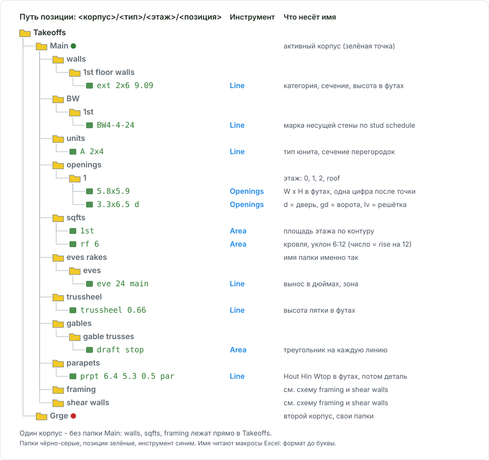
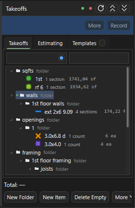
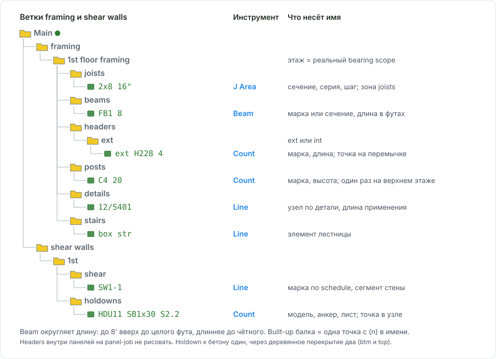
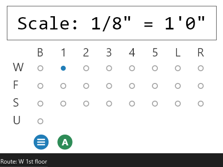

# Takeoff tree and sheet names

The canon: how the Takeoffs tree in OurPlanCore 3.0 is organized and how takeoffs
and sheets are named. Names are read by Excel macros and by the app's routing, so the
format matters down to the letter.

<figure markdown>
  
  <figcaption markdown="span">Four levels: building, work type, floor, takeoff. A single building has no building folder. Next to each branch: the tool and a sample name.</figcaption>
</figure>

## Tree shape

- Takeoff path: `<building>/<type>/<floor>/<takeoff>`.
- One building: the roots `walls`, `sqfts`, `framing`... sit directly in Takeoffs,
  do not create a `Main` folder. Several buildings: one folder per building (`Main`,
  `Grge`, `Storage`, `CFS`, `BldngA`); the active building is marked with a green dot,
  an inactive one with a red dot.
- COM template roots (`More > Auto Tree`): `units`, `sqfts`, `walls`, `gables`,
  `parapets`, `trussheel`, `openings`, `eves rakes`, `roof misc`, `framing`,
  `shear walls`, `trims`, `siding`; plus `BW` for bearing walls. There is no separate
  `sheathing` root: sheathing is calculated from walls, areas, gables, parapets.
- The `old` and `archive` folders are history only; do not measure from them.
- Move a takeoff only with the move operation: it keeps the measurements, color, icon and legend order.

<figure markdown>
  
  <figcaption markdown="span">Green dot = active building: new takeoffs go into its folders. To switch, click the dot next to another building.</figcaption>
</figure>

<figure markdown>
  
  <figcaption markdown="span">The second half of the tree: framing by floor (beams, headers, posts, joists, details, stairs) and shear walls with holdowns. Sample names on the right.</figcaption>
</figure>

## Branches and name formats

| Branch | Path | Tool | Takeoff name | Examples |
| --- | --- | --- | --- | --- |
| Walls | `walls/<floor> floor walls/` | Line | `<category> <size> <height in feet>` | `ext 2x6 9.09`, `corr 2x6 11.7`, `dem 2x6 9.09`, `2x4 9.09` (partition, no prefix), `furr 2x4 9.0` |
| Bearing walls | `BW/<floor>/` | Line | BW mark or type | `BW4-4-24`, `BW typical - per stud schedule` |
| Typical units | `units/[<floor>/]` | Line | `<unit type> <size>` | `A 2x4`, `B1A 2x4`, `G 2x6` |
| Openings | `openings/<0, 1, 2, ..., roof>/` | Openings | `<width>x<height>` in feet, one decimal place, suffix ` d` door, ` gd` garage door, ` lv` louver | `5.8x5.9`, `3.3x6.5 d`, `9.0x6.8 gd` |
| Shear walls | `shear walls/<floor>/shear/` | Line | mark and differences from the schedule | `SW1-1`, `WSW-C 7-16 OSB DTT2Z`, `ext W4B` |
| Holdowns | `shear walls/<floor>/holdowns/` | Count | `<mark> <model> <configuration>` | `HDU11 SB1x30 S2.2`, `HD1 (2) DTT2Z`, `MSTC40 type C S2.3` |
| Joists | `framing/<floor> framing/joists/` | J Area | `<size or series> <spacing> [purpose]` | `2x8 16"`, `flat roof 11 7/8 TJI 16"`, `porch 16 TJI 560 24"` |
| Beams | `framing/<floor> framing/beams/` | Beam | `<mark or size> <length>` | `FB1 8`, `B2 14`, `(3) 1 3/4 x 11 7/8 LVL 14`, `int 4x10 4` |
| Headers | `framing/<floor> framing/headers/<ext or int>/` | Count | `<ext or int> <mark or size> <length>` | `ext H228 4`, `int H228 4`, `ext (3) 2x10 8` |
| Posts | `framing/<supported floor> framing/posts/` | Count | `<mark> <size> <height>` | `C4 20`, `6x6 SYP#1 P.T. 8.2`, `C53 - 5 1/4 x 7 PSL + 2x6` |
| Details and hardware | `framing/<floor> framing/details/` | Line (detail), Count (product) | detail number or material | `12/S401`, `2x10 ledger + screws`, `ribbon`, `MPB88Z S2.1` |
| Stairs | `framing/<floor> framing/stairs/` | Line, J Area, Count | element | `box str`, `Stair 2x10 16"`, `Str FB5 10` |
| Areas | `sqfts/` | Area | floor or purpose | `1st`, `base`, `blcny`, `porch`, `flat grge`, `conc areas`, `open to below` |
| Roofing | `sqfts/` | Area | `<rf, rf mtl, overframe, flat> <pitch>` | `rf 6`, `rf mtl 4`, `overframe 4`, `flat`, `ply flat` |
| Eaves | `eves rakes/<eves or rakes>/` | Line | `<eve, rake, returns> <overhang in inches> <zone>` | `eve 24 main`, `rake 12 main`, `returns 12`, `eve 12 porch` |
| Truss heel | `trussheel/` | Line | `trussheel <height in feet>` | `trussheel 0.66`, `trussheel 1.25` |
| Gables | `gables/<gable stick or gable trusses>/` | Area (face), Line (`top`, `btm`) | purpose | `gable`, `draft stop`, `btm`, `top`, `existing gable` |
| Parapets | `parapets/[<zone>/]` | Line | `prpt <Hout> <Hin> <Wtop> [<detail>]` | `prpt 6.4 5.3 0.5 par`, `prpt 3.4 3 2 2/S405` |
| Balconies and porch | `Balcony blocks/`, `Porch blocks/` | Count | block type with size and count | `#4 Balcony 12.9x7.83 (2GZO x7)` |
| Siding and trims | `siding/`, `trims/` | Area, Line, Count | product | `6" vertical`, `2" casing`, `8" horizontal trim` |

The folder `eves rakes/eves` is spelled exactly like this, not `eaves`: routing works
by this name. Put the mark (`W1`), the sheet and the R.O. of openings in the takeoff's
Notes, not in the name.

## Numbers in the name

The name is the input for Excel. Each number is always in its own unit:

| Takeoff | Number | Unit |
| --- | --- | --- |
| Wall, truss heel | height | decimal feet (`9.09` = 9'-1 1/8") |
| Opening | product width x height | feet, one decimal place |
| Eve, rake | overhang | inches |
| Roof `rf 6` | pitch, rise per 12 | number |
| Parapet `prpt A B C` | outside height, inside height, top width; then the detail number | feet |
| Beam, header | order length; the Beam tool rounds it itself: up to 8' rounds up to a whole foot, longer rounds to an even number | feet |
| Joists `16"` | spacing | inches |

## Colors and icons

Each new takeoff gets its own Color; point takeoffs (Count) also get their own
CountSymbol. Identical colors in neighboring takeoffs make the legend and the PDF
unreadable. Split assigns a new color itself; gray is reserved for `bft`.

## Where a new takeoff goes

Under the Scale header each sheet has a grid of points: rows W (walls), F (framing),
S (shear walls) by floor, and a U row (units). A new takeoff from a W 2nd sheet goes into
`walls/2nd floor walls` (Line, Count) or into `sqfts` (Area); from an F 2nd sheet into
`framing/2nd floor framing/...` by tool; from an S sheet into `shear walls`;
from a U sheet into `units` with any tool. Names with `eve`, `rake`, `gable`, `prpt`,
`trussheel` and the Openings tool go to their own roots from any sheet except U.
`Record` continues the selected takeoff and ignores the point.

<figure markdown>
  
  <figcaption markdown="span">The point is set automatically from the sheet name. The status `Route: W 2nd` shows where a new takeoff will go.</figcaption>
</figure>

How points work, name rules and settings:
[Takeoff names and sheet dots](../reference/takeoff-naming.md#sheet-dots).

## Sheet names (Pages)

Format: lowercase, `<sheet number> <tag>`, the number without spaces or hyphens
(`S-101` = `s101`). The tag always goes last: `overall 1st`, `north base`, `stair d`.

| What is on the sheet | Tag | Examples |
| --- | --- | --- |
| Floor plan | `1st` ... `8th`, `base` (not bsmt), `rf` (not roof) | `a101 1st`, `s201 2nd`, `a105 rf`, `a1.7 1st 2nd` (two floors) |
| Foundation | `f` (foundation only; do not add it to floor plans) | `s101 f` |
| Unit plan | `u` (as the last tag; gives the U point) | `a3011 u`, `a301 common terrace u` |
| Unit finishes | `fin` | `a302 fin` |
| Details; a section together with details | `d` | `s501 d`, `stair d` |
| Sections | `sec`, `d sec`, `str sec`, `elev sec` | `a3.01 sec` |
| Elevations; bathroom and kitchen elevations | `el`, `in el` | `a201 el`, `a601 in el` |
| RCP | `rcp` | `a8.01 1st rcp` |
| Notes, cover sheet, code/egress/loading plan | `n` | `g001 n` |
| Schedules | `sch`, `dr sch`, `win sch` | `a901 win sch` |
| Wall and floor types (WALL SCHEDULE on A = `wt`, FLOOR/ROOF SCHEDULE = `ft`) | `wt`, `ft` | `a501 wt` |
| Demolition | `demo` | `ad101 demo` |
| Title sheet | `t` | `g000 t` |
| Revision duplicate (PR/ASI on top of the main set) | package suffix | `a1.20 rcp pr5` |
| Panel plans | panel supplier number + `wp` + floor | `w1 wp ground` |

A legend or "SHEET NOTES" in the plan's title block does not make it `n`. A sheet from a separate
PDF takes its number from the file name. Names within one folder are unique.

## Pages folders

```text
--------others/        unused sheets under their own names: title, civil, landscape, MEP, notes
00. imported/          wt, ft and unclassified sheets go right here
  Arch/                A plans, elevations, roof (Arch/unlarged - enlarged plans)
  Struct/              S plans and notes (Struct/Shear - copies for shear walls)
  sections/            A sections
  details arch/        A details and schedules
  details struct/      S details, schedules and sections
  rcp/
  units/               u, fin, in el
  demolition/
```

Several buildings: a building folder with the same name as in Takeoffs. Revision:
`01. old/` and `02. NEW SET <date>/` with the same layout inside.

## Sheet copies and scale

- A sheet copy is needed only for shear walls (S point one floor below), for a second
  level on the same sheet, for another building and for a new sheet set. Do not make copy
  folders for each takeoff type.
- Check the scale against a dimension string and grid lines, not the sheet label:
  S sheets are sometimes labeled 1/8" when they are actually 3/16". A sheet with several
  scales is calibrated for the zone you need.

??? note "Detail codes for Excel (M flags)"
    A detail name in `framing/.../details` gives a flag in column M of the export, and the
    `C_RimBoardBlockingHangers` macro expands the flag into rows. How to write them:
    a doubled letter = x2 (`rr`, `bb`, `hh16`), a number = o.c. spacing (`b48`, `h16`,
    `blt24`), a space and a digit = group number (`b 1`, `r 1`).

    | Code | What | Default |
    | --- | --- | --- |
    | `r` / `rr` | Rim board | |
    | `rb` | Ribbon board | |
    | `l` / `ll` | Ledger | |
    | `b` / `bb`, `b48` | Blocking, blocking at spacing | 48" o.c. |
    | `bd` | Blocking for Drywall | |
    | `bft` | Bracing for Trusses | |
    | `h16` / `hh16` | Hangers | 16" o.c. |
    | `s` / `ss` / `s16` | Screws | 16" o.c. |
    | `t` / `tt` / `t16` | Ties | 16" o.c. |
    | `blt` / `blt24` | Anchor Bolts + Washers + Nuts (three rows) | spacing and size per detail |

    Material override at the end of the selection: `r` = `1 3/4 x 11 7/8 LVL`,
    `r 1` = `1 3/4 x 18 LVL`, `b` = `11 7/8 TJI 230`, `b48` = `2x10`,
    `h16` = `ITS2.56/9.5`, `l` = `2x12 P.T.`, `l 1` = `2x10`.
    More: [Rim Board](../work/horizontal/floor-framing/details/rim.md),
    [Blocking](../work/horizontal/floor-framing/details/blocking.md),
    [Anchor Bolts](../work/deck/anchor-bolts.md), [Hangers](../reference/hangers.md).

## See also

- [Takeoff names and sheet dots](../reference/takeoff-naming.md)
- [Workflow](workflow.md)
- [Common mistakes: sheets and tree](common-mistakes.md#pages)
