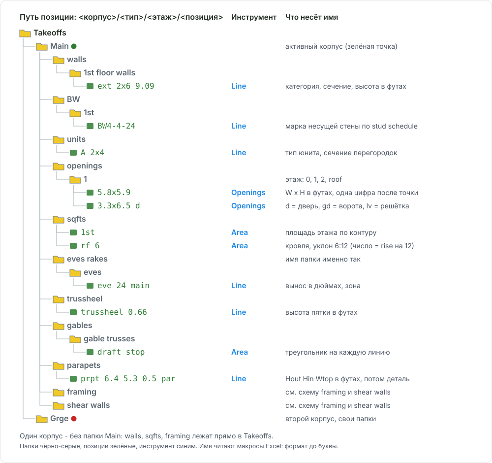
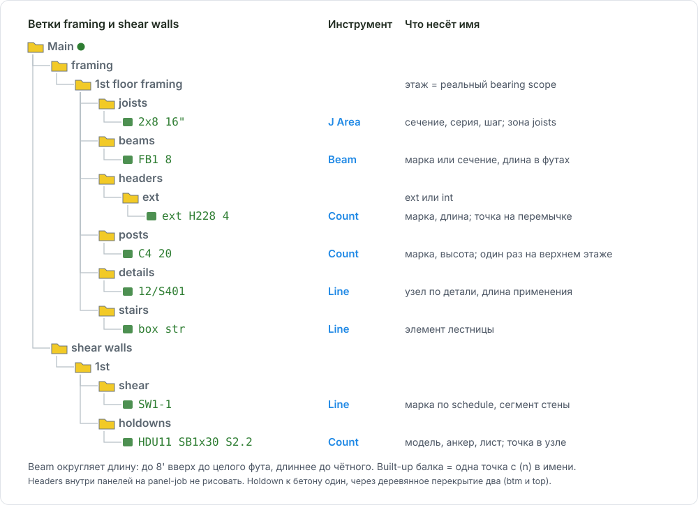

# Дерево takeoff и имена листов

Канон: как устроено дерево Takeoffs в OurPlanCore 3.0, как называются позиции
и листы. Имена читают макросы Excel и маршрутизация программы, поэтому формат
важен до буквы.

<figure markdown>
  
  <figcaption markdown="span">Четыре уровня: корпус, тип работы, этаж, позиция. Один корпус - без папки корпуса. Рядом с каждой веткой инструмент и пример имени.</figcaption>
</figure>

## Форма дерева

- Путь позиции: `<корпус>/<тип>/<этаж>/<позиция>`.
- Один корпус: корни `walls`, `sqfts`, `framing`... лежат прямо в Takeoffs,
  папку `Main` не создавать. Несколько корпусов: папка на каждый (`Main`,
  `Grge`, `Storage`, `CFS`, `BldngA`), активный корпус отмечен зелёной точкой,
  неактивный красной.
- Корни COM-шаблона (`More > Auto Tree`): `units`, `sqfts`, `walls`, `gables`,
  `parapets`, `trussheel`, `openings`, `eves rakes`, `roof misc`, `framing`,
  `shear walls`, `trims`, `siding`; плюс `BW` для несущих стен. Отдельного корня
  `sheathing` нет: обшивка считается от стен, площадей, gables, parapets.
- Папки `old` и `archive` - только история, из них не мерят.
- Перенос позиции - только операцией move: сохраняются замеры, цвет, значок и порядок легенды.

<figure markdown>
  
  <figcaption markdown="span">Зелёная точка - активный корпус: новые замеры ложатся в его папки. Переключить - щёлкнуть точку у другого корпуса.</figcaption>
</figure>

<figure markdown>
  
  <figcaption markdown="span">Вторая половина дерева: framing по этажам (beams, headers, posts, joists, details, stairs) и shear walls с holdowns. Примеры имён справа.</figcaption>
</figure>

## Ветки и форматы имён

| Ветка | Путь | Инструмент | Имя позиции | Примеры |
| --- | --- | --- | --- | --- |
| Стены | `walls/<этаж> floor walls/` | Line | `<категория> <сечение> <высота в футах>` | `ext 2x6 9.09`, `corr 2x6 11.7`, `dem 2x6 9.09`, `2x4 9.09` (перегородка без префикса), `furr 2x4 9.0` |
| Несущие стены | `BW/<этаж>/` | Line | марка BW или тип | `BW4-4-24`, `BW typical - per stud schedule` |
| Типовые юниты | `units/[<этаж>/]` | Line | `<тип юнита> <сечение>` | `A 2x4`, `B1A 2x4`, `G 2x6` |
| Проёмы | `openings/<0, 1, 2, ..., roof>/` | Openings | `<ширина>x<высота>` в футах, одна цифра после точки, суффикс ` d` дверь, ` gd` ворота, ` lv` решётка | `5.8x5.9`, `3.3x6.5 d`, `9.0x6.8 gd` |
| Shear walls | `shear walls/<этаж>/shear/` | Line | марка и отличия из schedule | `SW1-1`, `WSW-C 7-16 OSB DTT2Z`, `ext W4B` |
| Holdowns | `shear walls/<этаж>/holdowns/` | Count | `<марка> <модель> <конфигурация>` | `HDU11 SB1x30 S2.2`, `HD1 (2) DTT2Z`, `MSTC40 type C S2.3` |
| Joists | `framing/<этаж> framing/joists/` | J Area | `<сечение или серия> <шаг> [назначение]` | `2x8 16"`, `flat roof 11 7/8 TJI 16"`, `porch 16 TJI 560 24"` |
| Балки | `framing/<этаж> framing/beams/` | Beam | `<марка или сечение> <длина>` | `FB1 8`, `B2 14`, `(3) 1 3/4 x 11 7/8 LVL 14`, `int 4x10 4` |
| Headers | `framing/<этаж> framing/headers/<ext или int>/` | Count | `<ext или int> <марка или сечение> <длина>` | `ext H228 4`, `int H228 4`, `ext (3) 2x10 8` |
| Posts | `framing/<поддерживаемый этаж> framing/posts/` | Count | `<марка> <сечение> <высота>` | `C4 20`, `6x6 SYP#1 P.T. 8.2`, `C53 - 5 1/4 x 7 PSL + 2x6` |
| Детали и крепёж | `framing/<этаж> framing/details/` | Line (узел), Count (изделие) | номер детали или материал | `12/S401`, `2x10 ledger + screws`, `ribbon`, `MPB88Z S2.1` |
| Лестницы | `framing/<этаж> framing/stairs/` | Line, J Area, Count | элемент | `box str`, `Stair 2x10 16"`, `Str FB5 10` |
| Площади | `sqfts/` | Area | этаж или назначение | `1st`, `base`, `blcny`, `porch`, `flat grge`, `conc areas`, `open to below` |
| Кровля | `sqfts/` | Area | `<rf, rf mtl, overframe, flat> <уклон>` | `rf 6`, `rf mtl 4`, `overframe 4`, `flat`, `ply flat` |
| Карнизы | `eves rakes/<eves или rakes>/` | Line | `<eve, rake, returns> <вынос в дюймах> <зона>` | `eve 24 main`, `rake 12 main`, `returns 12`, `eve 12 porch` |
| Truss heel | `trussheel/` | Line | `trussheel <высота в футах>` | `trussheel 0.66`, `trussheel 1.25` |
| Фронтоны | `gables/<gable stick или gable trusses>/` | Area (грань), Line (`top`, `btm`) | назначение | `gable`, `draft stop`, `btm`, `top`, `existing gable` |
| Парапеты | `parapets/[<зона>/]` | Line | `prpt <Hout> <Hin> <Wtop> [<деталь>]` | `prpt 6.4 5.3 0.5 par`, `prpt 3.4 3 2 2/S405` |
| Балконы и porch | `Balcony blocks/`, `Porch blocks/` | Count | тип блока с размером и числом | `#4 Balcony 12.9x7.83 (2GZO x7)` |
| Siding и trims | `siding/`, `trims/` | Area, Line, Count | продукт | `6" vertical`, `2" casing`, `8" horizontal trim` |

Папка `eves rakes/eves` пишется именно так, не `eaves`: по этому имени
работает маршрутизация. Марку (`W1`), лист и R.O. у проёмов пиши в Notes
позиции, не в имя.

## Числа в имени

Имя - вход для Excel. Число всегда в своей единице:

| Позиция | Число | Единица |
| --- | --- | --- |
| Стена, truss heel | высота | футы десятичные (`9.09` = 9'-1 1/8") |
| Проём | ширина x высота изделия | футы, одна цифра после точки |
| Eve, rake | вынос | дюймы |
| Кровля `rf 6` | уклон, подъём на 12 | число |
| Парапет `prpt A B C` | наружная высота, внутренняя высота, ширина верха; потом номер детали | футы |
| Балка, header | заказная длина; инструмент Beam сам округляет: до 8' вверх до целого фута, длиннее до чётного | футы |
| Joists `16"` | шаг | дюймы |

## Цвета и значки

У каждой новой позиции свой Color; у точечных позиций (Count) ещё и свой
CountSymbol. Одинаковые цвета в соседних позициях делают легенду и PDF
нечитаемыми. Split даёт новый цвет сам; серый зарезервирован под `bft`.

## Куда ложится новая позиция

Под заголовком Scale у листа стоит сетка точек: строки W (walls), F (framing),
S (shear walls) по этажам и строка U (units). Новый замер с листа W 2nd ложится в
`walls/2nd floor walls` (Line, Count) или в `sqfts` (Area); с листа F 2nd - в
`framing/2nd floor framing/...` по инструменту; с листа S - в `shear walls`;
с листа U - в `units` любым инструментом. Имена с `eve`, `rake`, `gable`, `prpt`,
`trussheel` и инструмент Openings уходят в свои корни с любого листа, кроме U.
`Record` продолжает выбранную позицию и точку не слушает.

<figure markdown>
  
  <figcaption markdown="span">Точка ставится сама по имени листа. Статус `Route: W 2nd` показывает, куда пойдёт новый замер.</figcaption>
</figure>

Механика точек, правила по имени и настройки -
[Имена takeoffs и точки листа](../reference/takeoff-naming.md#sheet-dots).

## Имена листов (Pages)

Формат: строчные, `<номер листа> <тег>`, номер без пробелов и дефисов
(`S-101` = `s101`). Тег всегда последний: `overall 1st`, `north base`, `stair d`.

| Что на листе | Тег | Примеры |
| --- | --- | --- |
| План этажа | `1st` ... `8th`, `base` (не bsmt), `rf` (не roof) | `a101 1st`, `s201 2nd`, `a105 rf`, `a1.7 1st 2nd` (два этажа) |
| Фундамент | `f` (только фундамент; к планам этажей не дописывать) | `s101 f` |
| План юнита | `u` (последним тегом; даёт точку U) | `a3011 u`, `a301 common terrace u` |
| Отделка юнита | `fin` | `a302 fin` |
| Детали; разрез вместе с деталями | `d` | `s501 d`, `stair d` |
| Разрезы | `sec`, `d sec`, `str sec`, `elev sec` | `a3.01 sec` |
| Фасады; фасады ванн и кухонь | `el`, `in el` | `a201 el`, `a601 in el` |
| RCP | `rcp` | `a8.01 1st rcp` |
| Примечания, обложка, code/egress/loading plan | `n` | `g001 n` |
| Спецификации | `sch`, `dr sch`, `win sch` | `a901 win sch` |
| Типы стен и перекрытий (WALL SCHEDULE на A = `wt`, FLOOR/ROOF SCHEDULE = `ft`) | `wt`, `ft` | `a501 wt` |
| Демонтаж | `demo` | `ad101 demo` |
| Титул | `t` | `g000 t` |
| Ревизионный дубль (PR/ASI поверх основного сета) | суффикс пакета | `a1.20 rcp pr5` |
| Панельные планы | номер панельщика + `wp` + этаж | `w1 wp ground` |

Легенда или "SHEET NOTES" в штампе плана не делают его `n`. Лист из отдельного
PDF берёт номер из имени файла. Имена в одной папке уникальны.

## Папки Pages

```text
--------others/        ненужное под своим именем: титул, civil, landscape, MEP, заметки
00. imported/          wt, ft и листы без класса прямо здесь
  Arch/                планы, фасады, крыша A (Arch/unlarged - увеличенные фрагменты)
  Struct/              планы и заметки S (Struct/Shear - копии под shear walls)
  sections/            разрезы A
  details arch/        детали и спецификации A
  details struct/      детали, спецификации и разрезы S
  rcp/
  units/               u, fin, in el
  demolition/
```

Несколько корпусов: папка корпуса с тем же именем, что в Takeoffs. Ревизия:
`01. old/` и `02. NEW SET <дата>/` с той же раскладкой внутри.

## Копии листов и масштаб

- Копия листа нужна только под shear walls (точка S на этаж ниже), под второй
  уровень на том же листе, под другой корпус и под новый комплект. Папки-копии
  под каждый тип замера не делаются.
- Масштаб проверять по размерной цепочке и осям, не по подписи листа:
  S-листы бывают подписаны 1/8" при фактических 3/16". Лист с несколькими
  масштабами калибруется по нужной зоне.

??? note "Коды деталей для Excel (флаги M)"
    Имя детали в `framing/.../details` даёт флаг в колонке M экспорта, а макрос
    `C_RimBoardBlockingHangers` разворачивает флаг в строки. Правила записи:
    удвоенная буква = x2 (`rr`, `bb`, `hh16`), число = шаг o.c. (`b48`, `h16`,
    `blt24`), пробел и цифра = номер группы (`b 1`, `r 1`).

    | Код | Что | По умолчанию |
    | --- | --- | --- |
    | `r` / `rr` | Rim board | |
    | `rb` | Ribbon board | |
    | `l` / `ll` | Ledger | |
    | `b` / `bb`, `b48` | Blocking, blocking по шагу | 48" o.c. |
    | `bd` | Blocking for Drywall | |
    | `bft` | Bracing for Trusses | |
    | `h16` / `hh16` | Hangers | 16" o.c. |
    | `s` / `ss` / `s16` | Screws | 16" o.c. |
    | `t` / `tt` / `t16` | Ties | 16" o.c. |
    | `blt` / `blt24` | Anchor Bolts + Washers + Nuts (три строки) | шаг и размер по детали |

    Переопределение материала в конце выделения: `r` = `1 3/4 x 11 7/8 LVL`,
    `r 1` = `1 3/4 x 18 LVL`, `b` = `11 7/8 TJI 230`, `b48` = `2x10`,
    `h16` = `ITS2.56/9.5`, `l` = `2x12 P.T.`, `l 1` = `2x10`.
    Подробнее: [Rim Board](../work/horizontal/floor-framing/details/rim.md),
    [Blocking](../work/horizontal/floor-framing/details/blocking.md),
    [Anchor Bolts](../work/deck/anchor-bolts.md), [Hangers](../reference/hangers.md).

## См. также

- [Имена takeoffs и точки листа](../reference/takeoff-naming.md)
- [Процесс работы](workflow.md)
- [Частые ошибки: листы и дерево](common-mistakes.md#pages)
