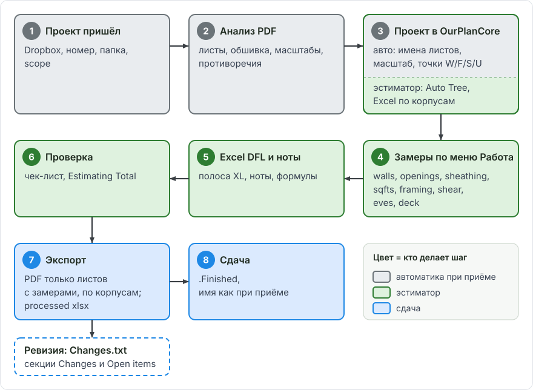
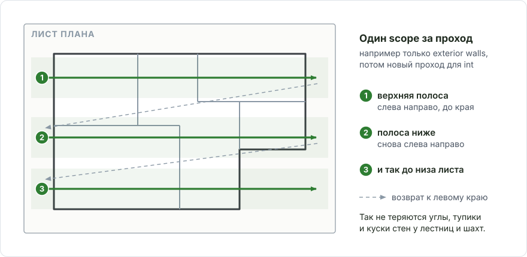
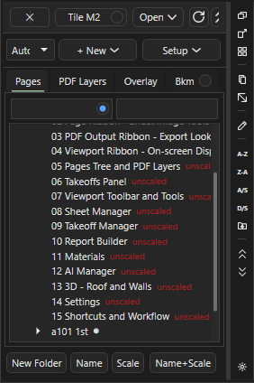
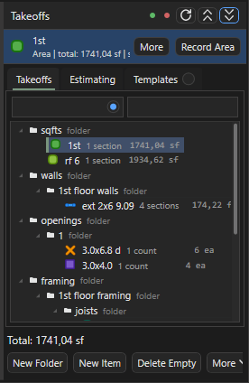
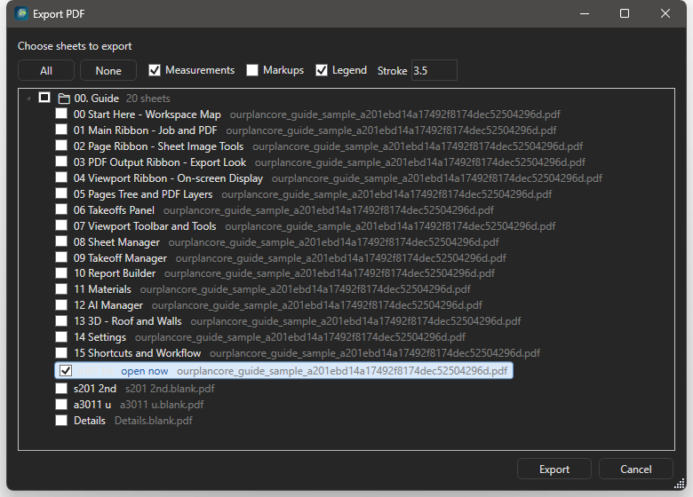

# Workflow

The path of a project from the client folder to delivery. This is the general route;
how to measure each element is on the topic pages of the "Work" section, how to fill
Excel is in the "Excel and DFL" tab: [DFL row labels](../reference/takeoff-items.md).

<figure markdown>
  
  <figcaption markdown="span">Eight steps. Gray steps are done by automation at intake, green ones by the estimator, blue is delivery. A revision adds Changes.txt.</figcaption>
</figure>

!!! tip "Golden rule of takeoff"
    Do not jump around the drawing. Take one scope (for example, exterior walls) and scan
    the whole sheet left to right, top to bottom, before moving on to the next one.
    That way you do not lose corners, dead-end areas and small wall pieces at stairs and shafts.

<figure markdown>
  
  <figcaption markdown="span">One pass = one strip across the full width of the sheet, then the next one below. One scope per pass.</figcaption>
</figure>

## 1. The project arrives

1. The project sits in the client folder (Dropbox) under the client's name: `<queue number>. <Project>_<Client>_<tags>`.
   You will need this name at delivery: the folder in `.Finished` has the same name.
2. The project gets an internal running number and a folder `<N>. <name>` with the drawings,
   Excel and the OurPlanCore job. The number is not made up: it is the next one in the
   job log.
3. Scope is read from the tags on the client folder: `Frame`, `Frame. Wall panels`,
   `Frame. EWP by others`, `Revision`, `NO metal`, `EXT`. What each tag changes:
   [Client rules](client-rules.md).
4. Revision: the folder has `Revision`, `rev`, `review` or an email with the changes.
   The Excel base is a copy of the previous delivery; the new and old sheet sets are kept separately.

## 2. PDF analysis

1. Cover sheet and sheet index: how many buildings, which sheet series (A, S, G), which
   sheets are takeoff sheets (floor plans, roof plan, framing plans).
2. Wall sheathing and insulation come from the wall types sheet; roofing from the structural
   roof framing and the section; subfloor from the section. A conflict between arch and S is resolved
   right away: the sheathing and barrier product comes from the wall types on Arch, while thickness,
   framing and which walls are sheathed come from Structural; the discrepancy is recorded with a
   note `... per <sheet>; verify` naming both sheets.
3. Scales: plans are usually 1/8", unit plans 1/4", sections 3/8", details NTS.
   The scale label on the sheet is not proof; check the scale against a dimension on the sheet.
4. Raster set (scan): auto-names and auto-scale will not work, sheets are
   named by hand from the title block.

## 3. The job in OurPlanCore

<figure markdown>
  
  <figcaption markdown="span">Sheets are sorted into folders `00. imported/Arch`, `Struct`, `sections`, `details ...`; unused ones go to `--------others`. Sheet name `a101 1st`.</figcaption>
</figure>

1. **Sheets.** Name is `<sheet number> <tag>` in lowercase: `a101 1st`, `s201 2nd`, `s101 f`,
   `a105 rf`, `a3.01 sec`. The tag goes at the end, `f` only for the foundation. Full table
   of tags and folders: [Takeoff tree and sheet names](takeoff-structure.md).
2. **Scale.** Set Scale from a known dimension, check with Ruler against a second dimension.
   A sheet with several scales is calibrated by zone.
3. **W/F/S/U points.** Under the Scale header each sheet has a point: W (walls) on
   architectural plans, F (framing) on structural, S (shear) on copies for shear,
   U on unit plans. The point decides which building folder a new takeoff goes into.
   It is set automatically from the sheet name; for an older job use
   `Settings > Sheet Takeoff Routing > Route sheets without a dot now`.
   How it works: [Takeoff names and sheet dots](../reference/takeoff-naming.md#sheet-dots).
4. **Takeoffs tree.** `More > Auto Tree` creates the COM template roots (`walls`,
   `sqfts`, `framing`, `openings`, `shear walls`, `units`...). Several buildings:
   one folder per building (`Main`, `Grge`); the active building is marked with a green dot.
5. **Excel per building.** Each building gets its own workbook from TemplateCom. Right away
   fill in the main header notes (template ones first, then project ones) and
   the spec cells for wall, floor and roof sheathing with a reference to the sheet. How to format them:
   [Standard notes](../reference/standard-notes.md).

## 4. Takeoffs in the order of the "Work" menu

<figure markdown>
  
  <figcaption markdown="span">COM template roots. Each takeoff goes into `<building>/<type>/<floor>/<takeoff>`; the name carries the numbers for Excel.</figcaption>
</figure>

Go down the "Work" menu top to bottom, one scope per pass over the sheet:

| Step | What | Tool | Where it goes |
| --- | --- | --- | --- |
| 1 | Walls: ext, corridor, demising, unit, basement, BW | Line | `walls/<floor> floor walls`, `BW/<floor>`, `units` |
| 2 | Openings | Openings | `openings/<floor>` |
| 3 | Sheathing, gables, truss heel, parapets, box | Area, Line | `gables`, `trussheel`, `parapets` (walls are calculated from walls x height) |
| 4 | Floor and roof areas | Area | `sqfts` (`1st`, `blcny`, `rf 6`) |
| 5 | Floor framing: posts, beams, headers, joists, details, stairs | Count, Beam, J Area, Line | `framing/<floor> framing/...` |
| 6 | Shear walls and holdowns | Line, Count | `shear walls/<floor>/shear`, `.../holdowns` |
| 7 | Eaves, roofing, eve/rake | Line | `eves rakes/eves`, `eves rakes/rakes` |
| 8 | Deck, porch, balconies | Count by block type | `Balcony blocks`, `Porch blocks` |
| 9 | Siding, trims (if in scope) | Area, Line, Count | `siding`, `trims` |

Rules: each new takeoff gets its own color and its own point icon; `Record`
continues an existing takeoff, pressing the tool again creates a new one;
joists only with J Area, beams only with Beam, openings only with Openings. Name formats:
[Takeoff tree](takeoff-structure.md).

## 5. Excel DFL and notes

<figure markdown>
  
  <figcaption markdown="span">The XL strip buttons send tree branches into the open TemplateCom workbook section by section; `ALL` does everything in order. In Lite the strip appears after checking `Excel Strip (XL)` in `Settings > Modules`.</figcaption>
</figure>

1. The building workbook is open, the DFL worksheet is active. In OurPlanCore Lite numbers go
   over with the `Excel`, `Value`, `Link to Excel` and `Auto Link` buttons, and the calculation
   from the `J:L` list is run with the E-Wood tab buttons in Excel. The XL strip
   sends takeoffs section by section (walls, sheathing, areas, openings, framing...) and
   runs the macros itself; it is on from the start in the full version, and in Lite the
   `Excel Strip (XL)` checkbox in `Settings > Modules` turns it on. Details: [Export to Excel](../reference/ourplancore-excel.md),
   [Lite vs full version](../reference/ourplancore-lite.md).
2. Wall height lives in column E of the stud row (to 1/8"), units in D: `LFT` for linear items,
   `pcs` for hardware, `4x8` for panels, `SQ FT` for areas; lumber ordered by the piece has the
   board length in feet in D. Row names: [DFL row names](../reference/takeoff-items.md).
3. Formulas only from the block's own inputs; check a new formula on the first
   row right away. Do not multiply by 1.1 a second time: [Formulas](../reference/formulas.md).
4. Notes: prefix `Important:`, `Note:` or `Comment:`, yellow fill, always under
   the header of their block. A natural phrase, up to 80 characters, `per <sheet>`, no `=`.
   Samples: [Standard notes](../reference/standard-notes.md). Headers, color-coded options,
   groups and revision marks: [File format](../reference/dfl-overview.md#source-format).
5. Balconies, porches, holdowns go in blocks, following delivered jobs:
   [Deck / Porch / Balcony](../work/deck/deck-porch-balcony-frame.md),
   [Shear Wall](../work/vertical/sheathing/shear-wall.md).

## 6. Check

A full check before delivery, especially for items that come in large numbers: nothing is
doubled, every measured area made it to Excel, notes do not contradict the
rows. Checklist by section: [Pre-delivery check](quality-checklist.md),
list of known mistakes: [Common mistakes](common-mistakes.md).
In OurPlanCore: Estimating, `Total`, sheet legend (`Organize > Sort Sheet Legend by Key`).

## 7. Export

<figure markdown>
  
  <figcaption markdown="span">PDF Output: Preview, then Export. Only sheets with visible takeoffs go into the file.</figcaption>
</figure>

1. **PDF.** Save the job (Ctrl+S). Hide what is not needed (H), collect details
   with Crop to Sheet. `PDF Output > Preview`, then Export. The PDF has only
   sheets with takeoffs; each building gets its own PDF (hide the branches of other buildings).
   Revision "new only": by the branches of the new sheet set.
2. **Processed xlsx.** The working `.xlsm` is turned into an `.xlsx` with formulas
   converted to values and no links between workbooks. Excel must be closed for this.
   Check that notes and rows are in place and that the xlsx is not older than the working xlsm.
3. **Changes.txt** - only for a revision, review or rework. In English,
   one line = one change, past tense, source `per <sheet>` or
   `per <detail>/<sheet>`. Anything unresolved goes only under `Open items` (the section is required,
   even with one line). No Russian text, no cells, no internal details. Small things
   are grouped into one line. The file name is exactly `Changes.txt`.

??? example "Changes.txt sample"
    ```text
    <Excel name without extension>

    Changes
    - Stair and trash shaft walls above the podium were changed from CMU to wood framing. The corresponding framing quantities were added.
    - Ceiling blocking was added per A7.01.
    Open items

    - Revised structural drawings were not provided.
    ```

## 8. Delivery

1. The client folder `.Finished\<name as at intake>` gets: PDFs per building,
   the processed xlsx, and `Changes.txt` for a revision. Source drawing PDFs and internal
   files are not delivered.
2. The folder must be named exactly like the Dropbox folder at intake.
3. The job status is marked in the tracker; if the deadline slipped, say so in advance,
   not on the delivery day.

## See also

- [How to use the KB](how-to-use.md)
- [Takeoff tree and sheet names](takeoff-structure.md)
- [Pre-delivery check](quality-checklist.md)
- [OurPlanCore 3.0: getting started](../reference/ourplancore-start.md)
