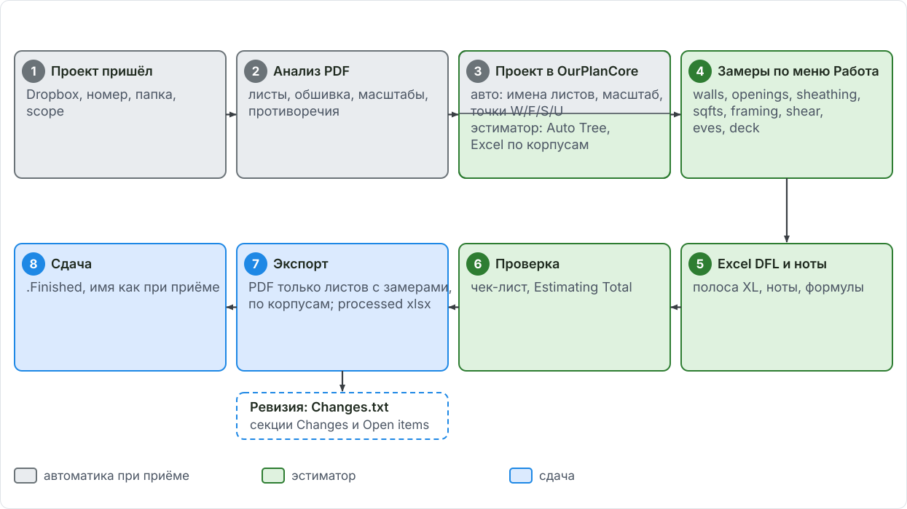
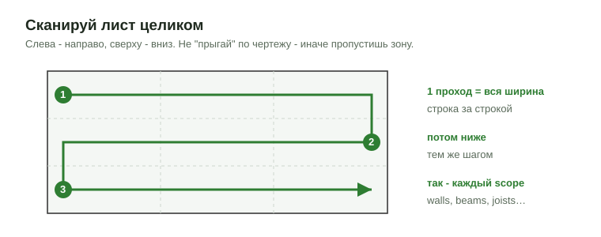
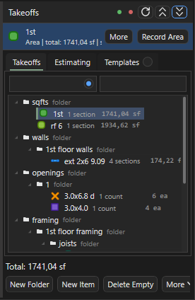
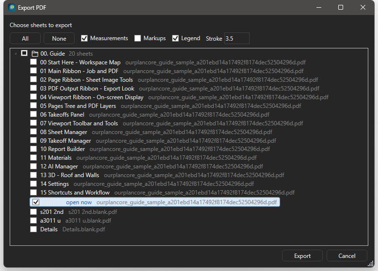

# Процесс работы

Путь проекта от папки клиента до сдачи. Это общий маршрут; как мерить каждый
элемент, написано на предметных страницах раздела "Работа", как заполнять
Excel - в [Справочнике](../reference/takeoff-items.md).

<figure markdown>
  
  <figcaption markdown="span">Восемь шагов. Серые шаги делает автоматика при приёме, зелёные - эстиматор, синий - сдача. Ревизия добавляет Changes.txt.</figcaption>
</figure>

!!! tip "Золотое правило замера"
    Не прыгай по чертежу. Бери один scope (например, exterior walls) и сканируй
    весь лист слева направо, сверху вниз, прежде чем перейти к следующему.
    Так не теряются углы, тупиковые зоны и мелкие куски стен у лестниц и шахт.

<figure markdown>
  
  <figcaption markdown="span">Один проход = одна полоса по всей ширине листа, потом ниже. Один scope за проход.</figcaption>
</figure>

## 1. Проект пришёл

1. Проект лежит в папке клиента (Dropbox) под именем клиента: `<номер очереди>. <Проект>_<Клиент>_<теги>`.
   Это имя понадобится при сдаче: папка в `.Finished` называется так же.
2. Проект получает внутренний сквозной номер и папку `<N>. <имя>` с чертежами,
   Excel и проектом OurPlanCore. Номер не выдумывается: он следующий по
   журналу работ.
3. Scope читается из пометок в папке клиента: `Frame`, `Frame. Wall panels`,
   `Frame. EWP by others`, `Revision`, `NO metal`, `EXT`. Что меняет каждая
   пометка - [Правила клиентов](client-rules.md).
4. Ревизия: в папке есть `Revision`, `rev`, `review` или письмо с изменениями.
   База для Excel - копия прошлой сдачи, новый и старый комплект листов лежат раздельно.

## 2. Анализ PDF

1. Обложка и sheet index: сколько корпусов, какие серии листов (A, S, G), какие
   листы мерные (планы этажей, roof plan, framing plans).
2. Обшивка и утеплитель стен - с листа wall types; кровля - со structural
   roof framing и разреза; subfloor - с разреза. Противоречие арх и S решается
   сразу: structural главнее, расхождение записывается нотой `... per <лист>; verify`.
3. Масштабы: планы обычно 1/8", unit-планы 1/4", разрезы 3/8", детали NTS.
   Подпись листа не доказательство, масштаб проверяется по размеру на листе.
4. Растровый комплект (скан): автоимена и автомасштаб не сработают, листы
   называются руками по тайтл-блоку.

## 3. Проект в OurPlanCore

<figure markdown>
  
  <figcaption markdown="span">Листы разложены по папкам `00. imported/Arch`, `Struct`, `sections`, `details ...`; ненужное в `--------others`. Имя листа `a101 1st`.</figcaption>
</figure>

1. **Листы.** Имя `<номер листа> <тег>` строчными: `a101 1st`, `s201 2nd`, `s101 f`,
   `a105 rf`, `a3.01 sec`. Тег в конце, `f` только у фундамента. Полная таблица
   тегов и папок - [Дерево takeoff и имена листов](takeoff-structure.md).
2. **Масштаб.** Scale по известному размеру, проверка Ruler по второму размеру.
   Лист с несколькими масштабами калибруется по зоне.
3. **Точки W/F/S/U.** Под заголовком Scale у листа стоит точка: W (walls) у
   архитектурных планов, F (framing) у structural, S (shear) у копий под shear,
   U у планов юнитов. Точка решает, в какую папку корпуса ляжет новый замер.
   Ставится сама по имени листа; для старого проекта
   `Settings > Sheet Takeoff Routing > Route sheets without a dot now`.
   Механика - [Имена takeoffs и точки листа](../reference/takeoff-naming.md#sheet-dots).
4. **Дерево Takeoffs.** `More > Auto Tree` создаёт корни COM-шаблона (`walls`,
   `sqfts`, `framing`, `openings`, `shear walls`, `units`...). Несколько корпусов:
   папка на каждый (`Main`, `Grge`), активный корпус отмечен зелёной точкой.
5. **Excel по корпусам.** На каждый корпус своя книга из TemplateCom. Сразу
   заполняются главные ноты шапки (сначала шаблонные, потом проектные) и
   спек-ячейки обшивки стен, пола и кровли со ссылкой на лист. Как оформлять -
   [Стандартные notes](../reference/standard-notes.md).

## 4. Замеры по порядку меню "Работа"

<figure markdown>
  
  <figcaption markdown="span">Корни COM-шаблона. Каждая позиция ложится в `<корпус>/<тип>/<этаж>/<позиция>`; имя несёт числа для Excel.</figcaption>
</figure>

Идёшь по меню "Работа" сверху вниз, один scope на проход листа:

| Шаг | Что | Инструмент | Куда ложится |
| --- | --- | --- | --- |
| 1 | Стены: ext, corridor, demising, unit, basement, BW | Line | `walls/<этаж> floor walls`, `BW/<этаж>`, `units` |
| 2 | Проёмы | Openings | `openings/<этаж>` |
| 3 | Обшивка, gables, truss heel, parapets, box | Area, Line | `gables`, `trussheel`, `parapets` (стены считаются от walls x height) |
| 4 | Площади этажей и кровли | Area | `sqfts` (`1st`, `blcny`, `rf 6`) |
| 5 | Перекрытия: posts, beams, headers, joists, details, stairs | Count, Beam, J Area, Line | `framing/<этаж> framing/...` |
| 6 | Shear walls и holdowns | Line, Count | `shear walls/<этаж>/shear`, `.../holdowns` |
| 7 | Карнизы, кровля, eve/rake | Line | `eves rakes/eves`, `eves rakes/rakes` |
| 8 | Deck, porch, балконы | Count по типу блока | `Balcony blocks`, `Porch blocks` |
| 9 | Siding, trims (если в scope) | Area, Line, Count | `siding`, `trims` |

Правила: у каждой новой позиции свой цвет и свой значок точек; `Record`
продолжает существующую позицию, повторное нажатие инструмента создаёт новую;
joists только J Area, балки только Beam, проёмы только Openings. Форматы имён -
[Дерево takeoff](takeoff-structure.md).

## 5. Excel DFL и ноты

<figure markdown>
  
  <figcaption markdown="span">Кнопки полосы XL переносят ветки дерева в открытую книгу TemplateCom по секциям; `ALL` делает всё по порядку.</figcaption>
</figure>

1. Книга корпуса открыта, лист DFL активен. Полоса XL в OurPlanCore переносит
   замеры по секциям (стены, обшивка, площади, проёмы, framing...). Подробно -
   [Интерфейс и инструменты](../reference/ourplanecore.md).
2. Высота стены живёт в E строки студов (до 1/8"), единицы в D: `LFT` для досок,
   `pcs` для крепежа, SF для листов. Имена строк - [Имена строк DFL](../reference/takeoff-items.md).
3. Формулы только от собственных входов блока; новую формулу проверяй на первой
   строке сразу. Не множить на 1.1 второй раз - [Формулы](../reference/formulas.md).
4. Ноты: главные в шапке (жёлтый фон, красный жирный), локальные сразу под
   заголовком своего блока. Живая фраза, до 80 знаков, `per <лист>`, без `=`.
   Образцы - [Стандартные notes](../reference/standard-notes.md).
5. Балконы, porch, holdowns - блоками по образцу сданных работ:
   [Deck / Porch / Balcony](../work/deck/deck-porch-balcony-frame.md),
   [Shear Wall](../work/vertical/sheathing/shear-wall.md).

## 6. Проверка

Полная проверка перед сдачей, особенно позиций, которых много: ничего не
задвоено, каждая измеренная площадь дошла до Excel, ноты не противоречат
строкам. Чек-лист по разделам - [Проверка перед сдачей](quality-checklist.md),
список известных ошибок - [Частые ошибки](common-mistakes.md).
В OurPlanCore: Estimating, `Total`, легенда листа (`Organize > Sort Sheet Legend by Key`).

## 7. Экспорт

<figure markdown>
  
  <figcaption markdown="span">PDF Output: Preview, потом Export. В файл идут только листы, на которых есть видимые замеры.</figcaption>
</figure>

1. **PDF.** Сохранить проект (Ctrl+S). Лишнее спрятать (H), узлы собрать
   через Crop to Sheet. `PDF Output > Preview`, затем Export. В PDF только
   листы с замерами; на каждый корпус свой PDF (скрыть ветки других корпусов).
   Ревизия "только новое": по веткам нового комплекта.
2. **Processed xlsx.** Из рабочей `.xlsm` делается `.xlsx` с формулами,
   переведёнными в значения, и без ссылок между книгами. Excel при этом закрыт.
   Проверить, что ноты и строки на месте и что xlsx не старше рабочей xlsm.
3. **Changes.txt** - только для ревизии, review или переделки. По-английски,
   одна строка - одно изменение, прошедшее время, источник `per <лист>` или
   `per <деталь>/<лист>`. Незакрытое только в `Open items` (секция обязательна,
   даже с одной строкой). Без русского текста, ячеек и внутренней кухни. Мелочь
   группируется одной строкой. Имя файла ровно `Changes.txt`.

??? example "Образец Changes.txt"
    ```text
    <имя Excel без расширения>

    Changes
    - Stair and trash shaft walls above the podium were changed from CMU to wood framing. The corresponding framing quantities were added.
    - Ceiling blocking was added per A7.01.
    Open items

    - Revised structural drawings were not provided.
    ```

## 8. Сдача

1. В папку клиента `.Finished\<имя как при приёме>` уходят: PDF по корпусам,
   processed xlsx, для ревизии `Changes.txt`. Исходные чертёжные PDF и служебные
   файлы в сдачу не идут.
2. Папка должна называться ровно как папка Dropbox при приёме.
3. Статус работы отмечается в трекере; если срок уезжал, об этом сказано заранее,
   а не в день сдачи.

## См. также

- [Как пользоваться базой](how-to-use.md)
- [Дерево takeoff и имена листов](takeoff-structure.md)
- [Проверка перед сдачей](quality-checklist.md)
- [OurPlanCore 3.0: начало работы](../reference/ourplancore-start.md)
