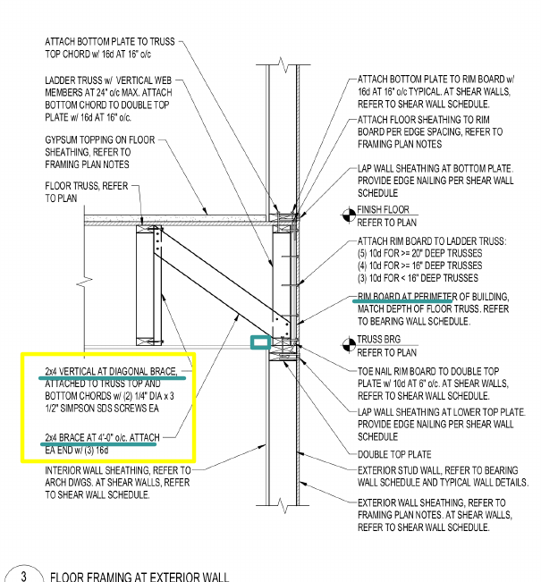
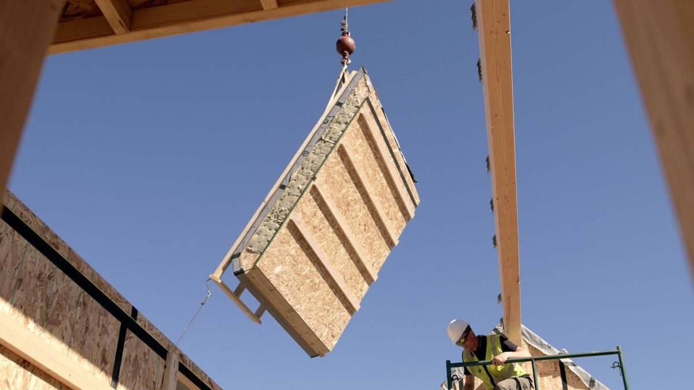
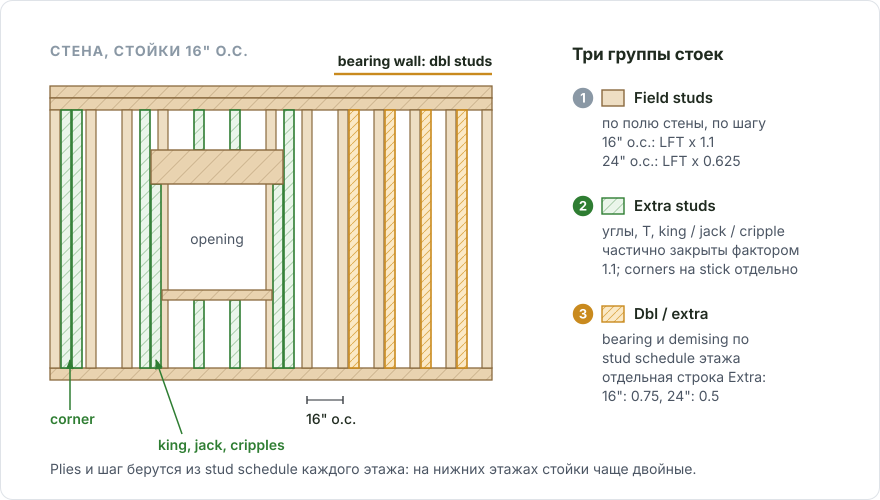
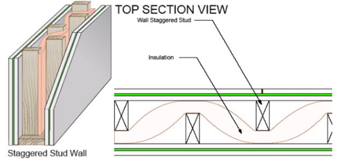
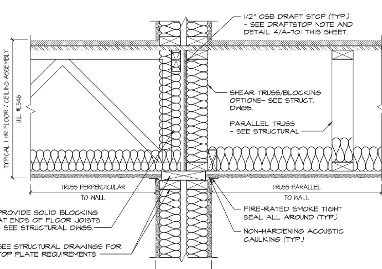

# COM Commercial

Large projects: multifamily, hotels, podium buildings, mixed-use. Many
floors, corridors, demising walls, shafts, often wall panels and FRT.

<figure markdown>
  
  <figcaption markdown="span">A typical COM detail: ladder truss at the exterior wall, rim board around the perimeter, 2x4 brace at 4' o.c. On a panel job the wall is in the panel, while rim, blocking and brace are loose and we count them.</figcaption>
</figure>

## What it is

COM differs from a house not in size but in what it is made of: walls are split into
exterior, corridor, demising and unit; floor framing is trusses or I-joists with
fire hangers at shafts; the roof is flat with parapets or uses piggyback trusses; walls
often come as panels. Scope is most often `Frame`, `Frame. Wall panels` or
`Frame. EWP by others` - [Client rules](../start/client-rules.md).

## COM order

Go down the "Work" menu, one scope per pass over the sheet:

1. Exterior walls.
2. Corridor walls.
3. Demising walls.
4. Unit / interior walls (by unit type).
5. Openings.
6. Sheathing: walls, gables, truss heel, parapets, shear walls.
7. SQFT by floor and roof.
8. Floor framing: posts, beams, headers, joists, details, stairs.
9. Roof framing and eaves.
10. Deck / porch / balcony and other items.

## Two types of COM plan

<figure markdown>
  
  <figcaption markdown="span">Panel COM: a wall panel with sheathing and insulation is assembled at the plant and set by crane. On such a project the panel supplier counts the walls, and the DFL gets only the items built on site (see the table below). Photo: phoenixhaus.com, [source](https://phoenixhaus.com/gallery), found via Pinterest.</figcaption>
</figure>

| Type | What we count | What we do not count |
| --- | --- | --- |
| Regular walls (`Frame`) | Studs, plates, blocking, sheathing, bracing, headers, openings | Whatever is explicitly by others (trusses, metal per client) |
| Panels (`Frame. Wall panels`) | Loose scope: bracing along ext/corridor/demising, floor-height plywood, box sheathing, truss heel, parapets, gables, shear plywood, holdowns, beams, posts; stick exceptions | Studs, plates, in-panel blocking and plywood, corners, typical headers in the panels |

What the panel package includes, which walls stay stick (under concrete, in an
existing frame, short, sloped) and how to record it: the canon is on the
[Wall Panels](../work/vertical/walls/wall-panels.md) page. Exterior build-up walls
are checked against the assembly and scope; do not automatically exclude them from panels.
On a panel job headers inside the panels are not counted; only flush and
loose headers are counted separately - [Headers](../work/vertical/openings/headers.md).

## Studs: spacing, extra studs, dbl extra

Wall framing is not just field studs at spacing. We count three groups:

<figure markdown>
  
  <figcaption markdown="span">Field studs 16" o.c., extra (corner, king/jack/cripple), dbl on bearing and demising.</figcaption>
</figure>

| Group | Where | How to count |
| --- | --- | --- |
| Field studs | Across the wall | By spacing factor (base16 = 1.1, base24 = 0.625) - [Formulas](../reference/formulas.md#stud-spacing-factors) |
| Extra studs | Corners, T-intersections, king/jack/cripple at openings | The 1.1 factor partly covers them; corners as a separate row on stick |
| Dbl / extra on bearing walls | Lower floors, demising per structural | A separate Extra row (Extra16 = 0.75, Extra24 = 0.5); plies and spacing from the stud schedule of each floor |

Bearing walls sit in their own branch in the tree, `BW/<floor>` (Line along the wall strip),
and go to Excel as Extra after the regular studs.

## Walls: order and makeup

- First `ext`, then `corr`, `dem`; unit partitions after that, by unit
  type (`A 2x4`) - [Unit / Interior](../work/vertical/walls/unit.md).
- Demising walls can be double: two frames only if the plan shows two frames,
  row `dem (2) 2x6 ...`.
- Corridor 2x4 staggered = two rows at 16" on 2x6 plates
  ([detail](../work/vertical/walls/corridor.md)).
- Shafts always: elevator, stair, trash chute; material per the wall type
  ([Shaft](../work/vertical/walls/shaft.md)).
- Bracing for drywall by wall height: table on the
  [Bracing for Drywall](../work/horizontal/floor-framing/details/bracingdrywall.md) page.
  Blocking flat and diagonal 48" o.c.: formulas in [Formulas](../reference/formulas.md#blocking-formulas).

<figure markdown>
  
  <figcaption markdown="span">Staggered stud wall: two rows of 2x4 staggered on 2x6 plates, insulation woven between them. This is how corridor walls and some demising walls are built in COM.</figcaption>
</figure>

## Corridor and floor framing

- A 6'-7' corridor is often framed with `2x10` on a ledger: its own joist area, with ledger and
  hangers as separate rows per detail.
- Floor and roof trusses have different depths, do not mix them up; joist direction per the structural detail.
- Hardware around the truss perimeter (accessories): bearing parallel or perpendicular
  per the structural plans.
- DHU fire hangers only over stair, elevator and shaft walls; demising with gypsum
  under the floor framing = ITS - [Hangers](../reference/hangers.md).

## FRT and construction type

The construction type comes from the Code Compliance Summary on the cover sheet; it is not
a conditional note.

| Type | What is FRT |
| --- | --- |
| Type III (podium, 4-7 floors of wood) | Everything in the plane of the exterior wall: studs, plates, headers, blocking, sheathing; wood walls below the podium. No LVL/PSL/LSL in the plane of the exterior wall, do not write "LVL FRT" |
| Type V-A, V-B | No general FRT; only what the details show |
| Any | If the exterior wall is FRT, then exterior blocking and parapets are FRT too; FRT subfloor strips 2' or 4' around the perimeter of their own floor |

The note `all wood materials at exterior to be FRT` means all loose plywood is
FRT with `verify`. FRT and FRTW are different designations, write them as in the project.
Table: [Tips: FRT](../reference/boss-feedback-rules.md#frt).

<figure markdown>
  
  <figcaption markdown="span">1/2" OSB draft stop over a demising wall in the attic: a separate row in Gable Walls, area from the attic profile in the section. The most common miss in COM.</figcaption>
</figure>

## What to look for in the specs

Full checklist before delivery: [Pre-delivery check](../start/quality-checklist.md).
Here only what you read in a COM specification:

- Sheathing names: `Flame Block`, `Densglass` (often on metal walls), ZIP-R;
  write them as in the project, do not turn them into "7/16 OSB".
- Glulam grades (`24F-V3`), the word `camber`: note it.
- Stud and plate specs: `SP` plates, `SPF` vs `DF`, `DF#2`, `HF`, `MSR`, `LSL`;
  a different grade goes on a separate row.
- Gypcrete on the floor usually means double bottom plates.
- Insulation: only exterior continuous insulation over the sheathing; interior gypsum,
  interior insulation and sound batt are not counted in a frame scope.
- Piggyback trusses: 2x6 sleepers - [Overframes](../work/horizontal/roof-framing/overframes.md).
- Flat roof curb blocking `(2) 2x6 P.T.` if nothing is specified and there is no detail.

## Common mistakes

- Wall type assigned as a group, stud height = floor-to-floor.
- Shaft walls dropped as "panels by others".
- Draft stop missed or copied from the shear total.
- Headers inside panels counted separately.
- All wall mistakes: [Common mistakes](../start/common-mistakes.md#walls),
  sheathing mistakes: [sheathing](../start/common-mistakes.md#sheathing).

## Example

```text
Takeoffs/
  Main/
    walls/2nd floor walls/ext 2x6 9.09
    walls/2nd floor walls/corr 2x6 9.09
    walls/2nd floor walls/dem 2x6 9.09
    BW/2nd/BW4-4-24
    units/2nd/A 2x4
    shear walls/2nd/shear/SW1-1
    gables/gable trusses/draft stop
```

## See also

- [Wall Panels](../work/vertical/walls/wall-panels.md), [Exterior Walls](../work/vertical/walls/exterior.md)
- [Client and job type rules](../start/client-rules.md)
- [EWP / Capital](ewp-capital.md), [Reconstruction](reconstruction.md), [Residential](residential.md)
