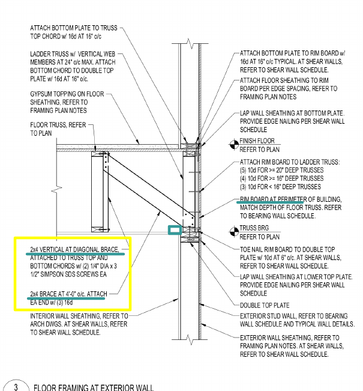
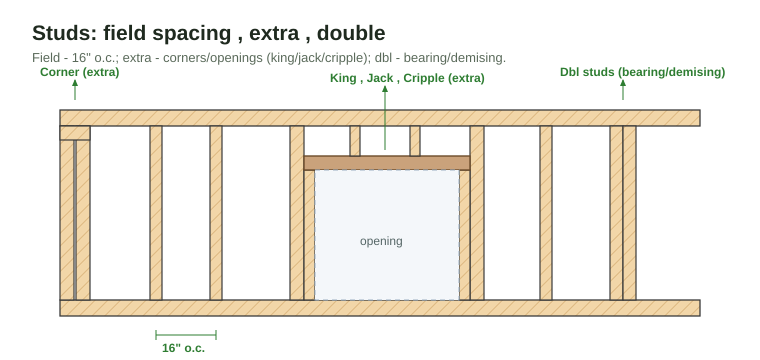
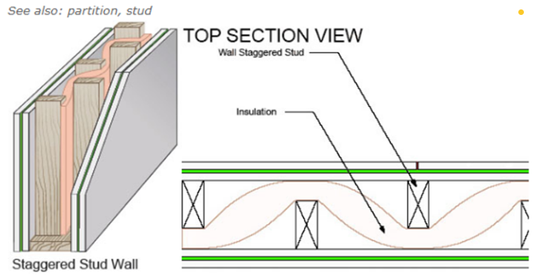
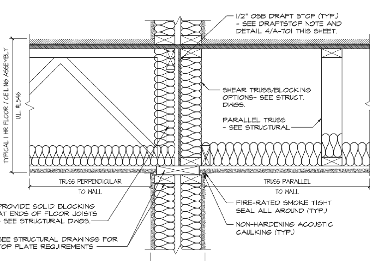

# COM Commercial

Большие проекты: multifamily, отели, подиумные здания, mixed-use. Много
этажей, коридоры, demising-стены, шахты, часто wall panels и FRT.

<figure markdown>
  
  <figcaption markdown="span">Типичный узел COM: ladder truss у наружной стены, rim board по периметру, 2x4 brace at 4' o.c. На panel-job стена в панели, а rim, blocking и brace - loose, их считаем.</figcaption>
</figure>

## Что это

COM отличается от жилого дома не размером, а составом: стены делятся на
exterior, corridor, demising и unit; перекрытия на фермах или I-joists с
fire hangers у шахт; кровля плоская с parapets или с piggyback trusses; стены
часто приходят панелями. Scope чаще всего `Frame`, `Frame. Wall panels` или
`Frame. EWP by others` - [Правила клиентов](../start/client-rules.md).

## Порядок COM

Идёшь по меню "Работа", один scope на проход листа:

1. Exterior walls.
2. Corridor walls.
3. Demising walls.
4. Unit / interior walls (по типам юнитов).
5. Openings.
6. Sheathing: стены, gables, truss heel, parapets, shear walls.
7. SQFT по этажам и кровле.
8. Floor framing: posts, beams, headers, joists, details, stairs.
9. Roof framing и eaves.
10. Deck / porch / balcony и прочее.

## Два типа COM плана

<!-- TODO-PHOTO: prefabricated wood wall panels being installed by crane on a multifamily building; EN query "prefabricated wood wall panels installation crane" -->

| Тип | Что считаем | Что не считаем |
| --- | --- | --- |
| Обычные стены (`Frame`) | Studs, plates, blocking, sheathing, bracing, headers, openings | То, что явно by others (фермы, metal по клиенту) |
| Панели (`Frame. Wall panels`) | Loose scope: bracing по ext/corridor/demising, floor-height plywood, box sheathing, truss heel, parapets, gables, shear plywood, holdowns, beams, posts; stick-исключения | Studs, plates, in-panel blocking и plywood, corners, типовые headers в панелях |

Что входит в panel package, какие стены остаются stick (под бетоном, в
existing frame, короткие, наклонные) и как это записать - канон на странице
[Wall Panels](../work/vertical/walls/wall-panels.md). Exterior build-up walls
проверяются по конструкции и scope; автоматически из панелей их не исключать.
На panel-job headers внутри панелей не считаются, отдельно только flush и
loose - [Headers](../work/vertical/openings/headers.md).

## Studs: spacing, extra studs, dbl extra

Каркас стены - не только field studs с шагом. Считаем три группы:

<figure markdown>
  
  <figcaption markdown="span">Field studs 16" o.c., extra (corner, king/jack/cripple), dbl на bearing и demising.</figcaption>
</figure>

| Группа | Где | Как считать |
| --- | --- | --- |
| Field studs | По полю стены | По фактору шага (база16 = 1.1, база24 = 0.625) - [Формулы](../reference/formulas.md#stud-spacing-factors) |
| Extra studs | Углы, T-пересечения, king/jack/cripple у проёмов | Фактор 1.1 частично закрывает; corners отдельной строкой на stick |
| Dbl / extra на bearing walls | Нижние этажи, demising по structural | Отдельная строка Extra (Extra16 = 0.75, Extra24 = 0.5); plies и шаг из stud schedule каждого этажа |

Bearing walls в дереве лежат в своей ветке `BW/<этаж>` (Line по полосе стены),
в Excel идут как Extra после обычных studs.

## Стены: порядок и состав

- Сначала `ext`, потом `corr`, `dem`; юнитовые перегородки после, по типам
  юнитов (`A 2x4`) - [Unit / Interior](../work/vertical/walls/unit.md).
- Demising бывают двойные: два каркаса только если на плане два каркаса,
  строка `dem (2) 2x6 ...`.
- Corridor 2x4 staggered = два ряда по 16" на plates 2x6
  ([деталь](../work/vertical/walls/corridor.md)).
- Шахты всегда: лифт, лестница, мусоропровод; материал по wall type
  ([Shaft](../work/vertical/walls/shaft.md)).
- Bracing for drywall по высоте стены - таблица на странице
  [Bracing for Drywall](../work/horizontal/floor-framing/details/bracingdrywall.md).
  Blocking flat и diagonal 48" o.c. - формулы в [Формулы](../reference/formulas.md#blocking-formulas).

<figure markdown>
  
  <figcaption markdown="span">Staggered stud wall: два ряда 2x4 вразбежку на plates 2x6, утеплитель змейкой. Так устроены corridor и часть demising стен в COM.</figcaption>
</figure>

## Corridor и перекрытия

- Коридор 6'-7' часто перекрыт `2x10` на ledger: своя зона joists, ledger и
  hangers отдельными строками по детали.
- Фермы пола и крыши разной высоты, не путать; направление joists по structural detail.
- Крепёж по периметру ферм (accessories): опирание параллельно или перпендикулярно
  по structural plans.
- Fire hangers DHU только над стенами лестниц, лифтов и шахт; demising с гипсом
  под перекрытием = ITS - [Hangers](../reference/hangers.md).

## FRT и тип конструкции

Тип конструкции берётся из Code Compliance Summary на обложке, это не
условная нота.

| Тип | Что FRT |
| --- | --- |
| Type III (подиум, 4-7 этажей дерева) | Всё в плоскости наружной стены: studs, plates, headers, blocking, sheathing; деревянные стены ниже podium. LVL/PSL/LSL в плоскости наружной стены нельзя, "LVL FRT" не писать |
| Type V-A, V-B | Общего FRT нет; только то, что показано в деталях |
| Любой | Если наружная стена FRT, то exterior blocking и parapets тоже FRT; FRT-полосы subfloor 2' или 4' по периметру своего этажа |

Нота `all wood materials at exterior to be FRT` означает весь loose plywood
FRT с `verify`. FRT и FRTW - разные обозначения, писать как в проекте.
Таблица - [Советы: FRT](../reference/boss-feedback-rules.md#frt).

<figure markdown>
  
  <figcaption markdown="span">1/2" OSB draft stop над demising стеной на чердаке: отдельная строка в Gable Walls, площадь по профилю чердака с разреза. Самый частый пропуск в COM.</figcaption>
</figure>

## На что смотреть в спеках

Полный чек-лист перед сдачей - [Проверка перед сдачей](../start/quality-checklist.md).
Здесь только то, что читается в спецификации COM:

- Названия обшивки: `Flame Block`, `Densglass` (часто на metal walls), ZIP-R;
  писать как в проекте, не превращать в "7/16 OSB".
- Glulam grades (`24F-V3`), слово `camber` - отметить.
- Stud и plates specs: `SP` plates, `SPF` против `DF`, `DF#2`, `HF`, `MSR`, `LSL`;
  другой сорт отдельной строкой.
- Gypcrete на полу - обычно double bottom plates.
- Insulation: только наружный continuous после обшивки; внутренний гипс,
  внутренний утеплитель и sound batt во frame-scope не считаем.
- Piggyback trusses: sleepers 2x6 - [Overframes](../work/horizontal/roof-framing/overframes.md).
- Flat roof curb blocking `(2) 2x6 P.T.`, если ничего не указано и нет детали.

## Частые ошибки

- Тип стены назначен группой, высота стойки = floor-to-floor.
- Shaft walls выброшены как "panels by others".
- Draft stop пропущен или скопирован из суммы shear.
- Headers внутри панелей посчитаны отдельно.
- Все ошибки по стенам - [Частые ошибки](../start/common-mistakes.md#walls),
  по обшивке - [обшивка](../start/common-mistakes.md#sheathing).

## Пример

```text
Takeoffs/
  Main/
    walls/2nd floor walls/ext 2x6 9.09
    walls/2nd floor walls/corr 2x6 9.09
    walls/2nd floor walls/dem 2x6 9.09
    BW/2nd/BW4-4-24
    units/2nd/A 2x4
    shear walls/2nd/shear/SW1-1
    gables/gable trusses/draft stop
```

## См. также

- [Wall Panels](../work/vertical/walls/wall-panels.md), [Exterior Walls](../work/vertical/walls/exterior.md)
- [Правила клиентов и типов заказов](../start/client-rules.md)
- [EWP / Capital](ewp-capital.md), [Reconstruction](reconstruction.md), [Residential](residential.md)
