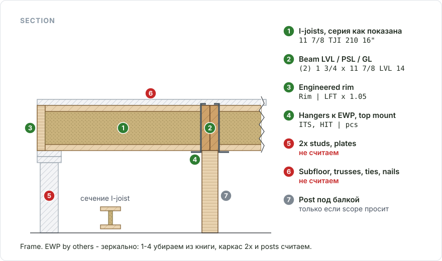
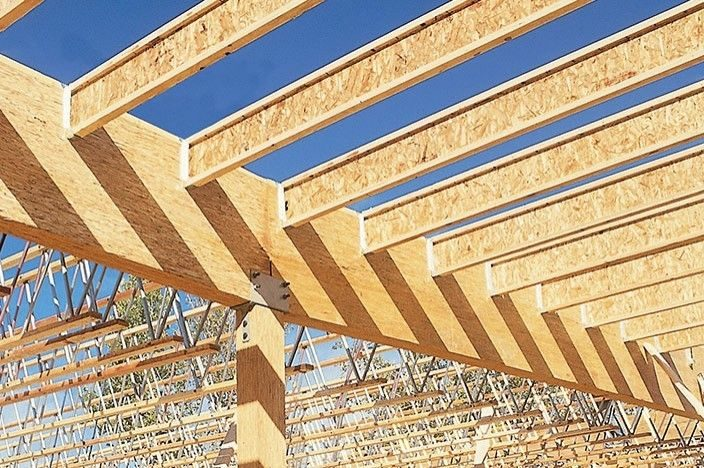

# EWP / Capital

**EWP (Engineered Wood Products)** - factory-made engineered framing materials:
I-joists, LVL / PSL / LSL / GL beams and engineered rim. There are two opposite
job types: "EWP only" (Capital-type) and "everything except EWP" (`Frame. EWP by others`).

<figure markdown>
  
  <figcaption markdown="span">EWP only: we count I-joists, LVL/PSL/GL, engineered rim and hangers for them. Not 2x, trusses, nails.</figcaption>
</figure>

<figure markdown>
  { width="520" }
  <figcaption markdown="span">EWP on site: I-joists sit on a glued beam, the beam sits on a post with a metal post cap. In an "EWP only" job we count the I-joists, the beam and the hangers for them; not the 2x post or the trusses in the background. Photo: redbuilt.com, [source](http://www.redbuilt.com/commercial-systems/i-joists), found via Pinterest.</figcaption>
</figure>

## What these materials are

| Material | What it is | Where |
| --- | --- | --- |
| I-joist | OSB web and LVL/OSB flanges; a light floor joist (TJI, LPI, BCI, RFPI, Nordic) | Floors, flat roofs |
| LVL | Laminated veneer; strong, stable | Beams, headers, rim under load |
| PSL | Parallel strand lumber; high bearing capacity | Beams, columns |
| LSL | Laminated strand; often rim and short beams | Rim, headers |
| GL / Glulam | Glued laminations; often exposed | Long spans |

Product details: [Joist](../work/horizontal/floor-framing/joist.md)
and [Beam](../work/horizontal/floor-framing/beam.md).

## EWP only (Capital-type)

**Count:** I-joists, LVL / PSL / GL beams, engineered rim and blocking in LFT,
hangers for them; possibly columns and stair stringers.

**Do not count:** regular 2x, trusses, ties (CS, MST and similar), nails,
stair connectors, unless the scope explicitly asks for them.

Rules:

- TJI series as shown: 110 does not become 230.
- Most hangers are top mount; joists deeper than 16" take HIT, not ITS.
  Over walls with double gypsum (firewall) at stairs and shafts: DHU / DGU
  as a separate row - [Hangers](../reference/hangers.md).
- Rim: if LVL is not specified anywhere, do not assume `1-3/4 LVL Rim`; by default use
  `Rim` or the product marked assumed. Rim thicknesses: 1-1/8" OSB, 1-1/2" LSL,
  1-3/4" LVL - [Rim Board](../work/horizontal/floor-framing/details/rim.md).
- Rim and continuous blocking stay in `LFT` on this kind of job: rim `x 1.05`,
  blocking with no factor; rim is not cut into 16' boards. The `1.05` factor is
  **for EWP-only jobs**. In a regular framing book (Frame, COM, residential)
  `Rim Board` is 16' boards through `=CEILING(G/D,1)` with no separate
  waste factor: [Rim Board](../work/horizontal/floor-framing/details/rim.md),
  [Formulas](../reference/formulas.md).
- Identical floor: note `4th floor frame is identical to 3rd floor`, but
  still list the materials.

## The opposite case: Frame. EWP by others {#ewp-by-others}

The `Frame. EWP by others` tag on the project folder: the client supplies the EWP,
we count all the other framing.

**Count:** walls, openings, sheathing, areas, all posts (including those under
EWP beams), 2x headers, roofing, eaves, truss heel, hardware.

**Do not count:** I-joists, LVL / PSL / LSL beams and headers, engineered rim.
Remove the EWP rows, do not leave them at zero.

**Exceptions (checklist):**

- **Assumed LVL is always included.** If we assigned the LVL ourselves because the
  drawings give no mark (a long window header with no mark, a ridge), it stays in the
  book with `assumed`: the client's EWP package does not have it.
- **`EWP Floors by others`** is narrower than `EWP by others`: by others is only what
  is drawn on the floor framing layouts (I-joists, beams and rim of those
  floors). Attic, roof and stick porch with their LVL stay ours.

Rules:

- Header note `All EWP products are by others`. The template note
  `Walls are panels by others` is deleted if there is no panel scope.
- Hangers for EWP are not counted; other hardware as usual: Zmax outside and on P.T.,
  ties to trusses under sheathing without Zmax.
- Furring and rainscreen, if in question, go in as optional with a note giving the reason.
- Posts under EWP beams are still ours: per schedule, with cap and base.

## Common mistakes

- EWP counted with `EWP by others`, or not counted with EWP only.
- With `EWP Floors by others` the roof, attic and porch LVL thrown out, or an assumed LVL removed.
- Rim `x 1.05` in LFT carried over into a regular framing book.
- Rim recorded as LVL with no callout.
- Hangers counted from the purchased boards, not by assembly.
- All floor framing mistakes: [Common mistakes](../start/common-mistakes.md#floor).

## Example

```text
Takeoffs/
  framing/2nd floor framing/joists/11 7/8 TJI 210 16"
  framing/2nd floor framing/beams/(2) 1 3/4 x 11 7/8 LVL 14
  framing/2nd floor framing/details/rim
  framing/2nd floor framing/posts/C4 9.0
```

## See also

- [Joist](../work/horizontal/floor-framing/joist.md), [Beam](../work/horizontal/floor-framing/beam.md), [Rim Board](../work/horizontal/floor-framing/details/rim.md), [Hangers](../reference/hangers.md)
- [Client and job type rules](../start/client-rules.md)
- [COM Commercial](com.md), [Residential](residential.md)
