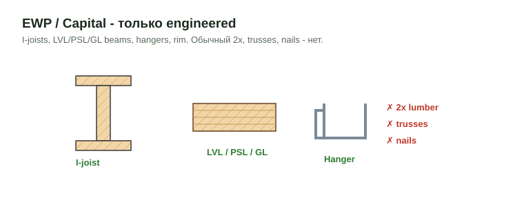

# EWP / Capital

**EWP (Engineered Wood Products)** - заводские инженерные материалы каркаса:
I-joists, LVL / PSL / LSL / GL балки и engineered rim. Есть два противоположных
заказа: "только EWP" (Capital-тип) и "всё, кроме EWP" (`Frame. EWP by others`).

<figure markdown>
  
  <figcaption markdown="span">EWP only: считаем I-joists, LVL/PSL/GL, engineered rim и hangers к ним. 2x, фермы, гвозди - нет.</figcaption>
</figure>

<!-- TODO-PHOTO: floor framing with I-joists, LVL beam and rim board, no people; EN query "I-joist floor framing LVL beam engineered wood" -->

## Что это за материалы

| Материал | Что это | Где |
| --- | --- | --- |
| I-joist | OSB-стенка и LVL/OSB-полки; лёгкая балка перекрытия (TJI, LPI, BCI, RFPI, Nordic) | Полы, плоские крыши |
| LVL | Клееный шпон; прочный, стабильный | Балки, headers, rim под нагрузкой |
| PSL | Parallel strand lumber; высокая несущая | Балки, колонны |
| LSL | Laminated strand; часто rim и короткие балки | Rim, headers |
| GL / Glulam | Клееные ламели; часто exposed | Большие пролёты |

Детали по продуктам - [Joist](../work/horizontal/floor-framing/joist.md)
и [Beam](../work/horizontal/floor-framing/beam.md).

## EWP only (Capital-тип)

**Считать:** I-joists, балки LVL / PSL / GL, engineered rim и blocking в LFT,
hangers к ним; возможно колонны и stringers лестниц.

**Не считать:** обычный 2x, фермы, ties (CS, MST и подобные), гвозди,
соединители лестниц, если scope прямо не просит.

Правила:

- TJI серия как показана: 110 не превращается в 230.
- Большинство hangers top mount; joists глубже 16" берут HIT, не ITS.
  Над стенами с двойным гипсом (firewall) у лестниц и шахт - DHU / DGU
  отдельной строкой - [Hangers](../reference/hangers.md).
- Rim: если LVL нигде не указан, не предполагать `1-3/4 LVL Rim`; по умолчанию
  `Rim` или продукт с пометкой assumed. Толщины rim 1-1/8" OSB, 1-1/2" LSL,
  1-3/4" LVL - [Rim Board](../work/horizontal/floor-framing/details/rim.md).
- Rim factor 1.05; blocking continuous в LFT, фактор по [Формулам](../reference/formulas.md).
- Одинаковый этаж: нота `4th floor frame is identical to 3rd floor`, но
  материалы перечислить.

## Обратный случай: Frame. EWP by others {#ewp-by-others}

Пометка `Frame. EWP by others` в папке проекта: клиент поставляет EWP сам,
мы считаем весь остальной каркас.

**Считать:** стены, проёмы, обшивка, площади, все posts (в том числе под
EWP-балками), headers из 2x, кровля, eaves, truss heel, крепёж.

**Не считать:** I-joists, LVL / PSL / LSL балки и headers, engineered rim.
Строки с EWP убрать, не оставлять нулевыми.

Правила:

- Нота в шапке `All EWP products are by others`. Шаблонная нота
  `Walls are panels by others` удаляется, если panel scope нет.
- Hangers к EWP не считаем; остальной крепёж как обычно: снаружи и на P.T.
  Zmax, ties к фермам под обшивкой без Zmax.
- Furring и rainscreen, если они под вопросом, как optional с нотой-причиной.
- Posts под EWP-балками всё равно наши: по schedule, с cap и base.

## Частые ошибки

- EWP посчитан при `EWP by others` или не посчитан при EWP only.
- Rim записан как LVL без указания.
- Hangers по закупочным доскам, а не по сборкам.
- Все ошибки по перекрытиям - [Частые ошибки](../start/common-mistakes.md#floor).

## Пример

```text
Takeoffs/
  framing/2nd floor framing/joists/11 7/8 TJI 210 16"
  framing/2nd floor framing/beams/(2) 1 3/4 x 11 7/8 LVL 14
  framing/2nd floor framing/details/rim
  framing/2nd floor framing/posts/C4 9.0
```

## См. также

- [Joist](../work/horizontal/floor-framing/joist.md), [Beam](../work/horizontal/floor-framing/beam.md), [Rim Board](../work/horizontal/floor-framing/details/rim.md), [Hangers](../reference/hangers.md)
- [Правила клиентов и типов заказов](../start/client-rules.md)
- [COM Commercial](com.md), [Residential](residential.md)
