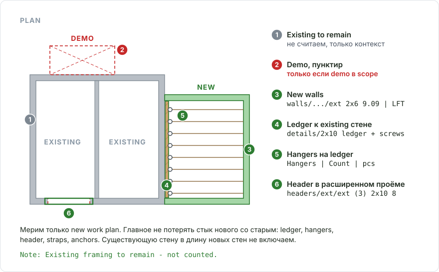

# Reconstruction

Part of the building already exists, part is demolished, part is added. The main
difficulty: do not count the whole building as new, and do not lose the places where new
framing connects to existing.

<figure markdown>
  
  <figcaption markdown="span">Existing - do not count, Demo - only if in scope, New and connections - count.</figcaption>
</figure>

## What it is

A job on an existing building: an addition on top, a re-layout, floor framing replacement,
new openings, roof or porch repair. Scope comes with a tag like
`Frame. Interior trim and Int doors. NO metal` or `Revision`. Panel rules
do not apply here to new walls inside an existing frame:
[Wall Panels](../work/vertical/walls/wall-panels.md#reconstruction-existing).

## How it differs

| | New construction | Reconstruction |
| --- | --- | --- |
| Floor plan | The whole plan is a takeoff plan | The existing floor plan is often just context; measure from the new work plan |
| Walls | Per the wall schedule | Only `New`, `Replace`, `Patch`; do not count `Existing to remain` |
| Panels | Possible | New walls inside an existing frame are always stick |
| Main focus | Completeness | New-to-existing connections: ledgers, straps, anchors, hangers |

## What to count and what not

**Count:** new walls, openings, floor framing and roofing shown as new;
repair and rebuild areas (rotten framing, replaced subfloor, patched roof, rebuilt
porch, new beams and posts); new connections (hangers, straps, anchors, bolts,
blocking, ledgers); bracing, if in the structural notes; envelope: WRB, sheathing
patches, siding backing, insulation, flashing; a new subfloor over the whole
existing floor, if the detail requires it (the old floor is covered entirely).

**Do not count:** existing framing with no changes; demo-only items without demo scope;
existing walls and openings shown for context; old joists and rafters with the note
`existing to remain`; trim with a structural scope; steel partitions with
`NO metal` (note `Metal Studs by others`).

## How to read the marks

| Mark on the drawings | How to read it | What to do |
| --- | --- | --- |
| `Existing` / `E` | Already built | Do not count unless a repair or replacement is shown |
| `Existing to remain` | Stays | Do not add material; check only the connection to new work |
| `Demo` / dashed line | Removed | Count only with demo scope |
| `New` / heavy line / keyed note | New work | Count as regular material scope |
| `Replace in kind` | Replace with the same | Count the replacement area or length, not the whole existing run |
| `Patch` / `Repair` | Local repair | Only the indicated area, plus a note |

## What to look at

| Where on the drawings | What to check |
| --- | --- |
| Cover, code, general notes | What the remodel scope includes; construction type |
| Demo plans | What is removed and what stays |
| New work plans | Where new framing actually appears |
| Structural details | Connections to existing: ledgers, straps, anchors, sistering |
| Elevations, sections | Height changes, roof tie-ins, wall rebuild areas |
| Keynotes | Patch, repair, replace items that are not visible on the plan |
| Photos, field notes | Existing condition, if the drawings are incomplete |

- Legend first: line weights, dashed lines, hatch, keynote symbols.
- An opening is moved or widened: header, king/jack studs, sill, sheathing patch.
- An existing roof or floor is opened up: temporary support, sistering, scab, reinforcement.
- Old member sizes are not the same as new ones: do not assume `2x10` if the detail shows the actual existing member.
- If the drawings show only the repair area, do not multiply it over the whole floor.

## How to measure and name it

New work is measured with the same tools and in the same branches as in a new
building. There is one difference: existing must not get into the book.

1. Legend and new work plans first. Measure only what is shown as `New`,
   `Replace`, `Patch`.
2. **New walls** go in the regular branch `walls/<floor> floor walls` with regular names
   (`ext 2x6 9.09`, `2x4 9.09`). Inside an existing frame they are always stick.
3. **Existing walls**, if you need to trace them for reference, go into a separate
   folder `existing not in repair/<floor> exst/`. Nothing from it goes into the DFL.
4. **Framing that is replaced or added inside the existing area** (joists,
   beams, hangers) stays in its regular `framing` branch, and the name gets
   `in exist area` added: `joists/2x10 12" in exist area`,
   `beams/(2) 2x10 8 in exist area`, `details/LUS210 in exist area`. These
   takeoffs do go into the DFL.
5. **Openings** are counted only in walls that have a new wall line.
   An existing opening in an existing wall (and a window replaced in it) is skipped entirely: no flashing,
   no deduction; count a header only if the drawing shows it being replaced.
   A new opening cut into an existing wall (shown as new on the new work plan) stays out
   of the regular opening count of the floor and goes on its own row,
   `Window Flashing in Exist Walls`: `(2H + W) x count x 1.1` from the schedule sizes.
6. **Existing items** (doors, storefronts, a roof marked existing) do not go into the
   book: one note in the header, and their takeoffs are removed from the tree.
7. An existing gable, if it is needed for sheathing, is a separate takeoff
   `existing gable`.

| What the drawings show | What goes into the DFL |
| --- | --- |
| New walls, new openings in them | regular wall rows; `Window Flashing`, `Sill Flashing` in LFT |
| New opening in an existing wall | `Window Flashing in Exist Walls`, `Flashing Tape`, LFT, figured like `Window Flashing` |
| Opening in an existing wall with no new wall line | no rows |
| Framing in the existing area (`... in exist area`) | the same labels as the new framing, as a separate group after it under the bold note `Note: In existing area per <sheet>` |
| Existing part clearly out of scope | no rows, one note `Important: Existing ... not included per <sheet>` |
| Existing part in doubt | separate blocks as an option: note `Note: Optional for existing, verify if apply` and an option color from the palette, never gray |

The order in a framing list: first all rows of the new framing, then the group for the
existing area. The totals do not change, only the order does.

## Common items

| Item | When it appears | Check |
| --- | --- | --- |
| Ledgers | New floor, deck or roof to an existing wall | Size, fasteners, P.T. or FRT, spacing |
| Hangers | New joists to an existing beam, wall, ledger | Top mount or face mount, skew, width |
| Blocking | Edge support, drywall backing, roof or floor patch | New or existing? |
| Sistered joists, rafters | Reinforcing an existing member | Length, count, side, fasteners |
| New headers | New and widened openings | Plies, LVL or 2x, bearing |
| Anchor bolts, straps | New wall or ledger to existing concrete or framing | Material, spacing, embed per detail |
| Sheathing patch | Wall, roof, floor repair | Thickness, FRT, Zip, OSB; one side or two |
| New subfloor | Detail "new subfloor over existing" | The whole area of the new layer |

## Common mistakes

- A demo plan taken as a material takeoff.
- A patch area stretched over the whole floor.
- A new subfloor over the old floor missed ("it is already there").
- Steel partitions counted with `NO metal`, or not marked with a note.
- Existing walls traced in `walls` and sent to the DFL, or openings in existing walls produced flashing and a sheathing deduction.
- Framing in the existing area written without the `in exist area` suffix and mixed with the new framing.
- All wall mistakes: [Common mistakes](../start/common-mistakes.md#walls).

## Notes in the DFL

- `Important: Existing ... not included per <sheet>` - existing items, one note in the header.
- `Note: In existing area per <sheet>` - bold note before the group of rows for the existing area.
- `Note: Optional for existing, verify if apply` - option block for an existing part in doubt.
- `Existing framing to remain - not counted.`
- `Counted new work only per shaded/keyed repair area.`
- `Header counted only at enlarged opening.`
- `Ledger and hangers counted at new-to-existing connection per <detail>.`
- `Demo shown for context only - no demo material counted.`
- `Metal Studs by others.`

## Example

An addition over part of the 2nd floor, beams replaced in the existing area and two new `3.0x5.0` windows cut into an existing wall:

```text
Takeoffs/
  walls/2nd floor walls/
    ext 2x6 9.09                      Line, 86.0 LFT     (new walls)
  existing not in repair/2nd exst/
    ext 2x6 9.09                      Line, 210.0 LFT    (reference only, not in the DFL)
  openings/2/
    3.0x5.0                           Count, 6 ea        (in new walls)
  framing/2nd floor framing/beams/
    (2) 2x10 8 in exist area          Count, 3 ea
  framing/2nd floor framing/details/
    LUS210                            Count, 24 ea
    LUS210 in exist area              Count, 12 ea
```

The two new windows in the existing wall are not placed in `openings/2`: that wall has no
new wall line. Their size and count go from the schedule straight into the
`Window Flashing in Exist Walls` row.

```text
Important: Existing structure to remain; products listed for new construction only.

2nd Floor Walls
Window Flashing                  Flashing Tape    90   LFT   (2 x 5.0 + 3.0) x 6 x 1.1 = 85.8
Sill Flashing                    Sill Flashing    20   LFT   3.0 x 6 x 1.1 = 19.8
Window Flashing in Exist Walls   Flashing Tape    30   LFT   (2 x 5.0 + 3.0) x 2 x 1.1 = 28.6

2nd Floor Framing List
Hangers                          LUS210           24   pcs
Note: In existing area per S201
Beam (2)                         2x10              6   8     3 points x 2 plies
Hangers                          LUS210           12   pcs
```

## See also

- [Wall Panels](../work/vertical/walls/wall-panels.md), [Exterior Walls](../work/vertical/walls/exterior.md)
- [Headers](../work/vertical/openings/headers.md), [Hangers](../reference/hangers.md)
- [Client and job type rules](../start/client-rules.md)
