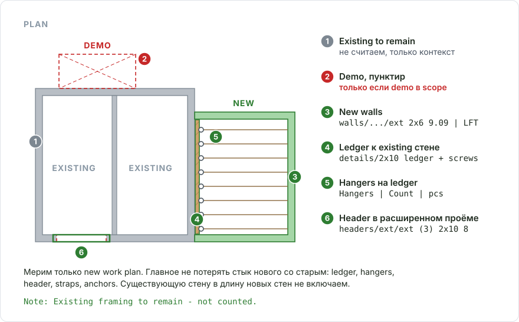

# Reconstruction (реконструкция)

Часть здания уже существует, часть сносится, часть добавляется. Главная
сложность: не посчитать весь дом как новый и не потерять места, где новый
каркас подключается к существующему.

<figure markdown>
  
  <figcaption markdown="span">Мини-план: existing серым не считаем, demo пунктиром только если в scope, new зелёным считаем. Отдельно стыки нового со старым: ledger и hangers на существующей стене, header в расширенном проёме.</figcaption>
</figure>

## Что это

Заказ на существующее здание: надстройка, перепланировка, замена перекрытий,
новые проёмы, ремонт кровли или porch. Scope приходит с пометкой вроде
`Frame. Interior trim and Int doors. NO metal` или `Revision`. Правила панелей
здесь не действуют на новые стены внутри existing frame:
[Wall Panels](../work/vertical/walls/wall-panels.md#reconstruction-existing).

## Чем отличается

| | Новое строительство | Reconstruction |
| --- | --- | --- |
| План этажа | Весь план мерный | План существующего этажа часто только контекст; мерить по new work plan |
| Стены | По wall schedule | Только `New`, `Replace`, `Patch`; `Existing to remain` не считать |
| Панели | Возможны | Новые стены внутри existing frame всегда stick |
| Главное | Полнота | Соединения new-to-existing: ledgers, straps, anchors, hangers |

## Что считать и что нет

**Считать:** new walls, openings, перекрытия и кровля, показанные как new;
repair и rebuild зоны (rotten framing, replaced subfloor, patched roof, rebuilt
porch, new beams и posts); new connections (hangers, straps, anchors, bolts,
blocking, ledgers); bracing, если в structural notes; envelope: WRB, sheathing
patches, siding backing, insulation, flashing; новый subfloor поверх всего
существующего пола, если деталь так требует (старый пол накрывают целиком).

**Не считать:** existing framing без изменений; demo-only items без demo scope;
existing walls и openings, показанные для контекста; old joists и rafters с нотой
`existing to remain`; отделку при structural scope; стальные перегородки при
`NO metal` (нота `Metal Studs by others`).

## Как читать марки

| Mark на чертежах | Как читать | Что делать |
| --- | --- | --- |
| `Existing` / `E` | Уже построено | Не считать, если не показан repair или replacement |
| `Existing to remain` | Остаётся | Материал не добавлять; проверить только connection к new work |
| `Demo` / пунктир | Удаляется | Считать только при demo scope |
| `New` / толстая линия / keyed note | Новая работа | Считать как обычный material scope |
| `Replace in kind` | Заменить таким же | Считать replacement area или length, не весь existing run |
| `Patch` / `Repair` | Локальный ремонт | Только указанную зону, плюс нота |

## На что смотреть

| Где на чертежах | Что проверить |
| --- | --- |
| Cover, code, general notes | Что входит в remodel scope; тип конструкции |
| Demo plans | Что удаляется и что остаётся |
| New work plans | Где реально появляется new framing |
| Structural details | Connections to existing: ledgers, straps, anchors, sistering |
| Elevations, sections | Изменения высот, roof tie-ins, зоны перестройки стен |
| Keynotes | Patch, repair, replace, которые не видны на плане |
| Photos, field notes | Existing condition, если чертежи неполные |

- Сначала легенда: line weights, пунктир, hatch, keynote symbols.
- Opening переносится или расширяется: header, king/jack studs, sill, sheathing patch.
- Existing roof или floor вскрывается: temporary support, sistering, scab, reinforcement.
- Старые сечения не равны новым: не предполагать `2x10`, если деталь показывает actual existing member.
- Если чертежи показывают только область ремонта, не умножать её на весь этаж.

## Как мерить и назвать

Новая работа меряется теми же инструментами и в тех же ветках, что и в новом
доме. Отличие одно: existing не должно попасть в книгу.

1. Сначала легенда и new work plans. Меряй только то, что показано как `New`,
   `Replace`, `Patch`.
2. **Новые стены** - обычная ветка `walls/<этаж> floor walls`, обычные имена
   (`ext 2x6 9.09`, `2x4 9.09`). Внутри existing frame они всегда stick.
3. **Existing стены**, если их нужно обвести для ориентира, - в отдельную
   папку `existing not in repair/<этаж> exst/`. Из неё в DFL ничего не идёт.
4. **Каркас, который меняют или добавляют внутри existing зоны** (joists,
   beams, hangers), остаётся в своей обычной ветке `framing`, а к имени
   добавляется `in exist area`: `joists/2x10 12" in exist area`,
   `beams/(2) 2x10 8 in exist area`, `details/LUS210 in exist area`. Эти
   позиции в DFL идут.
5. **Проёмы** считаются только в стенах, у которых есть новая линия стены.
   Существующий проём в existing стене (и замена окна в нём) пропускаем
   целиком: ни flashing,
   ни вычета; header считаем, только если чертёж показывает его замену.
   Новый проём, который прорезают в existing стене (на new work plan он
   показан как new), в обычный счёт проёмов этажа не входит и идёт своей
   строкой `Window Flashing in Exist Walls`: `(2H + W) x кол-во x 1.1` по
   размерам из schedule.
6. **Existing items** (двери, storefront, кровля с пометкой existing) в книгу
   не идут: одна нота в шапке, их замеры из дерева убираются.
7. Existing фронтон, если он нужен для обшивки, - отдельной позицией
   `existing gable`.

| Что на чертежах | Что в DFL |
| --- | --- |
| Новые стены, новые проёмы в них | обычные строки стен; `Window Flashing`, `Sill Flashing` в LFT |
| Новый проём в existing стене | `Window Flashing in Exist Walls`, `Flashing Tape`, LFT, считается как `Window Flashing` |
| Проём в existing стене без новой линии стены | строк нет |
| Каркас в existing зоне (`... in exist area`) | те же подписи, что у нового каркаса, отдельной группой после него под жирной нотой `Note: In existing area per <лист>` |
| Existing часть явно не в scope | строк нет, одна нота `Important: Existing ... not included per <лист>` |
| Existing часть под вопросом | отдельные блоки как опция: нота `Note: Optional for existing, verify if apply` и цвет опции из палитры, не серый |

В framing list порядок такой: сначала все строки нового каркаса, потом группа
existing зоны. Итоги при этом не меняются, меняется только порядок.

## Частые items

| Item | Когда появляется | Проверить |
| --- | --- | --- |
| Ledgers | New floor, deck или roof к existing wall | Размер, крепёж, P.T. или FRT, шаг |
| Hangers | New joists к existing beam, wall, ledger | Top mount или face mount, skew, ширина |
| Blocking | Edge support, drywall backing, roof или floor patch | New или existing? |
| Sistered joists, rafters | Усиление existing member | Длина, число, сторона, крепёж |
| New headers | Новые и расширенные проёмы | Plies, LVL или 2x, bearing |
| Anchor bolts, straps | New wall или ledger к existing concrete или framing | Материал, шаг, embed по детали |
| Sheathing patch | Ремонт стены, кровли, пола | Толщина, FRT, Zip, OSB; одна сторона или две |
| New subfloor | Деталь "new subfloor over existing" | Вся площадь нового слоя |

## Частые ошибки

- Demo plan принят за material takeoff.
- Patch зона растянута на весь этаж.
- Новый subfloor поверх старого пола пропущен ("он же есть").
- Стальные перегородки посчитаны при `NO metal` или не отмечены нотой.
- Existing стены обведены в `walls` и ушли в DFL, или проёмы existing стен дали flashing и вычет из обшивки.
- Каркас existing зоны записан без приписки `in exist area` и смешался с новым.
- Все ошибки по стенам - [Частые ошибки](../start/common-mistakes.md#walls).

## Ноты в DFL

- `Important: Existing ... not included per <лист>` - existing items, одна нота в шапке.
- `Note: In existing area per <лист>` - жирная нота перед группой строк existing зоны.
- `Note: Optional for existing, verify if apply` - блок-опция для existing под вопросом.
- `Existing framing to remain - not counted.`
- `Counted new work only per shaded/keyed repair area.`
- `Header counted only at enlarged opening.`
- `Ledger and hangers counted at new-to-existing connection per <деталь>.`
- `Demo shown for context only - no demo material counted.`
- `Metal Studs by others.`

## Пример

Надстройка над частью 2-го этажа, замена балок в existing зоне и два новых окна `3.0x5.0`, прорезанных в existing стене:

```text
Takeoffs/
  walls/2nd floor walls/
    ext 2x6 9.09                      Line, 86.0 LFT     (новые стены)
  existing not in repair/2nd exst/
    ext 2x6 9.09                      Line, 210.0 LFT    (ориентир, в DFL не идёт)
  openings/2/
    3.0x5.0                           Count, 6 ea        (в новых стенах)
  framing/2nd floor framing/beams/
    (2) 2x10 8 in exist area          Count, 3 ea
  framing/2nd floor framing/details/
    LUS210                            Count, 24 ea
    LUS210 in exist area              Count, 12 ea
```

Два новых окна в existing стене в `openings/2` не ставятся: у этой стены нет
новой линии. Их размер и число берутся из schedule прямо в строку
`Window Flashing in Exist Walls`.

```text
Important: Existing structure to remain; products listed for new construction only.

2nd Floor Walls
Window Flashing                  Flashing Tape    90   LFT   (2 x 5.0 + 3.0) x 6 x 1.1 = 85.8
Sill Flashing                    Sill Flashing    20   LFT   3.0 x 6 x 1.1 = 19.8
Window Flashing in Exist Walls   Flashing Tape    30   LFT   (2 x 5.0 + 3.0) x 2 x 1.1 = 28.6

2nd Floor Framing List
Hangers                          LUS210           24   pcs
Note: In existing area per S201
Beam (2)                         2x10              6   8     3 точки x 2 plies
Hangers                          LUS210           12   pcs
```

## См. также

- [Wall Panels](../work/vertical/walls/wall-panels.md), [Exterior Walls](../work/vertical/walls/exterior.md)
- [Headers](../work/vertical/openings/headers.md), [Hangers](../reference/hangers.md)
- [Правила клиентов и типов заказов](../start/client-rules.md)
