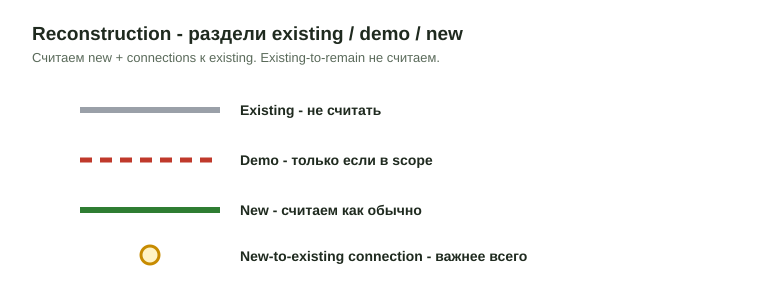

# Reconstruction (реконструкция)

Часть здания уже существует, часть сносится, часть добавляется. Главная
сложность: не посчитать весь дом как новый и не потерять места, где новый
каркас подключается к существующему.

<figure markdown>
  
  <figcaption markdown="span">Existing - не считать, Demo - только если в scope, New и connections - считаем.</figcaption>
</figure>

## Что это

Заказ на существующее здание: надстройка, перепланировка, замена перекрытий,
новые проёмы, ремонт кровли или porch. Scope приходит с пометкой вроде
`Frame. Interior trim and Int doors. NO metal` или `Revision`. Правила панелей
здесь не действуют на новые стены внутри existing frame:
[Wall Panels](../work/vertical/walls/wall-panels.md#reconstruction-existing).

## Чем отличается

| | Новое строительство | Reconstruction |
| --- | --- | --- |
| План этажа | Весь план мерный | План существующего этажа часто только контекст; мерить по new work plan |
| Стены | По wall schedule | Только `New`, `Replace`, `Patch`; `Existing to remain` не считать |
| Панели | Возможны | Новые стены внутри existing frame всегда stick |
| Главное | Полнота | Соединения new-to-existing: ledgers, straps, anchors, hangers |

## Что считать и что нет

**Считать:** new walls, openings, перекрытия и кровля, показанные как new;
repair и rebuild зоны (rotten framing, replaced subfloor, patched roof, rebuilt
porch, new beams и posts); new connections (hangers, straps, anchors, bolts,
blocking, ledgers); bracing, если в structural notes; envelope: WRB, sheathing
patches, siding backing, insulation, flashing; новый subfloor поверх всего
существующего пола, если деталь так требует (старый пол накрывают целиком).

**Не считать:** existing framing без изменений; demo-only items без demo scope;
existing walls и openings, показанные для контекста; old joists и rafters с нотой
`existing to remain`; отделку при structural scope; стальные перегородки при
`NO metal` (нота `Metal Studs by others`).

## Как читать марки

| Mark на чертежах | Как читать | Что делать |
| --- | --- | --- |
| `Existing` / `E` | Уже построено | Не считать, если не показан repair или replacement |
| `Existing to remain` | Остаётся | Материал не добавлять; проверить только connection к new work |
| `Demo` / пунктир | Удаляется | Считать только при demo scope |
| `New` / толстая линия / keyed note | Новая работа | Считать как обычный material scope |
| `Replace in kind` | Заменить таким же | Считать replacement area или length, не весь existing run |
| `Patch` / `Repair` | Локальный ремонт | Только указанную зону, плюс нота |

## На что смотреть

| Где на чертежах | Что проверить |
| --- | --- |
| Cover, code, general notes | Что входит в remodel scope; тип конструкции |
| Demo plans | Что удаляется и что остаётся |
| New work plans | Где реально появляется new framing |
| Structural details | Connections to existing: ledgers, straps, anchors, sistering |
| Elevations, sections | Изменения высот, roof tie-ins, зоны перестройки стен |
| Keynotes | Patch, repair, replace, которые не видны на плане |
| Photos, field notes | Existing condition, если чертежи неполные |

- Сначала легенда: line weights, пунктир, hatch, keynote symbols.
- Opening переносится или расширяется: header, king/jack studs, sill, sheathing patch.
- Existing roof или floor вскрывается: temporary support, sistering, scab, reinforcement.
- Старые сечения не равны новым: не предполагать `2x10`, если деталь показывает actual existing member.
- Если чертежи показывают только область ремонта, не умножать её на весь этаж.

## Частые items

| Item | Когда появляется | Проверить |
| --- | --- | --- |
| Ledgers | New floor, deck или roof к existing wall | Размер, крепёж, P.T. или FRT, шаг |
| Hangers | New joists к existing beam, wall, ledger | Top mount или face mount, skew, ширина |
| Blocking | Edge support, drywall backing, roof или floor patch | New или existing? |
| Sistered joists, rafters | Усиление existing member | Длина, число, сторона, крепёж |
| New headers | Новые и расширенные проёмы | Plies, LVL или 2x, bearing |
| Anchor bolts, straps | New wall или ledger к existing concrete или framing | Материал, шаг, embed по детали |
| Sheathing patch | Ремонт стены, кровли, пола | Толщина, FRT, Zip, OSB; одна сторона или две |
| New subfloor | Деталь "new subfloor over existing" | Вся площадь нового слоя |

## Частые ошибки

- Demo plan принят за material takeoff.
- Patch зона растянута на весь этаж.
- Новый subfloor поверх старого пола пропущен ("он же есть").
- Стальные перегородки посчитаны при `NO metal` или не отмечены нотой.
- Все ошибки по стенам - [Частые ошибки](../start/common-mistakes.md#walls).

## Ноты в DFL

- `Existing framing to remain - not counted.`
- `Counted new work only per shaded/keyed repair area.`
- `Header counted only at enlarged opening.`
- `Ledger and hangers counted at new-to-existing connection per <деталь>.`
- `Demo shown for context only - no demo material counted.`
- `Metal Studs by others.`

## См. также

- [Wall Panels](../work/vertical/walls/wall-panels.md), [Exterior Walls](../work/vertical/walls/exterior.md)
- [Headers](../work/vertical/openings/headers.md), [Hangers](../reference/hangers.md)
- [Правила клиентов и типов заказов](../start/client-rules.md)
