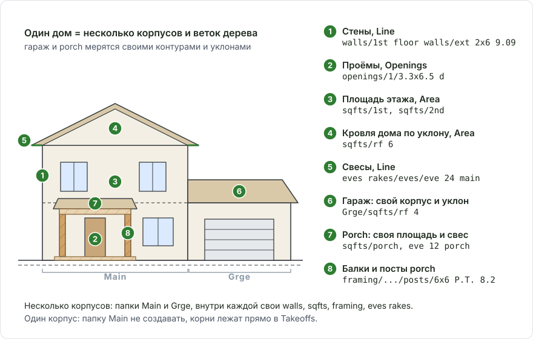
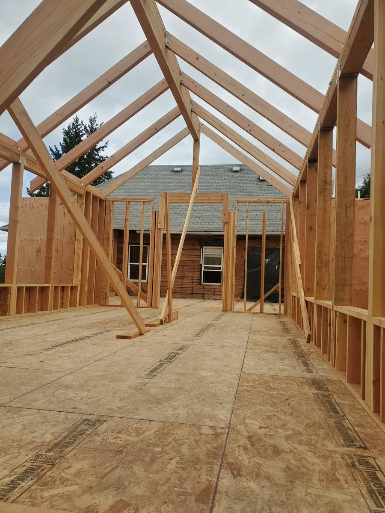

# Residential

A single-family house, duplex or townhouse: one or two buildings, a garage, a porch, often
wood walls for the full height and regular stick framing.

<figure markdown>
  
  <figcaption markdown="span">Walls + openings, floor/roof framing, sheathing, SQFT, roof/deck/porch. Same order as in the "Work" menu.</figcaption>
</figure>

<figure markdown>
  { width="420" }
  <figcaption markdown="span">Residential at the framing stage: 2x walls with sheathing at the corners, rafters on a ridge beam, OSB floor decking, temporary braces. All of this is the regular full scope: walls, openings, floor and roof framing, sheathing. Photo: threediamondsconstruction.com, [source](http://threediamondsconstruction.com/), found via Pinterest.</figcaption>
</figure>

## What it is

A residential full-framing job. Unlike COM, there are usually no corridors,
demising walls, shafts or panels; instead there is almost always a garage, porch, balcony or
deck with its own outlines and roof pitches. Scope is most often `Frame` or
`Frame. EWP by others`.

## How it differs from COM

| | Residential | COM |
| --- | --- | --- |
| Walls | ext and partitions with no prefix, bearing walls as `BW` | ext, corridor, demising, unit, shaft |
| Panels | Rarely | Often (`COM w/panel`) |
| Floor framing | Joists and beams per the framing plan, EWP per the specification | Same, plus fire hangers, firewall |
| Roofing | Trusses or rafters, overframes, dormers | Flat roof, parapets, piggyback trusses |
| Buildings | House, garage, sometimes an ADU | Several buildings, a workbook per building |

## What to count and what not

**Count:** walls per the wall schedule, openings, sheathing and WRB, areas by
floor, joists, beams, posts, headers, details, stairs, roofing by pitch,
eaves and rakes, truss heel, gables, deck / porch / balcony, hardware if shown.

**Do not count:** trusses (by others, note in the header), nails, interior gypsum and
interior insulation, trim not in scope. With `EWP by others`, also I-joists,
LVL and engineered rim - [EWP by others](ewp-capital.md#ewp-by-others).

## What to look at

- Structural and Arch give different wall sizes: structural wins, record the discrepancy with a note.
- Exact stud heights from the section, if the schedules differ by floor.
- Shaft walls in a duplex or townhouse (between units): demising with gypsum,
  attic draft stop.
- Exterior sheathing against the energy and Zip notes.
- Overframes, canopy, dormers, truss heel: their own areas and rows.
- Garage, porch, porte cochere: their own outlines and pitches, they do not inherit from the main house.
- EWP per the specification (TJI series as shown), not out of habit.

## Common mistakes

- Garage roof pitch taken from the main house.
- Exterior posts (porch, deck) not P.T.; posts under the roof recorded as P.T.
- Hangers outside without Zmax.
- Balcony and porch counted as one block.
- All mistakes by section: [Common mistakes](../start/common-mistakes.md#roof),
  [deck and porch](../start/common-mistakes.md#deck).

## Example

```text
Takeoffs/
  Main/
    walls/1st floor walls/ext 2x6 9.09
    walls/1st floor walls/2x4 9.09
    sqfts/1st, sqfts/rf 6, sqfts/porch
    framing/1st floor framing/beams/FB1 8
    eves rakes/eves/eve 24 main
  Grge/
    walls/1st floor walls/ext 2x6 10.0
    sqfts/rf 4, sqfts/flat grge
```

## See also

- [COM Commercial](com.md), [Reconstruction](reconstruction.md), [EWP / Capital](ewp-capital.md)
- [Client and job type rules](../start/client-rules.md)
- [Takeoff tree](../start/takeoff-structure.md), [Workflow](../start/workflow.md)
