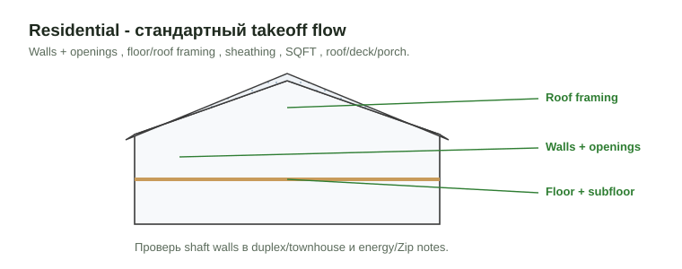
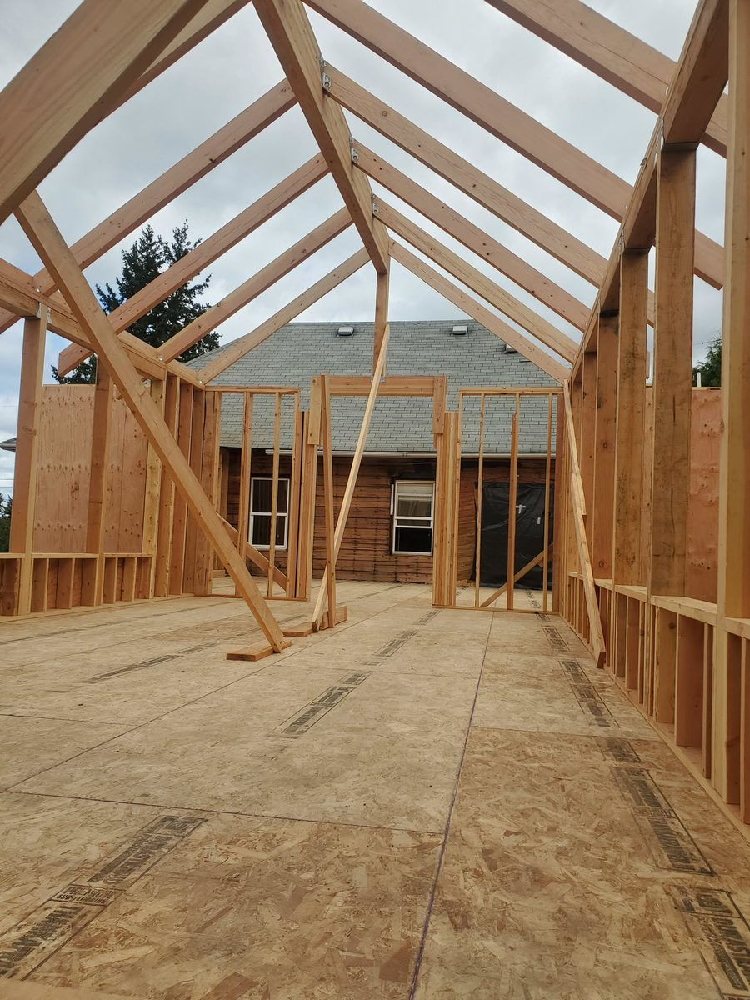

# Residential (жилой дом)

Отдельный дом, дуплекс или таунхаус: один-два корпуса, гараж, porch, часто
деревянные стены по всей высоте и обычный стик-каркас.

<figure markdown>
  
  <figcaption markdown="span">Walls + openings, floor/roof framing, sheathing, SQFT, roof/deck/porch. Порядок тот же, что в меню "Работа".</figcaption>
</figure>

<figure markdown>
  { width="420" }
  <figcaption markdown="span">Residential в стадии каркаса: стены из 2x с обшивкой по углам, стропила на коньковой балке, настил пола OSB, временные раскосы. Всё это обычный полный scope: walls, openings, floor и roof framing, sheathing. Фото: threediamondsconstruction.com, [источник](http://threediamondsconstruction.com/), найдено через Pinterest.</figcaption>
</figure>

## Что это

Жилой заказ по полному каркасу. В отличие от COM здесь обычно нет коридоров,
demising-стен, шахт и панелей; зато почти всегда есть гараж, porch, балкон или
deck со своими контурами и уклонами кровли. Scope чаще всего `Frame` или
`Frame. EWP by others`.

## Чем отличается от COM

| | Residential | COM |
| --- | --- | --- |
| Стены | ext и перегородки без префикса, bearing walls как `BW` | ext, corridor, demising, unit, shaft |
| Панели | Редко | Часто (`COM w/panel`) |
| Перекрытия | Joists и балки по framing plan, EWP по спецификации | То же плюс fire hangers, firewall |
| Кровля | Фермы или rafters, overframes, dormers | Flat roof, parapets, piggyback trusses |
| Корпуса | Дом, гараж, иногда ADU | Несколько корпусов, книги по корпусам |

## Что считать и что нет

**Считать:** стены по wall schedule, проёмы, обшивка и WRB, площади по
этажам, joists, beams, posts, headers, details, лестницы, кровля по уклонам,
eaves и rakes, truss heel, gables, deck / porch / balcony, крепёж, если показан.

**Не считать:** фермы (by others, нота в шапке), гвозди, внутренний гипс и
внутренний утеплитель, отделку без scope. При `EWP by others` ещё I-joists,
LVL и engineered rim - [EWP by others](ewp-capital.md#ewp-by-others).

## На что смотреть

- Structural и Arch дают разные размеры стен: structural главнее, расхождение нотой.
- Exact stud heights по разрезу, если schedule отличаются по этажам.
- Shaft walls в дуплексе или таунхаусе (между юнитами): demising с gypsum,
  draft stop на чердаке.
- Наружная обшивка против energy и Zip notes.
- Overframes, canopy, dormers, truss heel: свои площади и строки.
- Гараж, porch, porte cochere: свои контуры и уклоны, не наследуют основной дом.
- EWP по спецификации (TJI серия как показана), не по привычке.

## Частые ошибки

- Уклон кровли гаража взят с основного дома.
- Posts на улице (porch, deck) не P.T.; posts под крышей записаны P.T.
- Hangers снаружи без Zmax.
- Балкон и porch посчитаны одним блоком.
- Все ошибки по разделам - [Частые ошибки](../start/common-mistakes.md#roof),
  [deck и porch](../start/common-mistakes.md#deck).

## Пример

```text
Takeoffs/
  Main/
    walls/1st floor walls/ext 2x6 9.09
    walls/1st floor walls/2x4 9.09
    sqfts/1st, sqfts/rf 6, sqfts/porch
    framing/1st floor framing/beams/FB1 8
    eves rakes/eves/eve 24 main
  Grge/
    walls/1st floor walls/ext 2x6 10.0
    sqfts/rf 4, sqfts/flat grge
```

## См. также

- [COM Commercial](com.md), [Reconstruction](reconstruction.md), [EWP / Capital](ewp-capital.md)
- [Правила клиентов и типов заказов](../start/client-rules.md)
- [Дерево takeoff](../start/takeoff-structure.md), [Процесс работы](../start/workflow.md)
