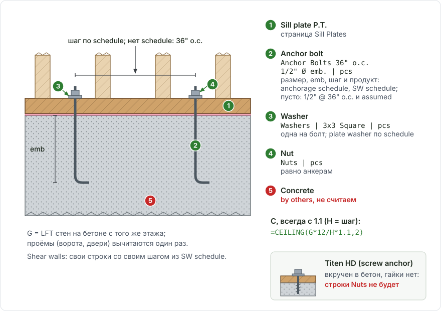

# Anchor Bolts

<figure markdown>
  { width="520" }
  <figcaption markdown="span">Foundation corner: P.T. sill plate on sill seal, anchors through the board with a washer and nut. Three DFL rows: `Anchor Bolts` at the spacing from the anchorage schedule, `Washers` and `Nuts` by the number of bolts. Photo: hunker.com, [source](https://www.hunker.com/13715964/what-is-a-sill-plate), found via Pinterest.</figcaption>
</figure>

<figure markdown>
  
  <figcaption markdown="span">An anchor bolt with washer and nut fastens the P.T. plate to concrete. Size, embedment and spacing come from the anchorage schedule and the SW schedule; if the plans give nothing, use the default `1/2" Ø` at 36" o.c. (below).</figcaption>
</figure>

## What it is

This page sits in the Deck section, but almost all of it is about sill plate anchors
to the foundation: the `Anchor Bolts` and `Washer` rows of the Foundation Walls block
that fasten the bottom plate to concrete or masonry. Ledger fasteners for balconies and
porches and through bolts at beam-to-post connections are the last rows of the table,
with links. General rules for bolts and screws are on the
[Bolts](../horizontal/floor-framing/details/bolts.md) page; holdown anchors are on
[Shear Wall](../vertical/sheathing/shear-wall.md).

## Where to find it on the plans

| Sheet | What to take |
| --- | --- |
| Sill and sole plate anchorage schedule (S0.x, S5xx), S general notes | Diameter, length, embedment (`emb`), spacing, product (Titen HD, wedge anchor, cast-in J-bolt) by wall type; plate washer |
| Shear Wall Schedule | Its own anchor spacing under each SW mark, often tighter than typical |
| Balcony and porch ledger details (S3xx) | Through bolts or screws, spacing, washers |
| S general notes | Hilti or another product by others, minimum embedment |

Size, embedment and spacing are read again on every job from the S notes or the
anchorage schedule. Only when the plans give nothing: the [default](#default)
(`1/2" Ø emb.`, 36" o.c.), `assumed` in E and the note
`Note: Anchor Bolts 1/2" Ø @ 36" o.c. assumed; verify`.

## How to measure in OurPlanCore

The anchor line length equals the LFT of walls on concrete on the same floor
(`walls/<floor>`, F point for the foundation). Openings in this line (overhead doors,
doors) are deducted once. Ledger: the ledger length from the balcony or
porch block. Spacing and anchor type are not needed in the name; they live in the DFL.

## Default when the plans have no anchorage schedule { #default }

The default is used only when neither the anchorage schedule nor the S notes give
an anchor:

| DFL row | B (spec) | H (spacing) | E | Formula C |
| --- | --- | --- | --- | --- |
| `Anchor Bolts 36" o.c.` | `1/2" Ø emb.` | `36` | `assumed` | `=CEILING(G*12/H*1.1,2)` |
| `Washer 36" o.c.` | `3x3 Square` | | | same formula: one washer per bolt |

Under the block header goes the note `Note: Anchor Bolts 1/2" Ø @ 36" o.c. assumed;
verify`. G is the length of walls on concrete. The DFL template has
`5/8" Ø x 6" emb. Titen HD` at 48" o.c. in these rows: that is a template placeholder,
not a default. It is always replaced with the job data or with the default from the
table above. Shear walls get their own rows with their own spacing from the SW
schedule; the default does not apply to them.

## Tree name and DFL row

| DFL row | B (spec) | Unit | Formula and rule |
| --- | --- | --- | --- |
| `Anchor Bolts 48" o.c.` | as in the S notes or schedule: `5/8" Ø Titen HD 4" emb.` | pcs | `=CEILING(G*12/H*1.1,2)`; H = spacing, it prints in the label; G = exterior walls on concrete; E = sheet and `for Ext Walls` |
| `Anchor Bolts 48" o.c.` (second row) | same anchor | pcs | same formula; G = corridor and demising walls of the 1st floor; E `for Corr and Demising` |
| `SW Anchor Bolts 16" o.c.` | per the SW schedule | pcs | same formula; G = LFT of that SW mark on concrete, E = the mark; this length is deducted from G of the general row |
| `Washer 48" o.c.` | `3x3 Square`; when the schedule names a plate washer, its model (`BP 5/8-3`, `BPS 1/2-3`) | pcs | same count as the anchors above it (with 1.1); when the building has one spacing |
| `Washers` | same | pcs | when there are SW rows: one row per group, `=SUM(C of all anchors in the group)` |
| `Nuts` | by anchor diameter | pcs | only for anchors that take a nut (cast-in J-bolt, wedge anchor), equal to the anchors; a Titen HD has no nut and no row |
| `Through Bolts (4)` (beam-to-post, ledger in the balcony block) | `1/2" Ø x 10" Bolt` per detail | pcs | bolts per connection x connections x units; `Washers` 2 per bolt, `Nuts` 1 per bolt in their own rows |

- The 1.1 waste is in the anchor and washer formula always, no exceptions. Round
  up to an even number.
- Spacing, size and product in every row come from the plans of this job; washers
  per the schedule, `3x3 Square` only when the schedule names no plate washer.
- A Titen HD is a screw anchor: it has no nut. The block of four rows (Blocking,
  Anchor Bolts, Washers, Nuts) is inserted by the `B_BoltsAdd` macro, see
  [Excel macro hotkeys](../../reference/excel-hotkeys.md); with a Titen HD delete the
  `Nuts` row.
- B format: diameter, length or embedment, product, as printed on the sheet
  (`5/8" Ø x 7" emb`, `1/2" Ø x 4" emb Titen HD`); general rules for writing
  hardware are in [Hangers: how to write hardware in the DFL](../../reference/hangers.md#dfl-format).
- Holdown anchors are counted in the holdowns block:
  [DFL blocks](../../reference/dfl-blocks.md#holdowns).

## Common mistakes

- One anchor spacing for the whole building without the SW schedule.
- Formula without 1.1, or fewer washers than anchors.
- The template placeholder `5/8" Titen HD` at 48" left in B although the plans give
  another anchor or give nothing (then `1/2" Ø` at 36" and `assumed`).
- A `Nuts` row for a Titen HD.
- Wedge anchor replaced with Titen HD with no basis in the detail.
- Openings not deducted from the anchor line, or deducted twice.
- Washers copied with the old spacing and not recalculated; `3x3` used when the
  schedule names a plate washer.
- Hilti by others counted as ours; the note must stay.
- All mistakes for the section: [Deck, porch, balconies](../../start/common-mistakes.md#deck), [Shear walls and holdowns](../../start/common-mistakes.md#holdowns).

## Example

```text
Exterior walls on concrete 194 LFT, of which SW1 is 24 LFT. Anchor and spacing per S0.2 and the SW schedule.

Anchor Bolts 48" o.c.      5/8" Ø Titen HD 4" emb.   48  pcs   S0.2; for Ext Walls   G = 194 - 24 = 170; 170 x 12/48 x 1.1 = 46.8
SW Anchor Bolts 16" o.c.   5/8" Ø Titen HD 4" emb.   20  pcs   SW1                   G = 24; 24 x 12/16 x 1.1 = 19.8
Washers                    3x3 Square                68  pcs   =SUM(C of anchors)    48 + 20
```

Titen HD: no `Nuts` row.

## See also

- [Bolts](../horizontal/floor-framing/details/bolts.md), [Sill Plates](../vertical/walls/sill-plates.md), [Shear Wall](../vertical/sheathing/shear-wall.md)
- [Deck / Porch / Balcony Frame](deck-porch-balcony-frame.md), [DFL blocks: holdowns](../../reference/dfl-blocks.md#holdowns), [Hangers](../../reference/hangers.md#dfl-format)
- [Hardware catalog](../../reference/hardware-catalog.md), [Standard notes](../../reference/standard-notes.md)
