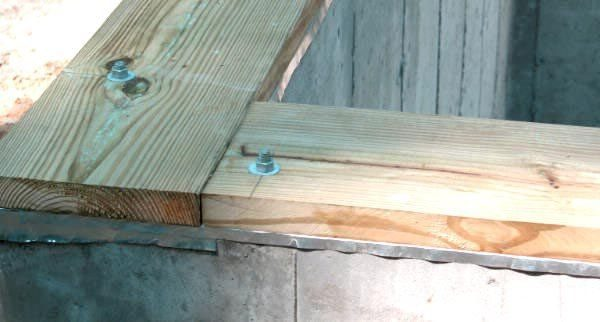

# Anchor Bolts

<figure markdown>
  { width="520" }
  <figcaption markdown="span">Foundation corner: P.T. sill plate on sill seal, anchors through the board with a washer and nut. Three DFL rows: `Anchor Bolts` at the spacing from the anchorage schedule, `Washers` and `Nuts` by the number of bolts. Photo: hunker.com, [source](https://www.hunker.com/13715964/what-is-a-sill-plate), found via Pinterest.</figcaption>
</figure>

<figure markdown>
  
  <figcaption markdown="span">An anchor bolt with washer and nut fastens the P.T. plate to concrete. Size, embedment and spacing come from the anchorage schedule and the SW schedule; if they are blank, use the template default (below).</figcaption>
</figure>

## What it is

Anchors for the bottom plate on concrete or masonry, ledger fasteners for balconies and porches to
the house, through bolts at beam-to-post connections. Each group is its own row: `Anchor
Bolts`, `Washers`, `Nuts`. General rules for bolts and screws are on the
[Bolts](../horizontal/floor-framing/details/bolts.md) page; holdown anchors are on
[Shear Wall](../vertical/sheathing/shear-wall.md).

## Where to find it on the plans

| Sheet | What to take |
| --- | --- |
| Sill and sole plate anchorage schedule (S0.x, S5xx) | Diameter, length, embedment (`emb`), spacing, product (Titen HD, wedge anchor, cast-in J-bolt) by wall type |
| Shear Wall Schedule | Its own anchor spacing under each SW mark, often tighter than typical |
| Balcony and porch ledger details (S3xx) | Through bolts or screws, spacing, washers |
| S general notes | Hilti or another product by others, minimum embedment |

Size, embedment and spacing come from the anchorage schedule. Schedule not
found: use the [template default](#default) (`1/2" Ø emb.`, 36" o.c.), put
`assumed` in E and the note `Note: Anchor Bolts 1/2" Ø @ 36" o.c. assumed; verify`.

## How to measure in OurPlanCore

The anchor line length equals the LFT of walls on concrete on the same floor
(`walls/<floor>`, F point for the foundation). Openings in this line (overhead doors,
doors) are deducted once. Ledger: the ledger length from the balcony or
porch block. Spacing and anchor type are not needed in the name; they live in the DFL.

## Default when the plans have no anchorage schedule { #default }

DFL template row (Foundation walls block):

| DFL row | B (spec) | H (spacing) | Formula C |
| --- | --- | --- | --- |
| `Anchor Bolts 36" o.c.` | `1/2" Ø emb.` | `36` | `=CEILING((G*12/36)*1.1, 2)` |
| `Washer 36" o.c.` | per detail, usually `3x3 Square` | `36` | same formula, one washer per bolt |

G - length of walls on concrete. Shear walls get their own rows with their own spacing from the
SW schedule; the default does not apply to them. If the sheets have an
anchorage schedule or notes with a size, they win over the default.

## Tree name and DFL row

| DFL row | B (spec) | Unit | Formula |
| --- | --- | --- | --- |
| `Anchor Bolts 48" o.c.` | `1/2" Ø x 4" emb Titen HD` | pcs | `=CEILING(G*12/48,2)`, E = `for Ext Walls` |
| `Anchor Bolts 32" o.c.` | per SW schedule, same format | pcs | a separate row for each spacing |
| `Washers` | `3x3` or plain per detail | pcs | equal to anchors |
| `Nuts` | | pcs | equal to anchors |
| `Through Bolts` (ledger, beam-to-post) | `1/2" Ø` per detail | pcs | spacing per detail, washers and nuts in their own rows |

B format: diameter, length or embedment, product, in that order
(`5/8" Ø x 7" emb`, `1/2" Ø x 4" emb Titen HD`); general rules for writing
hardware are in [Hangers: how to write hardware in the DFL](../../reference/hangers.md#dfl-format).
The block of four rows (Blocking, Anchor Bolts, Washers, Nuts) is inserted by the
`B_BoltsAdd` macro, see [Excel macro hotkeys](../../reference/excel-hotkeys.md).
Small hardware under 50 pieces is rounded up to an even number. Holdown anchors
are counted in the holdowns block: [DFL blocks](../../reference/dfl-blocks.md#holdowns).

## Common mistakes

- One anchor spacing for the whole building without the SW schedule.
- Wedge anchor replaced with Titen HD with no basis in the detail.
- Openings not deducted from the anchor line, or deducted twice.
- Washers copied with the old spacing and not recalculated.
- Hilti by others counted as ours; the note must stay.
- All mistakes for the section: [Deck, porch, balconies](../../start/common-mistakes.md#deck), [Shear walls and holdowns](../../start/common-mistakes.md#holdowns).

## Example

```text
Anchor Bolts 48" o.c.   1/2" Ø x 4" emb Titen HD   42  pcs   =CEILING(G*12/48,2)   for Ext Walls  S0.2
Anchor Bolts 32" o.c.   1/2" Ø x 4" emb Titen HD   18  pcs   SW1 per schedule       S502
Washers                 3x3                60  pcs   =C<bolts>
Nuts                                        60  pcs   =C<bolts>
```

## See also

- [Bolts](../horizontal/floor-framing/details/bolts.md), [Sill Plates](../vertical/walls/sill-plates.md), [Shear Wall](../vertical/sheathing/shear-wall.md)
- [Deck / Porch / Balcony Frame](deck-porch-balcony-frame.md), [DFL blocks: holdowns](../../reference/dfl-blocks.md#holdowns), [Hangers](../../reference/hangers.md#dfl-format)
- [Hardware catalog](../../reference/hardware-catalog.md), [Standard notes](../../reference/standard-notes.md)
