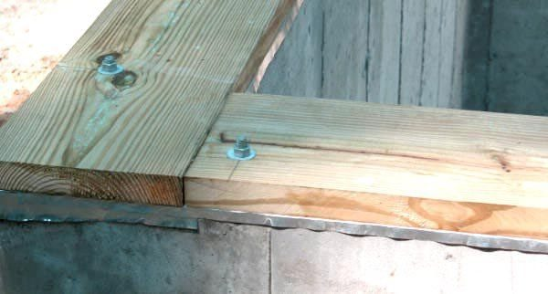
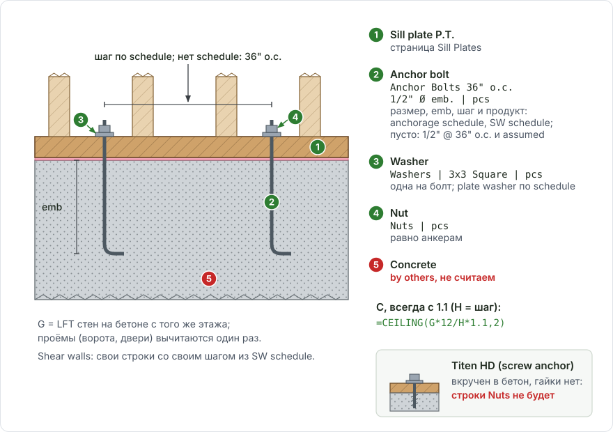

# Anchor Bolts (анкеры sill plate и крепёж ledger)

<figure markdown>
  { width="520" }
  <figcaption markdown="span">Угол фундамента: P.T. sill plate на sill seal, сквозь доску анкеры с шайбой и гайкой. Три строки DFL: `Anchor Bolts` по шагу из anchorage schedule, `Washers` и `Nuts` по числу болтов. Фото: hunker.com, [источник](https://www.hunker.com/13715964/what-is-a-sill-plate), найдено через Pinterest.</figcaption>
</figure>

<figure markdown>
  
  <figcaption markdown="span">Anchor bolt с washer и nut крепит P.T. plate к бетону. Размер, заглубление и шаг берутся из anchorage schedule и SW schedule; если на чертежах нет ничего, ставится дефолт `1/2" Ø` на 36" o.c. (ниже).</figcaption>
</figure>

## Что это

Страница стоит в разделе Deck, но почти вся она про анкеры sill plate к
фундаменту: строки `Anchor Bolts` и `Washer` блока Foundation Walls, которые
крепят нижнюю plate к бетону или кладке. Крепёж ledger балкона и porch и
through bolts узлов балка-пост - последние строки таблицы, со ссылками. Общие
правила по болтам и screws на странице
[Bolts](../horizontal/floor-framing/details/bolts.md); анкеры holdowns на
[Shear Wall](../vertical/sheathing/shear-wall.md).

## Где искать на чертежах

| Лист | Что взять |
| --- | --- |
| Sill and sole plate anchorage schedule (S0.x, S5xx), S general notes | Диаметр, длина, заглубление (`emb`), шаг, продукт (Titen HD, wedge anchor, cast-in J-bolt) по типу стены; plate washer |
| Shear Wall Schedule | Свой шаг анкеров под каждой маркой SW, часто чаще типового |
| Детали ledger балкона и porch (S3xx) | Through bolts или screws, шаг, washers |
| General notes S | Hilti или другой продукт by others, минимальное заглубление |

Размер, заглубление и шаг на каждом job заново читаются из S notes или
anchorage schedule. Только когда на чертежах нет ничего: [дефолт](#default)
(`1/2" Ø emb.`, 36" o.c.), в E `assumed` и нота
`Note: Anchor Bolts 1/2" Ø @ 36" o.c. assumed; verify`.

## Как мерить в OurPlanCore

Длина линии анкеров равна LFT стен на бетоне с того же этажа
(`walls/<этаж>`, точка F для фундамента). Проёмы в этой линии (ворота,
двери) вычитаются один раз. Ledger: длина ledger из блока балкона или
porch. Шаг и тип анкера в имени не нужны, они живут в DFL.

## Дефолт, если на чертежах нет anchorage schedule { #default }

Дефолт ставится только когда ни anchorage schedule, ни S notes не дают
анкер:

| Строка DFL | B (spec) | H (шаг) | E | Формула C |
| --- | --- | --- | --- | --- |
| `Anchor Bolts 36" o.c.` | `1/2" Ø emb.` | `36` | `assumed` | `=CEILING(G*12/H*1.1,2)` |
| `Washer 36" o.c.` | `3x3 Square` | | | та же формула: одна шайба на болт |

Под заголовком блока нота `Note: Anchor Bolts 1/2" Ø @ 36" o.c. assumed;
verify`. G - длина стен на бетоне. В шаблоне DFL в этих строках стоит
`5/8" Ø x 6" emb. Titen HD` на 48" o.c.: это заглушка шаблона, не дефолт.
Её всегда заменяют данными job или дефолтом из таблицы выше. Shear walls
получают свои строки со своим шагом из SW schedule, дефолт на них не
распространяется.

## Как назвать в дереве и строка DFL

| Строка DFL | B (spec) | Unit | Формула и правило |
| --- | --- | --- | --- |
| `Anchor Bolts 48" o.c.` | как в S notes или schedule: `5/8" Ø Titen HD 4" emb.` | pcs | `=CEILING(G*12/H*1.1,2)`; H = шаг, он печатается в подписи; G = наружные стены на бетоне; E = лист и `for Ext Walls` |
| `Anchor Bolts 48" o.c.` (вторая строка) | тот же анкер | pcs | та же формула; G = corridor и demising 1-го этажа; E `for Corr and Demising` |
| `SW Anchor Bolts 16" o.c.` | по SW schedule | pcs | та же формула; G = LFT этой марки SW на бетоне, E = марка; эта длина вычитается из G общей строки |
| `Washer 48" o.c.` | `3x3 Square`; schedule называет plate washer - его модель (`BP 5/8-3`, `BPS 1/2-3`) | pcs | то же число, что у анкеров над ней (с 1.1); при одном шаге на здание |
| `Washers` | то же | pcs | когда есть строки SW: одна строка на группу, `=SUM(C всех анкеров группы)` |
| `Nuts` | по диаметру анкера | pcs | только у анкеров с гайкой (cast-in J-bolt, wedge anchor), равно анкерам; у Titen HD гайки нет и строки нет |
| `Through Bolts (4)` (балка-пост, ledger в блоке балкона) | `1/2" Ø x 10" Bolt` по детали | pcs | болтов на узел x узлов x units; `Washers` 2 на болт, `Nuts` 1 на болт своими строками |

- Запас 1.1 стоит в формуле анкеров и шайб всегда, без исключений. Округление
  вверх до чётного.
- Шаг, размер и продукт в каждой строке - с чертежей этого job; шайбы - по
  schedule, `3x3 Square` только когда schedule не называет plate washer.
- Titen HD - screw anchor: гайки у него нет. Блок из четырёх строк (Blocking,
  Anchor Bolts, Washers, Nuts) вставляет макрос `B_BoltsAdd`, см.
  [Excel macro hotkeys](../../reference/excel-hotkeys.md); при Titen HD строку
  `Nuts` удали.
- Формат B: диаметр, длина или заглубление, продукт, как напечатано на листе
  (`5/8" Ø x 7" emb`, `1/2" Ø x 4" emb Titen HD`); общие правила записи
  крепежа в [Hangers: как записывать крепёж в DFL](../../reference/hangers.md#dfl-format).
- Анкеры holdowns считаются в блоке holdowns:
  [Блоки DFL](../../reference/dfl-blocks.md#holdowns).

## Частые ошибки

- Один шаг анкеров на всё здание без SW schedule.
- Формула без 1.1, или шайб меньше, чем анкеров.
- В B осталась заглушка шаблона `5/8" Titen HD` на 48", хотя чертежи дают
  другой анкер или не дают ничего (тогда `1/2" Ø` на 36" и `assumed`).
- Строка `Nuts` у Titen HD.
- Wedge anchor заменён на Titen HD без основания в детали.
- Проёмы не вычтены из линии анкеров, или вычтены дважды.
- Washers скопированы со старым шагом и не пересчитаны; `3x3` поставлены при
  plate washer в schedule.
- Hilti by others посчитаны как наши; нота обязана остаться.
- Все ошибки раздела: [Deck, porch, балконы](../../start/common-mistakes.md#deck), [Shear walls и holdowns](../../start/common-mistakes.md#holdowns).

## Пример

```text
Наружные стены на бетоне 194 LFT, из них SW1 24 LFT. Анкер и шаг по S0.2 и SW schedule.

Anchor Bolts 48" o.c.      5/8" Ø Titen HD 4" emb.   48  pcs   S0.2; for Ext Walls   G = 194 - 24 = 170; 170 x 12/48 x 1.1 = 46.8
SW Anchor Bolts 16" o.c.   5/8" Ø Titen HD 4" emb.   20  pcs   SW1                   G = 24; 24 x 12/16 x 1.1 = 19.8
Washers                    3x3 Square                68  pcs   =SUM(C анкеров)       48 + 20
```

Titen HD: строки `Nuts` нет.

## См. также

- [Bolts](../horizontal/floor-framing/details/bolts.md), [Sill Plates](../vertical/walls/sill-plates.md), [Shear Wall](../vertical/sheathing/shear-wall.md)
- [Deck / Porch / Balcony Frame](deck-porch-balcony-frame.md), [Блоки DFL: holdowns](../../reference/dfl-blocks.md#holdowns), [Hangers](../../reference/hangers.md#dfl-format)
- [Hardware catalog](../../reference/hardware-catalog.md), [Standard notes](../../reference/standard-notes.md)
