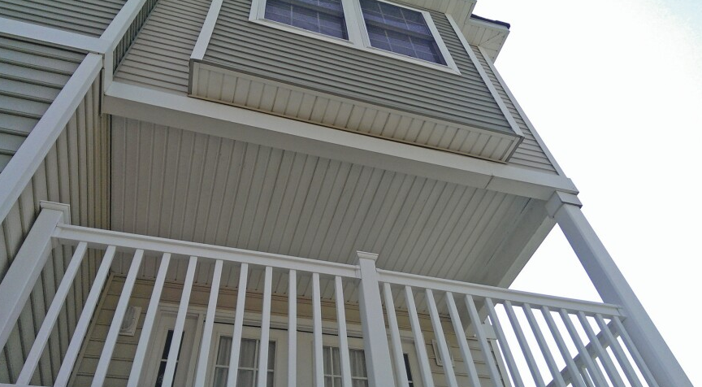

# Balcony Trims

<figure markdown>
  
  <figcaption markdown="span">Fascia and edge trim along the open sides of the balcony, soffit underneath, flashing at the wall. Counted only when trim is in scope.</figcaption>
</figure>

## What it is

A short pointer page. The finish rows of a balcony block (post wrap, EPDM, decking,
soffit underneath, fascia and edge trim, flashing at the wall), with all formulas and
an example, are covered on one page:
[Balcony build-up](../exterior-trims/balcony-buildup.md). The block frame is on
[Deck / Porch / Balcony Frame](deck-porch-balcony-frame.md), the railing on
[Railing](railing.md). This page holds only what is not there.

## Where to find it on the plans

| Sheet | What to take |
| --- | --- |
| Balcony section A4xx, details A5xx | Fascia, soffit (beadboard), flashing, post wrap: material and size |
| Elevations | Visible trims, color and profile, what is hidden by the railing, whether the post is wrapped |
| Job scope | Frame only: do not insert trim at all |

## How to measure in OurPlanCore

Balcony trim usually needs no takeoffs of its own: lengths and areas come from
the block size W x D and the multiplier G, as for railing. The soffit underneath is traced
as an Area only when the balcony outline is not a rectangle.

## Tree name and DFL row

The table of rows, units and formulas: [Balcony build-up](../exterior-trims/balcony-buildup.md).
Additions to it:

- Trim follows the block frame under its own header and only when trims are in
  scope; with Frame only the block ends with the frame.
- Write `Post Wrap` only when the elevation or a detail shows a wrapped post.
  Four boards per post: G = post height x 4 sides x number of posts. Board
  width = post face plus two board thicknesses: a 6x6 post takes `1x8`, a 4x4 post
  takes `1x6`. Wrap not detailed: `assumed` in E.
- Gypsum or metal soffit underneath by others: no `Soffits at Balcony`
  row, a note stays.
- Size not specified: `TBD` in the material and the note `Note: All trims to be verified.
  Scaled per elevations`.

## Common mistakes

- Balcony trims dissolved into the general `Exterior Trims` without their own row.
- Frame rows (sleepers, joists) written into the trims block.
- Trim inserted when the scope is Frame only.
- All mistakes for the section: [Deck, porch, balconies](../../start/common-mistakes.md#deck).

## See also

- [Balcony build-up](../exterior-trims/balcony-buildup.md) (canonical layers)
- [Porch / Deck / Balcony](../exterior-trims/porch-deck-balcony.md), [Rails & Decking](../exterior-trims/rails-decking.md)
- [Deck / Porch / Balcony Frame](deck-porch-balcony-frame.md), [Railing](railing.md)
