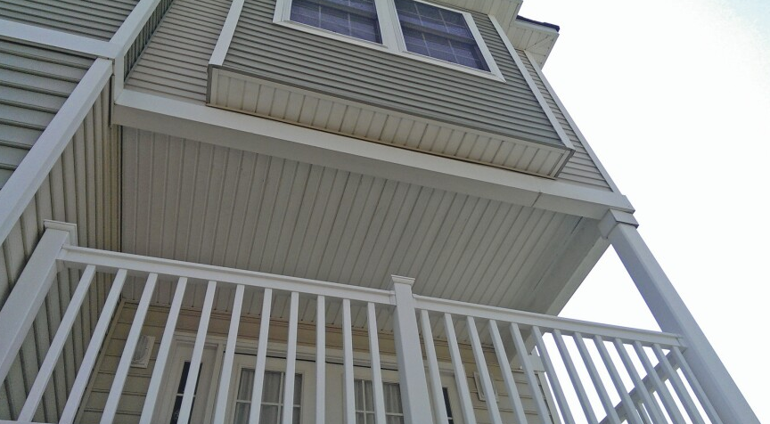

# Balcony Trims (отделка балкона в блоке)

<figure markdown>
  
  <figcaption markdown="span">Fascia и edge trim по открытым сторонам балкона, soffit снизу, flashing у стены. Считаем только когда отделка в scope.</figcaption>
</figure>

## Что это

Короткий указатель. Finish-строки балконного блока (post wrap, EPDM, decking,
soffit снизу, fascia и edge trim, flashing у стены) со всеми формулами и
примером описаны на одной странице:
[Balcony build-up](../exterior-trims/balcony-buildup.md). Каркас блока - на
[Deck / Porch / Balcony Frame](deck-porch-balcony-frame.md), перила - на
[Railing](railing.md). Здесь только то, чего там нет.

## Где искать на чертежах

| Лист | Что взять |
| --- | --- |
| Разрез балкона A4xx, детали A5xx | Fascia, soffit (beadboard), flashing, post wrap: материал и размер |
| Elevations | Видимые trims, цвет и профиль, что закрыто перилами, обшит ли пост |
| Scope задания | Frame only: отделку не вставлять вообще |

## Как мерить в OurPlanCore

Отдельных замеров отделке балкона обычно не нужно: длины и площади берутся из
размеров блока W x D и множителя G, как у перил. Soffit снизу обводят Area
только когда контур балкона не прямоугольник.

## Как назвать в дереве и строка DFL

Таблица строк, единиц и формул: [Balcony build-up](../exterior-trims/balcony-buildup.md).
Дополнения к ней:

- Отделка стоит за каркасом блока под своим заголовком и только когда trims в
  scope; при Frame only блок заканчивается каркасом.
- `Post Wrap` пишем только когда фасад или деталь показывают обшитый пост.
  Четыре доски на пост: G = высота поста x 4 стороны x число постов. Ширина
  доски = грань поста плюс две толщины доски: пост 6x6 это `1x8`, пост 4x4
  это `1x6`. Обшивка не детализирована: в E `assumed`.
- Soffit снизу из гипса или металла by others: строки `Soffits at Balcony`
  нет, остаётся нота.
- Размер не указан: `TBD` в материале и нота `Note: All trims to be verified.
  Scaled per elevations`.

## Частые ошибки

- Balcony trims растворены в общем `Exterior Trims` без своей строки.
- Строки каркаса (sleepers, joists) записаны в блок trims.
- Отделка вставлена при scope Frame only.
- Все ошибки раздела: [Deck, porch, балконы](../../start/common-mistakes.md#deck).

## См. также

- [Balcony build-up](../exterior-trims/balcony-buildup.md) (канон слоёв)
- [Porch / Deck / Balcony](../exterior-trims/porch-deck-balcony.md), [Rails & Decking](../exterior-trims/rails-decking.md)
- [Deck / Porch / Balcony Frame](deck-porch-balcony-frame.md), [Railing](railing.md)
