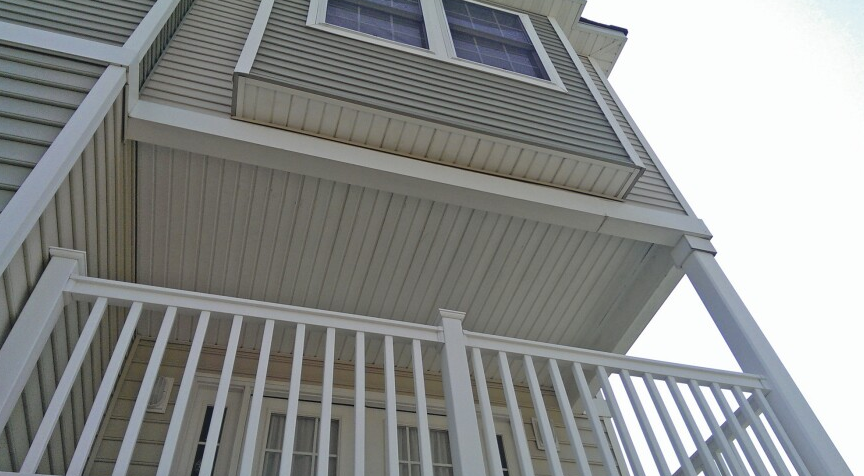

# Balcony Trims (отделка балкона в блоке)

<figure markdown>
  
  <figcaption markdown="span">Fascia и edge trim по открытым сторонам балкона, soffit снизу, flashing у стены. Считаем только когда отделка в scope.</figcaption>
</figure>

## Что это

Finish-строки балконного блока: fascia и edge trim по периметру, soffit
снизу, post wrap, flashing у стены. Полная карта слоёв от каркаса до
отделки на канонической странице
[Balcony build-up](../exterior-trims/balcony-buildup.md); каркас на
[Deck / Porch / Balcony Frame](deck-porch-balcony-frame.md).

## Где искать на чертежах

| Лист | Что взять |
| --- | --- |
| Разрез балкона A4xx, детали A5xx | Fascia, soffit (beadboard), flashing, post wrap: материал и размер |
| Elevations | Видимые trims, цвет и профиль, что закрыто перилами |
| Scope задания | Frame only: отделку не вставлять вообще |

## Как мерить в OurPlanCore

Длины и площади берутся из размеров блока W x D и множителя G, как у
перил. Soffit снизу балкона это Area по реальному контуру только когда
контур не прямоугольник; обычно хватает W x D.

## Как назвать в дереве и строка DFL

| Строка DFL | Материал | Unit | Правило |
| --- | --- | --- | --- |
| `Balcony Trims` / `Fascia` | `1x10`, `5/4x8` | LFT | открытые стороны: `=(W+2*D)*G` |
| `Soffits at Balcony` | `Beadboard` | SQ FT | `=W*D*G` |
| `Post Wrap` | `1x8` | LFT | по высоте поста x 4 стороны |
| `Flashings at Wall` | `Copper` / drip edge | LFT | по стене, `=W*G` |

Размер не указан: `TBD` в материале и нота `Note: All trims to be verified.
Scaled per elevations`.

## Частые ошибки

- Balcony trims растворены в общем `Exterior Trims` без своей строки.
- Строки каркаса (sleepers, joists) записаны в блок trims.
- Отделка вставлена при scope Frame only.
- Все ошибки раздела: [Deck, porch, балконы](../../start/common-mistakes.md#deck).

## См. также

- [Balcony build-up](../exterior-trims/balcony-buildup.md) (канон слоёв)
- [Porch / Deck / Balcony](../exterior-trims/porch-deck-balcony.md), [Rails & Decking](../exterior-trims/rails-decking.md)
- [Deck / Porch / Balcony Frame](deck-porch-balcony-frame.md), [Railing](railing.md)
