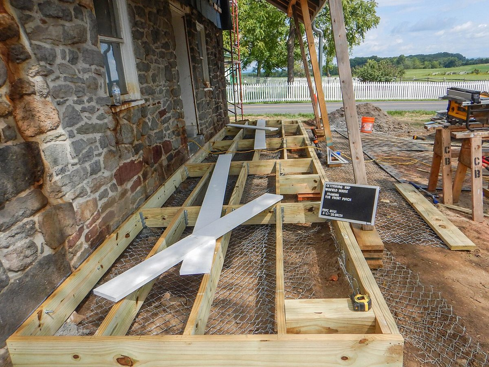
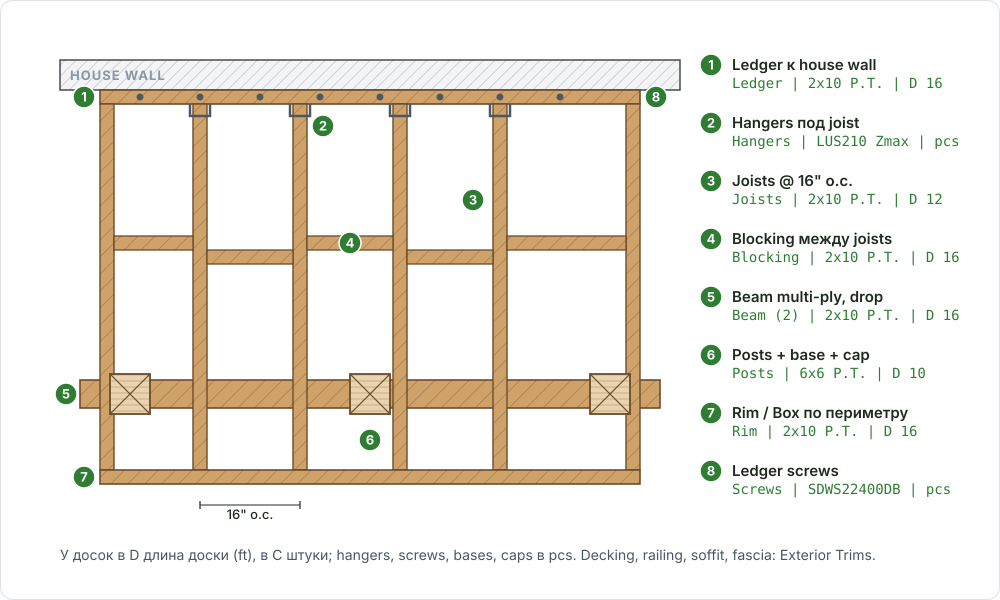
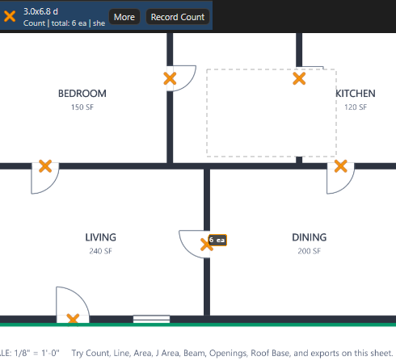
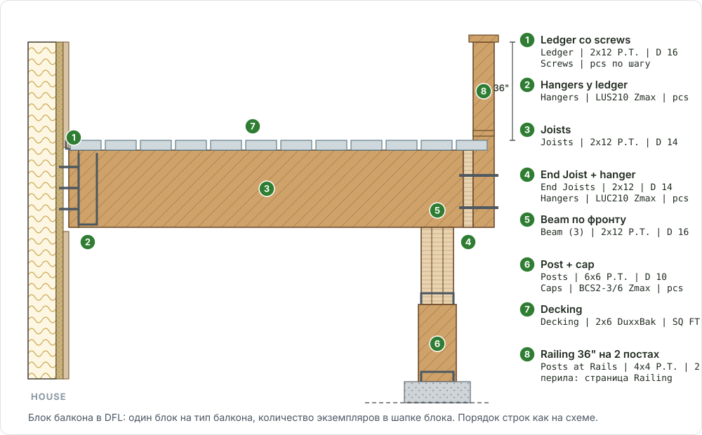

# Deck / Porch / Balcony Frame

<figure markdown>
  
  <figcaption markdown="span">Porch deck framing: P.T. ledger at the house wall, joists with hangers, rim around the perimeter, posts. Each element is its own row in the DFL. Photo: NPS Photo, public domain, [source](https://commons.wikimedia.org/wiki/File:Framing_for_the_front_porch_deck_is_being_installed._%28defb68bd-1bfc-4ad2-bacf-bbdd675758c9%29.jpg)</figcaption>
</figure>

<figure markdown>
  
  <figcaption markdown="span">Framing plan: ledger to the building, joists and hangers, beam on posts, rim and blocking. Units: posts, beam and joists in pieces with the board length in D, hangers pcs.</figcaption>
</figure>

## What it is

The structural frame of open platforms: posts with base and cap, beams, ledger,
box or rim, joists with hangers, blocking, sleepers, structural subfloor,
stringers. A **balcony** sits at an upper-floor wall on posts or cantilevered;
a **porch** is a covered entry with a roof and ceiling (ceiling joists); a **deck**
is a platform near grade on posts. Finish (decking as a finish, soffit, trims,
railing by type) lives on the
[Balcony build-up](../exterior-trims/balcony-buildup.md) and
[Rails & Decking](../exterior-trims/rails-decking.md) pages; this page covers only the structure.

## Where to find it on the plans

| Sheet | What to take |
| --- | --- |
| Floor plans A1xx | Balcony doors (tag), W x D size of each type, how many and on which floors |
| S floor framing plans | Deck joist callout (size, spacing), beam marks B1..B5, posts |
| Sections A4xx and details S3xx/S6xx | Ledger and its fasteners, post cap and base, hangers, End Joists, flush or dropped beam |
| Post and hardware schedule (S6xx) | Cap model by number of plies, base, through bolts |
| Roof plan and porch section | Porch roof, ceiling joists, ceiling (gypsum), whether there is framing at all |

A door with no wood joist callout on the S plan usually means concrete or
trusses under the balcony (a terrace over the garage). That is a separate block, not a copy
of the wood one.

## How to measure in OurPlanCore

1. Area: `sqfts/blcny` and `sqfts/porch`, Area tool along the real
   outline on the sheet with the W point. Do not join different balconies with a bridge;
   do not draw a rectangle to hit a known number.
2. Blocks: one Count item per balcony **type** in the `Balcony blocks` folder
   (porch in `Porch blocks`), a point for every instance. Item name
   `#4 Balcony 12.9x7.83 (2GZO x7)`, where `x7` equals the number of points; the point Notes
   hold the unit tag, side and floor (`2GZO S 2nd fl`). The points go on copies
   of the plan sheets (`a120 balcony`), the working plans stay clean. The number of points
   equals the multiplier G in the block header in Excel.
3. Counting instances: balcony doors on the plans multiplied by floors,
   checked against the deck joist callout on the S plans.
4. **Count porches separately from the plans**, do not mirror them from the balconies: the number
   of blocks, sizes and porch count usually do not match the balconies.
5. Connections with a detail number (`5/S311`) are counted as a Line item in
   `framing/<floor>/details`, one item per detail; see
   [Framing details](../horizontal/floor-framing/details/rim.md).

<figure markdown>
  
  <figcaption markdown="span">Count with points: one point for every balcony instance; the item name carries the type, size and number of instances.</figcaption>
</figure>

<figure markdown>
  
  <figcaption markdown="span">Balcony at the wall: ledger with screws, P.T. joists on Zmax hangers, end joist, beam on a post with a cap, decking and railing. Every callout is a block row in the DFL.</figcaption>
</figure>

## Tree name and DFL row

Block header: `#N Upper Balcony List W' x D' <G> unit`; porch
`#N Porch Framing List W' x D'`, A:B fill green `99CC00`; a ground deck frame
must have the words `Deck` and `Frame` or `Framing`. The group sits inside Framing;
decking, railing and trims follow the frame under their own headers, notes go under the
header: [File format, groups](../../reference/dfl-overview.md#groups). Zero rows
and empty template rows are deleted. Full block content with formulas:
[DFL blocks](../../reference/dfl-blocks.md).

In the formulas W and D are the width and depth of one balcony in feet, G is the number
of instances from the block header. For boards (posts, beam, ledger, box, joists)
column D holds the stock board length in feet and C the number of boards; they are
never written in `LFT`.

| Tree name | DFL row | Unit (D) | Formula or rule |
| --- | --- | --- | --- |
| `Balcony blocks/#1 Balcony 12x8 (x6)` | `Posts` `6x6 P.T.` | post length (10, 12) | 2 per balcony, `=2*G`; a corner balcony against two walls may carry 1 |
| | `Post Bases` | pcs | `=C<posts>`; on concrete `ABU66 Zmax`, on wood `ABA66 Zmax`; the schedule model wins |
| | `Post Caps` | pcs | `=C<posts>`; by number of beam plies: 3-ply `BCS2-3/6 Zmax`, 2-ply `BC46 Zmax`; read the schedule |
| | `Beam (3)` `2x12 P.T.` front (B4), `Beam (2)` `2x12 P.T.` sides (B3) | board length | C = plies x number of beams x G: `=3*G`; D is the even length not shorter than the beam; mark in E |
| | `Ledger` `2x12 P.T.` | board length | `=1*G`, D not shorter than the balcony width |
| | `Screws (8) at Ledger` or `Screws at Ledger`, `SDWS22400DB` | pcs | the detail gives a count: `=8*G`; the detail gives a spacing (two rows at 16"): `=CEILING(W*12/16*2*G,3)` |
| | `Box` of the same size as the joists | board length | `=1*G`; only when the beam runs under the joists, a flush beam has no such row |
| | `Joists 16" o.c.` `2x12 P.T.` | board length | per balcony `CEILING(W*12/16,1)+1`, C = that count x G, D not shorter than the depth; short joists: one long board cut in two, `=CEILING(n*G/2,1)` |
| | `Hangers` `LUS210 Zmax`, `End Joists` + `LUC210 Zmax`, `HUC212-2 Zmax` | pcs | 2 per joist when both ends hang (ledger and flush beam); beam under the joists: 1 per joist, at the ledger; outdoors always Zmax |
| | `Decking` `2x6 DuxxBak` | SQ FT | `=CEILING(W*D*G*1.1,10)`: the 1.1 waste always, under 50 round up to 2; `5/4x6` only on a terrace over the garage |
| `Porch blocks/#1 Porch 12x7 (x5)` | `Ceiling Joists 16" o.c.` + `Ledger` + `Hangers` | board length, pcs | number of joists `CEILING(W*12/16,1)+1` x G; separate from rafters, required |
| | `Beam (2)` `2x10` (B1), `Beam (3)` `2x10` (B2) | board length | plies x number of beams x G; porch codes differ from balcony codes |
| | `Soffit Gypsum (2)`, `5/8" Type X` or the board per the assembly | SQ FT | two layers are one row: `(2)` in the label and x 2 in the formula once, `=CEILING(W*D*2*1.1,2)*G` |

Terrace over the garage (trusses and LW concrete): `Subfloor 3/4" Ply` in
4x8 sheets, `Sleepers 2x4 P.T.` (`CEILING(W*12/16,1)+1` pieces per terrace, D holds a
board length not shorter than the depth), `Decking 5/4x6`; bases on such stacks are 0.

## Rules that break the block

- Outdoor posts (porch, balcony, railing) are always `P.T.`, under the porch roof
  too. The rest of the framing under a roof (rafters, ceiling joists): P.T. or not
  is decided by the plans.
- Porch framing not shown: right under the block header
  `Note: Porch framing is not specified; all framing assumed; verify`.
- Every connection from the S sheet gets its own row with the detail in E: beam to post
  (`ML210 Zmax`, `HL33 Zmax`, through bolts with washers and nuts, SDS), beam to beam
  (`HUC...-2`), end joists of a different size (`End Joists`). Hardware format:
  [Hangers: how to write hardware in the DFL](../../reference/hangers.md#dfl-format).
- Railing: 2 posts per balcony, as a system or by components depending on the type, see
  [Rails & Decking](../exterior-trims/rails-decking.md) and [Railing](railing.md).
- Flashings, Trims, Soffits, Post Wrap only when they are in scope; with
  Frame only do not insert them. The exception is `Flashings at Wall` on a terrace
  with a membrane: it is a row of the block itself.
- Porch and balcony stacked: the Porches row on the Front Page is filled separately;
  the balcony does not replace it.

## Common mistakes

- A balcony block without its own units multiplier (900 SF instead of 60).
- Porches mirrored from balconies instead of counted separately from the plans.
- Post cap `BCS2-3/6 Zmax` by default instead of the model by plies from the schedule.
- Hangers on one end only with a flush beam, or without Zmax outdoors.
- Posts not P.T. outdoors (posts under the porch roof are P.T. too).
- Beam and joists written in `LFT`, decking without 1.1, two gypsum layers multiplied twice.
- Porch SQFT empty on the Front Page; canopy and porch counted again in eve and rake.
- All mistakes for the section: [Deck, porch, balconies](../../start/common-mistakes.md#deck).

## Example

```text
Takeoffs/Main/sqfts/blcny                      Area   6 polygons
Takeoffs/Main/Balcony blocks/#1 Balcony 12x8 (2GZO x6)   Count 6 pts
Takeoffs/Main/Porch blocks/#1 Porch 12.8x7.3 (x5)        Count 5 pts

#1 Upper Balcony List 12' x 8' 6 unit
Posts             6x6 P.T.          12   12      =2*G                      S611
Post Bases        ABU66 Zmax        12   pcs     =C<posts>                 S611
Post Caps         BCS2-3/6 Zmax     12   pcs     =C<posts>, 3-ply          S611
Beam (3)          2x12 P.T.         18   12      =3*G                      B4
Joists 16" o.c.   2x12 P.T.         60   8       =10*G                     S130     12 x 12/16 = 9, plus 1
Hangers           LUS210 Zmax      120   pcs     =2*10*G                   8/S311
Decking           2x6 DuxxBak      640   SQ FT   =CEILING(12*8*G*1.1,10)   5/A550   633.6, round up to 10
```

## See also

- [DFL blocks](../../reference/dfl-blocks.md), [Rails & Decking](../exterior-trims/rails-decking.md), [Balcony build-up](../exterior-trims/balcony-buildup.md)
- [Railing](railing.md), [Balcony Trims](balcony-trims.md), [Anchor Bolts](anchor-bolts.md)
- [Beam](../horizontal/floor-framing/beam.md), [Joist](../horizontal/floor-framing/joist.md), [Post](../horizontal/floor-framing/post.md), [Hangers](../../reference/hangers.md)
- [Balcony SQFT](../sqfts/balcony.md), [Porch SQFT](../sqfts/porch.md), [Deck SQFT](../sqfts/deck.md), [Standard notes](../../reference/standard-notes.md)
