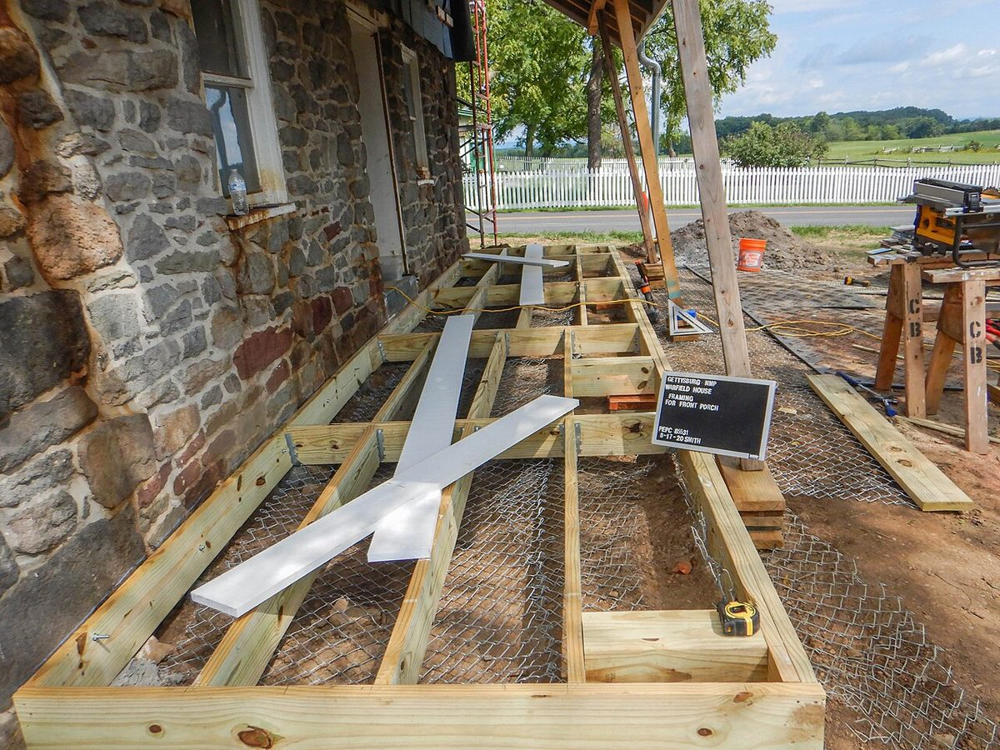
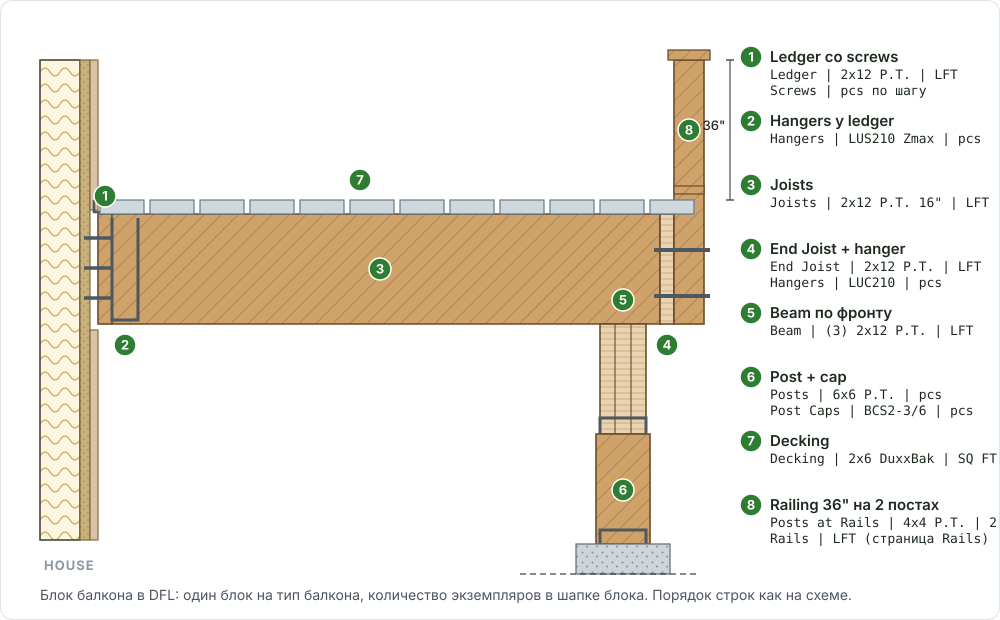

# Deck / Porch / Balcony Frame (каркас балконов, порчей и deck)

<figure markdown>
  
  <figcaption markdown="span">Каркас porch deck: P.T. ledger у стены дома, joists с hangers, rim по периметру, посты. Каждый элемент в DFL своя строка. Фото: NPS Photo, public domain, [источник](https://commons.wikimedia.org/wiki/File:Framing_for_the_front_porch_deck_is_being_installed._%28defb68bd-1bfc-4ad2-bacf-bbdd675758c9%29.jpg)</figcaption>
</figure>

<figure markdown>
  
  <figcaption markdown="span">План каркаса: ledger к зданию, joists и hangers, beam на posts, rim и blocking. Единицы: posts pcs, beam и joists LFT, hangers pcs.</figcaption>
</figure>

## Что это

Структурный каркас открытых площадок: posts с base и cap, beams, ledger,
box или rim, joists с hangers, blocking, sleepers, structural subfloor,
stringers. **Balcony** стоит у стены верхнего этажа на постах или консоли,
**porch** это крытое крыльцо с крышей и потолком (ceiling joists), **deck**
это площадка у земли на постах. Отделка (decking как finish, soffit, trims,
перила по типу) живёт на страницах
[Balcony build-up](../exterior-trims/balcony-buildup.md) и
[Rails & Decking](../exterior-trims/rails-decking.md); здесь только несущее.

## Где искать на чертежах

| Лист | Что взять |
| --- | --- |
| Планы этажей A1xx | Балконные двери (tag), размер W x D каждого типа, сколько штук и на каких этажах |
| S-планы перекрытий | Callout deck joists (сечение, шаг), марки балок B1..B5, посты |
| Разрезы A4xx и детали S3xx/S6xx | Ledger и его крепёж, post cap и base, hangers, End Joists, flush или dropped beam |
| Schedule постов и крепежа (S6xx) | Модель cap по числу plies, base, through bolts |
| Roof plan и разрез porch | Крыша porch, ceiling joists, потолок (gypsum), есть ли каркас вообще |

Дверь без callout деревянных joists на S-плане обычно значит бетон или
фермы под балконом (terrace над гаражом). Это отдельный блок, не копия
деревянного.

## Как мерить в OurPlanCore

1. Площадь: `sqfts/blcny` и `sqfts/porch`, инструмент Area по реальному
   контуру на листе с точкой W. Разные балконы не соединять перемычкой;
   прямоугольник под известное число не рисовать.
2. Блоки: один Count-итем на **тип** балкона в папке `Balcony blocks`
   (porch в `Porch blocks`), точка на каждый экземпляр. Имя итема
   `#4 Balcony 12.9x7.83 (2GZO x7)`, где `x7` равно числу точек; в Notes
   точки unit-тег, сторона и этаж (`2GZO S 2nd fl`). Точки ставят на копиях
   план-листов (`a120 balcony`), рабочие планы остаются чистыми. Число точек
   равно множителю G заголовка блока в Excel.
3. Счёт экземпляров: балконные двери на планах, умноженные на этажи, со
   сверкой по deck-joist callout на S-планах.
4. **Porch считать отдельно по планам**, не зеркалить с балконов: число
   блоков, размеры и количество порчей обычно не совпадают с балконами.
5. Узлы с номером детали (`5/S311`) считаются Line-итемом в
   `framing/<этаж>/details`, по итему на деталь; см.
   [Framing details](../horizontal/floor-framing/details/rim.md).

<figure markdown>
  
  <figcaption markdown="span">Count точками: одна точка на каждый экземпляр балкона, имя итема несёт тип, размер и число экземпляров.</figcaption>
</figure>

<figure markdown>
  
  <figcaption markdown="span">Балкон у стены: ledger со screws, joists P.T. на hangers Zmax, end joist, beam на посту с cap, decking и перила. Каждая выноска это строка блока в DFL.</figcaption>
</figure>

## Как назвать в дереве и строка DFL

Заголовок блока: `#N Upper Balcony List W' x D' <G> unit`, заливка A:B
оранжевая `FABF8F`; porch `#N Porch Framing List W' x D'`, заливка зелёная
`99CC00`. Строки с нулём и пустые строки шаблона удаляются. Подробный состав
блока с формулами: [Блоки DFL](../../reference/dfl-blocks.md).

| Имя в дереве | Строка DFL | Unit | Формула или правило |
| --- | --- | --- | --- |
| `Balcony blocks/#1 Balcony 12x8 (x6)` | `Posts 6x6 P.T.` | pcs | 2 на балкон, `=2*G`; угловой балкон у двух стен может нести 1 |
| | `Post Bases ABA66Z` | pcs | модель со schedule, не дефолт |
| | `Post Caps` | pcs | по числу plies балки: 3-ply `BCS2-3/6 Zmax`, 2-ply `BC46 Zmax`; читать schedule |
| | `Beam (3) 2x12 P.T. B4` фронт, `(2) 2x12 P.T. B3` бока | LFT | plies ведущим множителем: `=3*W*G` |
| | `Ledger 2x12 P.T.` + `Screws SDWS22400DB` | LFT, pcs | screws `=CEILING(...,3)`, по 3 на точку |
| | `Box` или `Rim` тем же сечением | LFT | только если балка не flush |
| | `Joists 2x12 P.T. 16" o.c.` | LFT | счёт `W*12/16+1`; длинная доска 14' и `/2` в формуле |
| | `Hangers LUS210 Zmax`, `End Joists` + `LUC210 Zmax`, `HUC212-2 Zmax` | pcs | hangers на оба конца; снаружи всегда Zmax |
| | `Decking 2x6 DuxxBak` | SQ FT | `W*D*G`; `5/4x6` только на Terrace над гаражом |
| `Porch blocks/#1 Porch 12x7 (x5)` | `Ceiling Joists 2x8 16" o.c.` + `Ledger` + `Hangers` | LFT, pcs | отдельно от rafters, обязательно |
| | `Beam (2) 2x10 B1` / `(3) 2x10 B2` | LFT | коды porch отличаются от балконных |
| | `5/8" Gyp` потолок | SQ FT | два слоя внутри формулы: `=CEILING(G*2*1.1,10)*G` |

Terrace над гаражом (фермы и LW concrete): `Subfloor 3/4" Ply` в листах
4x8, `Sleepers 2x4 P.T.`, `Decking 5/4x6`; bases у таких стеков 0.

## Правила, которые ломают блок

- Посты на улице (porch, балкон, перила) всегда `P.T.`. Закрытый porch или
  балкон под крышей каркас обычный, не P.T.
- Каркас porch не показан: сразу под заголовком блока
  `Note: Porch framing is not specified; all framing assumed; verify`.
- Все узлы соединений с S-листа своей строкой с деталью в E: балка к посту
  (`ML210Z`, `HL33Z`, through bolts с washers и nuts, SDS), балка в балку
  (`HUC...-2`), крайние joists другим сечением (`End Joists`). Формат записи
  крепежа: [Hangers: как записывать крепёж в DFL](../../reference/hangers.md#dfl-format).
- Перила: 2 поста на балкон, система или поэлементно по типу, см.
  [Rails & Decking](../exterior-trims/rails-decking.md) и [Railing](railing.md).
- Flashings, Trims, Soffits, Post Wrap только когда они в scope; при
  Frame only их не вставлять.
- Порч и балкон стопкой: в Front Page строка Porches заполняется отдельно,
  балкон её не заменяет.

## Частые ошибки

- Балконный блок без своего множителя units (900 SF вместо 60).
- Порчи зеркалены с балконов вместо отдельного счёта по планам.
- Post cap по умолчанию `BCS2-3/6 Zmax` вместо модели по plies со schedule.
- Hangers только на один конец, или без Zmax на улице.
- Posts не P.T. на улице, или P.T. под крышей.
- Porch SQFT на Front Page пустой; canopy и porch повторно в eve и rake.
- Все ошибки раздела: [Deck, porch, балконы](../../start/common-mistakes.md#deck).

## Пример

```text
Takeoffs/Main/sqfts/blcny                      Area   6 polygons
Takeoffs/Main/Balcony blocks/#1 Balcony 12x8 (2GZO x6)   Count 6 pts
Takeoffs/Main/Porch blocks/#1 Porch 12.8x7.3 (x5)        Count 5 pts

#1 Upper Balcony List 12' x 8' 6 unit
Posts            6x6 P.T.          12  pcs    =2*G       S611
Post Caps        BCS2-3/6 Zmax     12  pcs    3-ply      S611
Beam front       (3) 2x12 P.T. B4  216 LFT   =3*12*G    S130
Joists           2x12 P.T.         ... LFT   16" o.c.   S130
Hangers          LUS210 Zmax       ... pcs   joists x 2 8/S311
Decking          2x6 DuxxBak       576 SQ FT =12*8*G    5/A550
```

## См. также

- [Блоки DFL](../../reference/dfl-blocks.md), [Rails & Decking](../exterior-trims/rails-decking.md), [Balcony build-up](../exterior-trims/balcony-buildup.md)
- [Railing](railing.md), [Balcony Trims](balcony-trims.md), [Anchor Bolts](anchor-bolts.md)
- [Beam](../horizontal/floor-framing/beam.md), [Joist](../horizontal/floor-framing/joist.md), [Post](../horizontal/floor-framing/post.md), [Hangers](../../reference/hangers.md)
- [Balcony SQFT](../sqfts/balcony.md), [Porch SQFT](../sqfts/porch.md), [Deck SQFT](../sqfts/deck.md), [Standard notes](../../reference/standard-notes.md)
