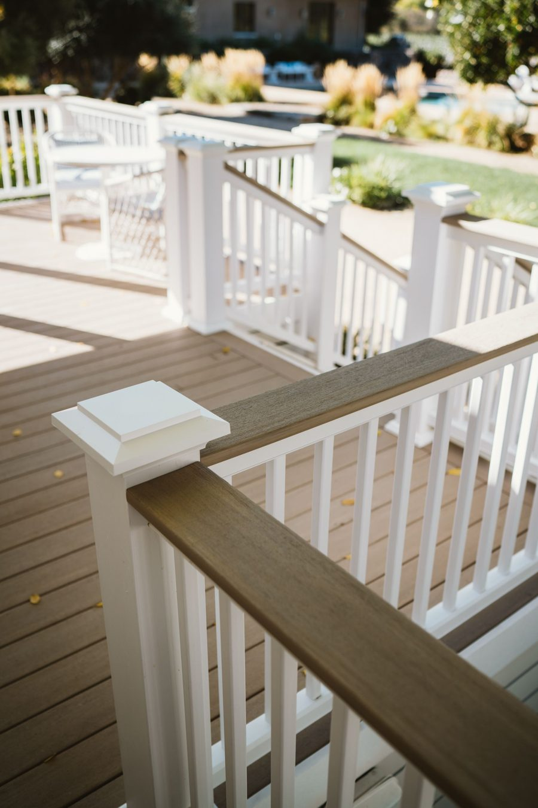

# Railing

<figure markdown>
  { width="360" }
  <figcaption markdown="span">Composite railing corner: a 4x4 post covered with a sleeve and cap, cap rail on top, balusters between the rails. In the balcony block: posts in pieces by corners and spacing, railing in LFT along the perimeter without the stair opening. Photo: timbertech.com, [source](https://www.timbertech.com/products/railing/), found via Pinterest.</figcaption>
</figure>

<figure markdown>
  
  <figcaption markdown="span">Railing assembly: posts, top and bottom rails, balusters, cap rail. Every element is a separate DFL row; the railing type sets the method (system or by components).</figcaption>
</figure>

## What it is

Railing for a balcony, porch or deck. This page covers what goes into the balcony block in the DFL:
posts, row formulas and choosing the counting method. System types (composite, Azek,
wood, cable, metal), decking and post hardware are fully covered on the
canonical page [Rails & Decking](../exterior-trims/rails-decking.md).

## Where to find it on the plans

| Sheet | What to take |
| --- | --- |
| Elevations | Railing type (composite, wood, cable, aluminum), height 36" or 42" |
| Details A5xx | Components: post sleeve, cap, rail sections, or balusters and rails |
| Plans and block size | Railing length: front W plus open sides D |
| Spec notes | `Aluminum railing by others` and the like: do not count the railing, the note stays |

## How to measure in OurPlanCore

A separate railing takeoff is usually not needed: the length comes from the balcony
block size (front W and open sides D) and is multiplied by the number of
instances G. A complex outline (a terrace, a porch all around) is traced with a Line on
the plan. Block area and points: [Deck / Porch / Balcony Frame](deck-porch-balcony-frame.md).

<figure markdown>
  
  <figcaption markdown="span">Composite is counted as a system, painted wood by components. Detailed rows are on the Rails and Decking page.</figcaption>
</figure>

## Tree name and DFL row

One method per run: a factory **system** or **by components**. Composite
is always a system; by components only for painted wood. Do not mix.

| Type | DFL row | Unit | Formula |
| --- | --- | --- | --- |
| Any | `Note: Railing called composite per A501; decking assumed; verify` | | one yellow note about the railing and decking right under the block header; drawings silent - `assumed` and `verify` |
| Any | `Posts at Rails` `4x4 P.T.` | `4` (4' post length) | 2 per balcony, `=2*G`, E `assumed`; long deck rails: `=CEILING(LFT/6,1)+1` |
| Composite (system) | `Post Sleeve` `Sleeve for 4x4`, `Post Cap` `Cap for 4x4` | pcs | by posts: `=C<posts>` |
| Composite (system) | `Rail sections` `8' Rail section` | unit | one row per section length, rule below |
| Wood painted (by components) | `Balustrades` `2x2 balusters` | pcs | `=EVEN(L*2.2)*G` |
| Wood painted (by components) | `Rails (top & bottom)` `2x4 rails` | LFT | `=EVEN(L*2.2)*G` (two runs x 1.1) |
| Wood painted (by components) | `Cap Rail` `2x6 cap rail` | LFT | `=EVEN(L*1.1)*G` |
| Aluminum / metal | only the note `Note: Aluminum railing materials are by others; verify components` | | material not counted |

In the formulas L is the railing LFT of one balcony (front plus open sides) and G is
the number of instances. `Balustrades` are counted in pieces (`pcs`), not `LFT`: one
every 5.5" with waste.

Composite system sections (`Rail sections`):

- The system is bought in sections: one section per span between posts.
- B is the nearest factory length not shorter than the side: a 7'-4" front is an
  `8' Rail section`, a 6' side is a `6' Rail section`.
- One row per length. C = sections of that length on one balcony x G, D
  `unit`, E holds the side and its real length (`front 7'-4"`, `sides 6'`).
- A side longer than the longest section of the system: add an intermediate post,
  count as many sections as there are spans, and add the post to `Posts at Rails`.
- The cap rail is part of the section: a composite railing has no `Cap Rail` row.

Outdoor railing posts are always `P.T.`. Blocking and bolts for the posts, if the detail
shows them, go in the frame rows with the detail in E.

## Common mistakes

- Three posts per balcony instead of two; a corner balcony against two walls carries one.
- System and component counting mixed on one run.
- Aluminum or vinyl railing counted as material instead of a note.
- Posts at Rails without `P.T.`.
- Sections counted in one row from the total length (`LFT / 6`) instead of side by side.
- Balustrades written in `LFT`.
- All mistakes for the section: [Deck, porch, balconies](../../start/common-mistakes.md#deck).

## Example

```text
Note: Railing called composite per A501; decking assumed; verify
Balcony 7'-4" x 6', 6 unit (G = 6)
Posts at Rails   4x4 P.T.          12  4      =2*G        assumed
Post Sleeve      Sleeve for 4x4    12  pcs    =C<posts>
Post Cap         Cap for 4x4       12  pcs    =C<posts>
Rail sections    8' Rail section    6  unit   =1*G        front 7'-4"
Rail sections    6' Rail section   12  unit   =2*G        sides 6'
```

## See also

- [Rails & Decking](../exterior-trims/rails-decking.md) (canonical page for railing types and decking)
- [Deck / Porch / Balcony Frame](deck-porch-balcony-frame.md), [Balcony Trims](balcony-trims.md)
- [DFL blocks](../../reference/dfl-blocks.md), [Standard notes](../../reference/standard-notes.md)
