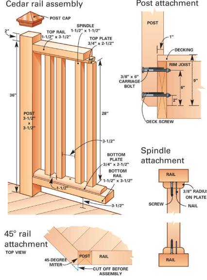
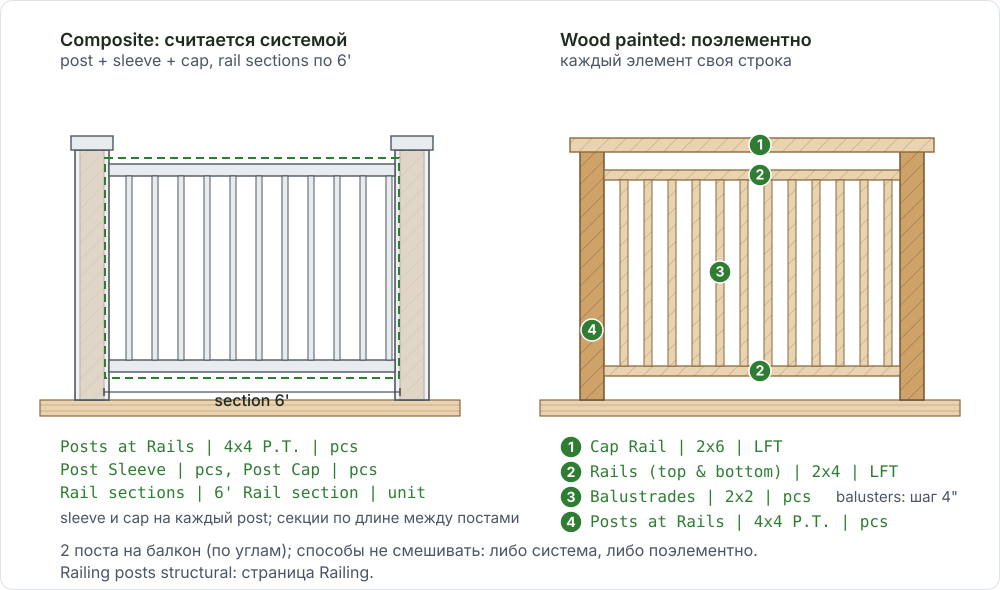

# Railing

<figure markdown>
  { width="360" }
  <figcaption markdown="span">Composite railing corner: a 4x4 post covered with a sleeve and cap, cap rail on top, balusters between the rails. In the balcony block: posts in pieces by corners and spacing, railing in LFT along the perimeter without the stair opening. Photo: timbertech.com, [source](https://www.timbertech.com/products/railing/), found via Pinterest.</figcaption>
</figure>

<figure markdown>
  
  <figcaption markdown="span">Railing assembly: posts, top and bottom rails, balusters, cap rail. Every element is a separate DFL row; the railing type sets the method (system or by components).</figcaption>
</figure>

## What it is

Railing for a balcony, porch or deck. This page covers what goes into the balcony block in the DFL:
posts, row formulas and choosing the counting method. System types (composite, Azek,
wood, cable, metal), decking and post hardware are fully covered on the
canonical page [Rails & Decking](../exterior-trims/rails-decking.md).

## Where to find it on the plans

| Sheet | What to take |
| --- | --- |
| Elevations | Railing type (composite, wood, cable, aluminum), height 36" or 42" |
| Details A5xx | Components: post sleeve, cap, rail sections, or balusters and rails |
| Plans and block size | Railing length: front W plus open sides D |
| Spec notes | `Aluminum railing by others` and the like: do not count the railing, the note stays |

## How to measure in OurPlanCore

A separate railing takeoff is usually not needed: the length comes from the balcony
block size (front W and open sides D) and is multiplied by the number of
instances G. A complex outline (a terrace, a porch all around) is traced with a Line on
the plan. Block area and points: [Deck / Porch / Balcony Frame](deck-porch-balcony-frame.md).

<figure markdown>
  
  <figcaption markdown="span">Composite is counted as a system, painted wood by components. Detailed rows are on the Rails and Decking page.</figcaption>
</figure>

## Tree name and DFL row

One method per run: a factory **system** or **by components**. Composite
is always a system; by components only for painted wood. Do not mix.

| Type | DFL row | Unit | Formula |
| --- | --- | --- | --- |
| Any | `Note: Railing is composite; verify product` | | a note about the system right under the railing rows |
| Any | `Posts at Rails 4x4 P.T.` | pcs | 2 per balcony, `=2*G`; height 4' in E |
| Composite (system) | `Post Sleeve` `Sleeve for 4x4`, `Post Cap` `Cap for 4x4` | pcs | by posts |
| Composite (system) | `Rail sections` `6' Rail section` | unit | front and sides as separate rows |
| Wood painted (by components) | `Balustrades 2x2` | pcs | `=EVEN(G*2.2)`, G = railing LFT x units |
| Wood painted (by components) | `Rails (top & bottom) 2x4` | LFT | `=EVEN(G*2.2)` (two runs) |
| Wood painted (by components) | `Cap Rail 2x6` | LFT | `=EVEN(G*1.1)` |
| Aluminum / metal | only the note `Note: Aluminum railing materials are by others; verify components` | | material not counted |

Outdoor railing posts are always `P.T.`. Blocking and bolts for the posts, if the detail
shows them, go in the frame rows with the detail in E.

## Common mistakes

- Three posts per balcony instead of two; a corner balcony against two walls carries one.
- System and component counting mixed on one run.
- Aluminum or vinyl railing counted as material instead of a note.
- Posts at Rails without `P.T.`.
- All mistakes for the section: [Deck, porch, balconies](../../start/common-mistakes.md#deck).

## Example

```text
Note: Railing called composite; Decking assumed Composite
Posts at Rails   4x4 P.T.          12  pcs    =2*G      4'
Post Sleeve      Sleeve for 4x4    12  pcs    =C<posts>
Post Cap         Cap for 4x4       12  pcs    =C<posts>
Rail sections    6' Rail section   12  unit   front 12'
Rail sections    6' Rail section   16  unit   sides 2x8'
```

## See also

- [Rails & Decking](../exterior-trims/rails-decking.md) (canonical page for railing types and decking)
- [Deck / Porch / Balcony Frame](deck-porch-balcony-frame.md), [Balcony Trims](balcony-trims.md)
- [DFL blocks](../../reference/dfl-blocks.md), [Standard notes](../../reference/standard-notes.md)
