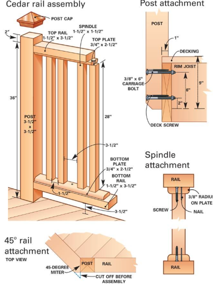

# Railing (перила: посты и строки блока)

<!-- TODO-PHOTO: composite deck railing with 4x4 posts, sleeves and caps, EN: "composite deck railing post sleeve cap" -->

<figure markdown>
  
  <figcaption markdown="span">Сборка перил: посты, top и bottom rails, balusters, cap rail. Каждый элемент в DFL отдельной строкой; способ (система или поэлементно) задаёт тип перил.</figcaption>
</figure>

## Что это

Перила балкона, porch или deck. Здесь то, что входит в блок балкона в DFL:
посты, формулы строк и выбор способа счёта. Типы систем (composite, Azek,
wood, cable, metal), decking и hardware постов полностью разобраны на
канонической странице [Rails & Decking](../exterior-trims/rails-decking.md).

## Где искать на чертежах

| Лист | Что взять |
| --- | --- |
| Elevations | Тип перил (composite, wood, cable, aluminum), высота 36" или 42" |
| Детали A5xx | Состав: post sleeve, cap, rail sections или balusters и rails |
| Планы и размер блока | Длина перил: фронт W плюс открытые бока D |
| Notes спецификации | `Aluminum railing by others` и подобные: перила не считаем, нота остаётся |

## Как мерить в OurPlanCore

Отдельный takeoff на перила обычно не нужен: длина берётся из размеров
блока балкона (фронт W и открытые бока D) и умножается на число
экземпляров G. Сложный контур (терраса, porch по периметру) обводят Line на
плане. Площадь и точки блока: [Deck / Porch / Balcony Frame](deck-porch-balcony-frame.md).

## Как назвать в дереве и строка DFL

Способ один на участок: заводская **система** или **поэлементно**. Composite
всегда система, поэлементно только wood painted. Не смешивать.

| Тип | Строка DFL | Unit | Формула |
| --- | --- | --- | --- |
| Любой | `Note: Railing is composite; verify product` | | нота о системе сразу под строками перил |
| Любой | `Posts at Rails 4x4 P.T.` | pcs | 2 на балкон, `=2*G`; высота 4' в E |
| Composite (система) | `Post Sleeve` `Sleeve for 4x4`, `Post Cap` `Cap for 4x4` | pcs | по постам |
| Composite (система) | `Rail sections` `6' Rail section` | unit | фронт и бока отдельными строками |
| Wood painted (поэлементно) | `Balustrades 2x2` | pcs | `=EVEN(G*2.2)`, G = LFT перил x units |
| Wood painted (поэлементно) | `Rails (top & bottom) 2x4` | LFT | `=EVEN(G*2.2)` (две нитки) |
| Wood painted (поэлементно) | `Cap Rail 2x6` | LFT | `=EVEN(G*1.1)` |
| Aluminum / metal | только нота `Note: Aluminum railing materials are by others; verify components` | | материал не считаем |

Посты перил на улице всегда `P.T.`. Blocking и bolts под посты, если деталь
их показывает, идут строками каркаса с деталью в E.

## Частые ошибки

- Три поста на балкон вместо двух; угловой балкон у двух стен несёт один.
- Система и поэлементный счёт смешаны на одном участке.
- Aluminum или vinyl перила посчитаны как материал, а не нотой.
- Posts at Rails без `P.T.`.
- Все ошибки раздела: [Deck, porch, балконы](../../start/common-mistakes.md#deck).

## Пример

```text
Note: Railing called composite; Decking assumed Composite
Posts at Rails   4x4 P.T.          12  pcs    =2*G      4'
Post Sleeve      Sleeve for 4x4    12  pcs    =C<posts>
Post Cap         Cap for 4x4       12  pcs    =C<posts>
Rail sections    6' Rail section   12  unit   front 12'
Rail sections    6' Rail section   16  unit   sides 2x8'
```

## См. также

- [Rails & Decking](../exterior-trims/rails-decking.md) (канон по типам перил и decking)
- [Deck / Porch / Balcony Frame](deck-porch-balcony-frame.md), [Balcony Trims](balcony-trims.md)
- [Блоки DFL](../../reference/dfl-blocks.md), [Standard notes](../../reference/standard-notes.md)
