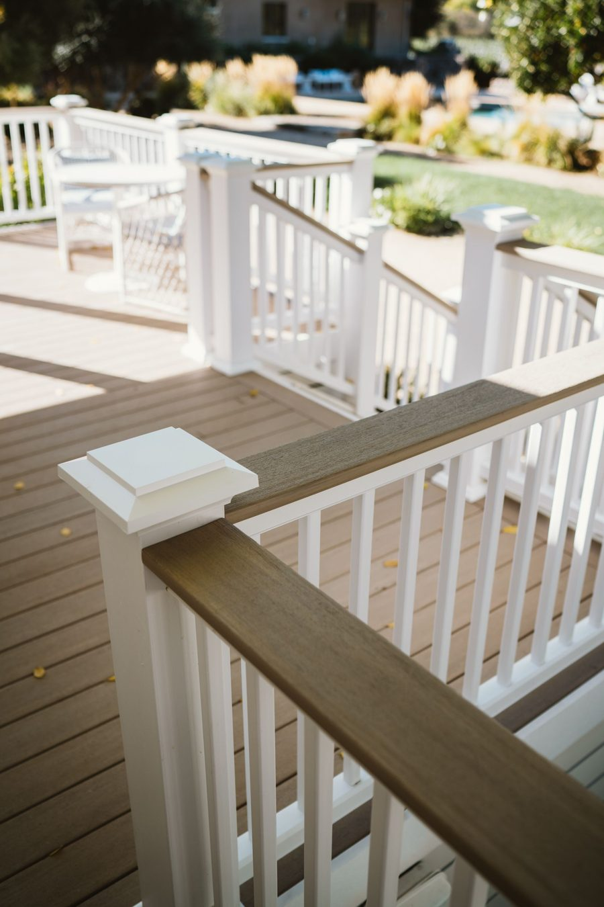
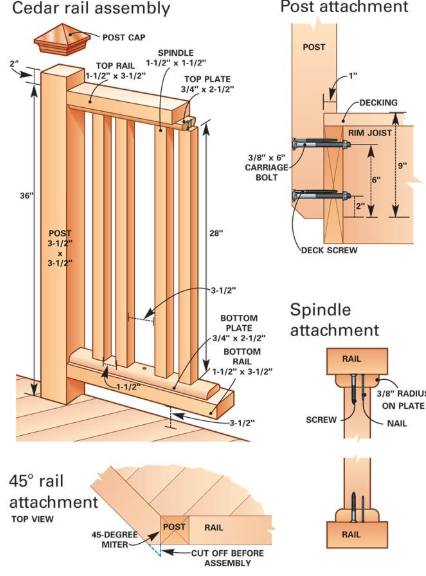
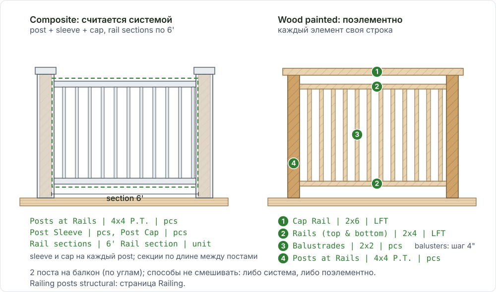

# Railing (перила: посты и строки блока)

<figure markdown>
  { width="360" }
  <figcaption markdown="span">Угол composite railing: пост 4x4 закрыт sleeve с cap, cap rail сверху, balusters между rails. В блоке балкона: посты штуками по углам и шагу, railing LFT по периметру без проёма лестницы. Фото: timbertech.com, [источник](https://www.timbertech.com/products/railing/), найдено через Pinterest.</figcaption>
</figure>

<figure markdown>
  
  <figcaption markdown="span">Сборка перил: посты, top и bottom rails, balusters, cap rail. Каждый элемент в DFL отдельной строкой; способ (система или поэлементно) задаёт тип перил.</figcaption>
</figure>

## Что это

Перила балкона, porch или deck. Здесь то, что входит в блок балкона в DFL:
посты, формулы строк и выбор способа счёта. Типы систем (composite, Azek,
wood, cable, metal), decking и hardware постов полностью разобраны на
канонической странице [Rails & Decking](../exterior-trims/rails-decking.md).

## Где искать на чертежах

| Лист | Что взять |
| --- | --- |
| Elevations | Тип перил (composite, wood, cable, aluminum), высота 36" или 42" |
| Детали A5xx | Состав: post sleeve, cap, rail sections или balusters и rails |
| Планы и размер блока | Длина перил: фронт W плюс открытые бока D |
| Notes спецификации | `Aluminum railing by others` и подобные: перила не считаем, нота остаётся |

## Как мерить в OurPlanCore

Отдельный takeoff на перила обычно не нужен: длина берётся из размеров
блока балкона (фронт W и открытые бока D) и умножается на число
экземпляров G. Сложный контур (терраса, porch по периметру) обводят Line на
плане. Площадь и точки блока: [Deck / Porch / Balcony Frame](deck-porch-balcony-frame.md).

<figure markdown>
  
  <figcaption markdown="span">Composite считается системой, wood painted поэлементно. Подробные строки на странице Rails and Decking.</figcaption>
</figure>

## Как назвать в дереве и строка DFL

Способ один на участок: заводская **система** или **поэлементно**. Composite
всегда система, поэлементно только wood painted. Не смешивать.

| Тип | Строка DFL | Unit | Формула |
| --- | --- | --- | --- |
| Любой | `Note: Railing called composite per A501; decking assumed; verify` | | одна жёлтая нота о перилах и decking сразу под заголовком блока; чертёж молчит - `assumed` и `verify` |
| Любой | `Posts at Rails` `4x4 P.T.` | `4` (длина поста 4') | 2 на балкон, `=2*G`, в E `assumed`; длинные перила deck: `=CEILING(LFT/6,1)+1` |
| Composite (система) | `Post Sleeve` `Sleeve for 4x4`, `Post Cap` `Cap for 4x4` | pcs | по постам: `=C<posts>` |
| Composite (система) | `Rail sections` `8' Rail section` | unit | одна строка на каждую длину секции, правило ниже |
| Wood painted (поэлементно) | `Balustrades` `2x2 balusters` | pcs | `=EVEN(L*2.2)*G` |
| Wood painted (поэлементно) | `Rails (top & bottom)` `2x4 rails` | LFT | `=EVEN(L*2.2)*G` (две нитки x 1.1) |
| Wood painted (поэлементно) | `Cap Rail` `2x6 cap rail` | LFT | `=EVEN(L*1.1)*G` |
| Aluminum / metal | только нота `Note: Aluminum railing materials are by others; verify components` | | материал не считаем |

В формулах L - LFT перил одного балкона (фронт плюс открытые бока), G -
число экземпляров. `Balustrades` считаются штуками (`pcs`), не `LFT`: одна на
каждые 5.5" с запасом.

Секции composite-системы (`Rail sections`):

- Систему покупают секциями: одна секция на пролёт между постами.
- B - ближайшая заводская длина не короче стороны: фронт 7'-4" это
  `8' Rail section`, бок 6' это `6' Rail section`.
- Одна строка на каждую длину. C = секций этой длины на один балкон x G, D
  `unit`, в E сторона и её настоящая длина (`front 7'-4"`, `sides 6'`).
- Сторона длиннее самой длинной секции системы: добавь промежуточный пост,
  секций столько, сколько пролётов, а пост допиши в `Posts at Rails`.
- Cap rail входит в секцию: строки `Cap Rail` у composite нет.

Посты перил на улице всегда `P.T.`. Blocking и bolts под посты, если деталь
их показывает, идут строками каркаса с деталью в E.

## Частые ошибки

- Три поста на балкон вместо двух; угловой балкон у двух стен несёт один.
- Система и поэлементный счёт смешаны на одном участке.
- Aluminum или vinyl перила посчитаны как материал, а не нотой.
- Posts at Rails без `P.T.`.
- Секции посчитаны одной строкой по общей длине (`LFT / 6`), а не по сторонам.
- Balustrades записаны в `LFT`.
- Все ошибки раздела: [Deck, porch, балконы](../../start/common-mistakes.md#deck).

## Пример

```text
Note: Railing called composite per A501; decking assumed; verify
Balcony 7'-4" x 6', 6 unit (G = 6)
Posts at Rails   4x4 P.T.          12  4      =2*G        assumed
Post Sleeve      Sleeve for 4x4    12  pcs    =C<posts>
Post Cap         Cap for 4x4       12  pcs    =C<posts>
Rail sections    8' Rail section    6  unit   =1*G        front 7'-4"
Rail sections    6' Rail section   12  unit   =2*G        sides 6'
```

## См. также

- [Rails & Decking](../exterior-trims/rails-decking.md) (канон по типам перил и decking)
- [Deck / Porch / Balcony Frame](deck-porch-balcony-frame.md), [Balcony Trims](balcony-trims.md)
- [Блоки DFL](../../reference/dfl-blocks.md), [Standard notes](../../reference/standard-notes.md)
