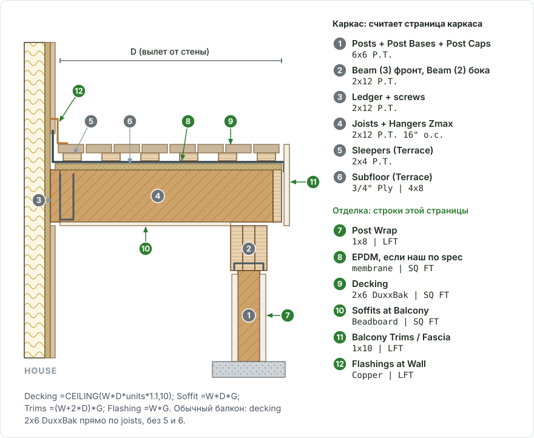

# Balcony build-up

<figure markdown>
  
  <figcaption markdown="span">Balcony section at the wall: frame, subfloor, EPDM on the subfloor turned up the wall, sleepers over the membrane, decking on the sleepers. Numbers match the table below: rows 1-6 are counted on the frame page, rows 7-12 here.</figcaption>
</figure>

## What it is

The map of all balcony layers and the canonical page for the finish layers: post wrap, EPDM, decking
as a finish, soffit underneath, fascia and edge trim, flashing at the wall, an assembly with
pavers. The frame (posts, beam, ledger, joists, hangers, sleepers, subfloor)
is counted on [Deck / Porch / Balcony Frame](../deck/deck-porch-balcony-frame.md),
the railing on [Rails & Decking](rails-decking.md). The
[Balcony Trims](../deck/balcony-trims.md) page is a short pointer here.

## Where to find it on the plans

| Sheet | What to take |
| --- | --- |
| Balcony section A4xx | Layer order: subfloor, sleepers, membrane, decking or pavers |
| Details A5xx (balcony edge, wall flashing) | Fascia, edge trim, soffit, flashing, post wrap |
| Spec and notes | `Pavers Deck System by others`, decking product (DuxxBak, composite) |
| Job scope | Frame only: do not insert rows 7-12 |

## How to measure in OurPlanCore

Areas and lengths come from the block size W x D and the multiplier G
(see [frame](../deck/deck-porch-balcony-frame.md)). The soffit underneath and the decking
equal the balcony area; trims and flashing go along the perimeter: the front and sides
are open, the wall side gives flashing.

## Tree name and DFL row

| # | DFL row | Material | Unit | Who counts it |
| --- | --- | --- | --- | --- |
| 1 | `Posts` + `Post Bases` + `Post Caps` | `6x6 P.T.`, per schedule | pcs | frame |
| 2 | `Beam (3)` front, `Beam (2)` sides | `2x12 P.T.` | LFT | frame |
| 3 | `Ledger` + screws, `Box` if the beam is not flush | `2x12 P.T.` | LFT | frame |
| 4 | `Joists` + `Hangers Zmax` + `End Joists` | `2x12 P.T.` 16" o.c. | LFT, pcs | frame |
| 5 | `Sleepers` (Terrace, often 2 layers) | `2x4 P.T.` | LFT | frame |
| 6 | `Subfloor` (Terrace) | `3/4" Ply` | 4x8 | frame |
| 7 | `Post Wrap` | `1x8` / `5/4x` | LFT | **here** |
| 8 | `EPDM` | membrane | SQ FT | **here**, if ours per spec |
| 9 | `Decking` | `2x6 DuxxBak` (balcony), `5/4x6` (Terrace) | SQ FT | **here**, `=W*D*G` |
| 10 | `Soffits at Balcony` | `Beadboard` | SQ FT | **here**, `=W*D*G` |
| 11 | `Balcony Trims` / `Fascia` | `1x10`, `5/4x8` | LFT | **here**, `=(W+2*D)*G` |
| 12 | `Flashings at Wall` | `Copper` / drip edge | LFT | **here**, `=W*G` |

Rows 7-12 are inserted only when trim is in scope. Size not specified:
`TBD` and the note `Note: All trims to be verified. Scaled per elevations`.

## Assembly with pavers

A balcony on a slab or over a garage instead of decking on sleepers:

| Layer, top to bottom | Scope |
| --- | --- |
| `Porcelain Pavers` + `Thinset Mortar` | usually by others, note `Note: Pavers Deck System are by others` |
| `Roofing Membrane`, `Tapered Rigid Insulation` | check the scope |
| `Conc. Deck`, `Structural Steel` | structural, not trim |

Over a garage with trusses and LW concrete the block is counted as a Terrace:
`3/4" Ply` subfloor, `2x4 P.T.` sleepers, `5/4x6` decking.

## Common mistakes

- Frame rows duplicated in the finish block (sleepers twice).
- `5/4x6` decking on a regular balcony instead of `2x6 DuxxBak` per the detail.
- Pavers and membrane by others counted as material.
- Trim inserted when the scope is Frame only.
- Decking area without the units multiplier.
- All mistakes for the section: [Deck, porch, balconies](../../start/common-mistakes.md#deck).

## Example

```text
Post Wrap            1x8          96  LFT    4 sides x 4' x 6 posts
Decking              2x6 DuxxBak  576 SQ FT  =12*8*G          5/A550
Soffits at Balcony   Beadboard    576 SQ FT  =12*8*G          6/A550
Balcony Trims        1x10         168 LFT    =(12+2*8)*G      6/A550
Flashings at Wall    Copper       72  LFT    =12*G            7/A550
```

## See also

- [Deck / Porch / Balcony Frame](../deck/deck-porch-balcony-frame.md), [Rails & Decking](rails-decking.md), [Balcony Trims](../deck/balcony-trims.md)
- [Porch / Deck / Balcony](porch-deck-balcony.md), [Exclusions and J-Channel](exclusions.md)
- [DFL blocks](../../reference/dfl-blocks.md), [Standard notes](../../reference/standard-notes.md)
