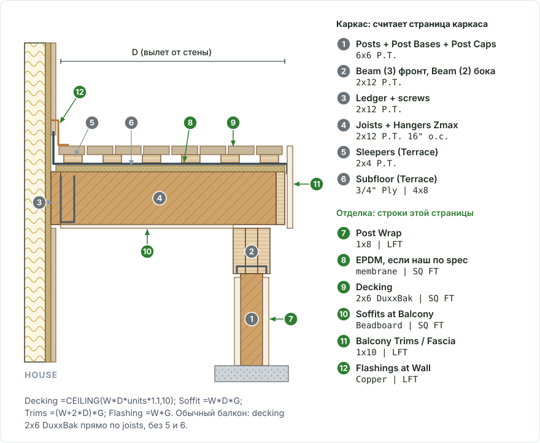

# Balcony build-up (слои балкона: от каркаса до отделки)

<figure markdown>
  
  <figcaption markdown="span">Разрез балкона у стены: каркас, subfloor, EPDM по subfloor с заводом на стену, sleepers поверх мембраны, decking по sleepers. Номера как в таблице ниже: строки 1-6 считает страница каркаса, строки 7-12 здесь. Pavers и membrane часто by others.</figcaption>
</figure>

## Что это

Карта всех слоёв балкона и канон по finish-слоям: post wrap, EPDM, decking
как finish, soffit снизу, fascia и edge trim, flashing у стены, composition с
pavers. Каркас (posts, beam, ledger, joists, hangers, sleepers, subfloor)
считается на [Deck / Porch / Balcony Frame](../deck/deck-porch-balcony-frame.md),
перила на [Rails & Decking](rails-decking.md). Страница
[Balcony Trims](../deck/balcony-trims.md) это короткий указатель сюда.

## Где искать на чертежах

| Лист | Что взять |
| --- | --- |
| Разрез балкона A4xx | Порядок слоёв: subfloor, membrane, sleepers, decking или pavers |
| Детали A5xx (balcony edge, wall flashing) | Fascia, edge trim, soffit, flashing, post wrap |
| Spec и notes | `Pavers Deck System by others`, продукт decking (DuxxBak, composite) |
| Scope задания | Frame only: строки 7, 10 и 11 не вставлять |

## Как мерить в OurPlanCore

Площади и длины берутся из размеров блока W x D и числа экземпляров (units)
(см. [каркас](../deck/deck-porch-balcony-frame.md)). Soffit снизу и decking
равны площади балкона, trims и flashing идут по периметру: фронт и бока
открыты, сторона у стены даёт flashing.

Порядок сборки снизу вверх, как это строят:

- Обычный открытый балкон: posts и beam, joists, decking прямо по joists.
- Terrace (над гаражом или помещением): joists, `Subfloor`, `EPDM` по
  subfloor, `Sleepers` поверх мембраны, decking по sleepers. Мембрана
  всегда под sleepers: decking на мембрану не кладут.

## Как назвать в дереве и строка DFL

| # | Строка DFL | Материал | Unit | Кто считает |
| --- | --- | --- | --- | --- |
| 1 | `Posts` + `Post Bases` + `Post Caps` | `6x6 P.T.`, по schedule | посты: длина в D; bases и caps pcs | каркас |
| 2 | `Beam (3)` фронт, `Beam (2)` бока | `2x12 P.T.` | доски, длина в D | каркас |
| 3 | `Ledger` + screws, `Box` если балка не flush | `2x12 P.T.` | доски, длина в D; screws pcs | каркас |
| 4 | `Joists` + `Hangers Zmax` + `End Joists` | `2x12 P.T.` 16" o.c. | доски, длина в D; hangers pcs | каркас |
| 5 | `Sleepers` (Terrace) | `2x4 P.T.` | доски, длина в D | каркас, штук на балкон `=CEILING(W*12/16,1)+1` |
| 6 | `Subfloor` (Terrace) | `3/4" Ply` | 4x8 | каркас |
| 7 | `Post Wrap` | `1x8` (пост 6x6), `1x6` (пост 4x4) | LFT | **здесь**, G = высота x 4 стороны x постов на балкон; C = G x 1.1 вверх до 10 (меньше 50 - до 2), x units |
| 8 | `EPDM` (Terrace) | `EPDM`, `60 EPDM` | SQ FT | **здесь**, `=CEILING(W*D*units*1.1,10)`, площадь как у subfloor |
| 9 | `Decking` | по детали: `2x6 DuxxBak` (балкон), `5/4x6` (Terrace) | SQ FT | **здесь**, `=CEILING(W*D*units*1.1,10)` |
| 10 | `Soffits at Balcony` | `Beadboard` | SQ FT | **здесь**, `=CEILING(W*D*1.1,10)*units` |
| 11 | `Fascia Trim at Hdr outside` | `1x12`, при header ниже 10" `1x10` | LFT | **здесь**, G = фронт W одного балкона (длина header); C = G x 1.1 вверх до 2 (от 50 до 10), x units |
| 12 | `Flashings at Wall` (Terrace) | `Copper` | LFT | **здесь**, `=W*units`, длина стороны у стены, без waste |

- Decking наш: каждый блок балкона заканчивается строкой `Decking`. Не
  считаем его только когда чертежи прямо пишут by others (pavers deck
  system, prefab балкон); тогда нота вместо строки.
- Продукт decking не назван нигде: `TBD Decking`; на panel-job без spec
  `5/4x6` и `assumed` в E.
- `Sleepers` это один ряд реек `2x4 P.T.` с шагом 16" под decking Terrace:
  на один балкон `=CEILING(W*12/16,1)+1` штук, длина доски в D = ближайшая
  чётная длина выше глубины D балкона. Сечение `2x6` или второй слой только
  когда разрез их показывает.
- `EPDM` и `Flashings at Wall` есть только у Terrace с мембраной; у
  открытого деревянного балкона этих строк нет.
- `Post Wrap` только когда фасад или деталь показывает обшитый пост; голый
  `P.T.` пост без строки.

`Post Wrap`, `Soffits at Balcony` и `Fascia Trim at Hdr outside` (строки 7, 10,
11) вставляются только когда отделка в scope, своей секцией `Balcony Trims`
за блоком, не внутрь блока. Боковые балки получают fascia trim только когда
деталь его на них показывает: тогда G = W + 2 x D. `Decking` (9), а у Terrace
`EPDM` (8) и `Flashings at Wall` (12) - строки самого блока: они пишутся и при
Frame only, когда чертёж их показывает. Размер не указан:
`TBD` и нота `Note: All trims to be verified. Scaled per elevations`.

## Composition с pavers

Балкон на плите или над гаражом вместо decking на sleepers:

| Слой сверху вниз | Scope |
| --- | --- |
| `Porcelain Pavers` + `Thinset Mortar` | обычно by others, нота `Note: Pavers Deck System are by others` |
| `Roofing Membrane`, `Tapered Rigid Insulation` | проверить scope |
| `Conc. Deck`, `Structural Steel` | structural, не trim |

Над гаражом с фермами и LW concrete блок считается как Terrace:
`3/4" Ply` subfloor, EPDM, `2x4 P.T.` sleepers поверх мембраны, `5/4x6`
decking.

## Частые ошибки

- Строки каркаса продублированы в блоке отделки (sleepers дважды).
- Decking `5/4x6` на обычном балконе вместо `2x6 DuxxBak` по детали.
- Pavers и membrane by others посчитаны как материал.
- Отделка вставлена при scope Frame only.
- Площадь decking без множителя units или без waste 1.1.
- Decking пропущен как "by others", хотя чертежи этого не пишут.
- В тексте или ноте decking положен на мембрану, sleepers под мембрану.
- Все ошибки раздела: [Deck, porch, балконы](../../start/common-mistakes.md#deck).

## Пример

```text
Блок: балкон 12' x 8', 6 units, по 2 поста на балкон = 12 постов 6x6, высота поста 9'

Post Wrap                    1x8          480  LFT    =CEILING(9*4*2*1.1,10)*6      assumed
Decking                      2x6 DuxxBak  640  SQ FT  =CEILING(12*8*6*1.1,10)       5/A550
Soffits at Balcony           Beadboard    660  SQ FT  =CEILING(12*8*1.1,10)*6       6/A550
Fascia Trim at Hdr outside   1x12          84  LFT    =CEILING(12*1.1,2)*6          6/A550

Post Wrap: 9' x 4 стороны x 2 поста = 72, x 1.1 = 79.2, вверх до 10 = 80, x 6 = 480
Decking: 12 x 8 x 6 = 576, x 1.1 = 633.6, вверх до 10 = 640
Soffit: 96 x 1.1 = 105.6, вверх до 10 = 110, x 6 = 660
Fascia: фронт 12 x 1.1 = 13.2, вверх до 2 = 14, x 6 = 84
```

## См. также

- [Deck / Porch / Balcony Frame](../deck/deck-porch-balcony-frame.md), [Rails & Decking](rails-decking.md), [Balcony Trims](../deck/balcony-trims.md)
- [Porch / Deck / Balcony](porch-deck-balcony.md), [Exclusions и J-Channel](exclusions.md)
- [Блоки DFL](../../reference/dfl-blocks.md), [Standard notes](../../reference/standard-notes.md)
