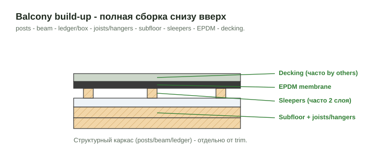

# Balcony build-up (слои балкона: от каркаса до отделки)

<figure markdown>
  
  <figcaption markdown="span">Снизу вверх: каркас, sleepers, EPDM, decking. Строки 1-6 считает страница каркаса, строки 7-12 здесь. Pavers и membrane часто by others.</figcaption>
</figure>

## Что это

Карта всех слоёв балкона и канон по finish-слоям: post wrap, EPDM, decking
как finish, soffit снизу, fascia и edge trim, flashing у стены, composition с
pavers. Каркас (posts, beam, ledger, joists, hangers, sleepers, subfloor)
считается на [Deck / Porch / Balcony Frame](../deck/deck-porch-balcony-frame.md),
перила на [Rails & Decking](rails-decking.md). Страница
[Balcony Trims](../deck/balcony-trims.md) это короткий указатель сюда.

## Где искать на чертежах

| Лист | Что взять |
| --- | --- |
| Разрез балкона A4xx | Порядок слоёв: subfloor, sleepers, membrane, decking или pavers |
| Детали A5xx (balcony edge, wall flashing) | Fascia, edge trim, soffit, flashing, post wrap |
| Spec и notes | `Pavers Deck System by others`, продукт decking (DuxxBak, composite) |
| Scope задания | Frame only: строки 7-12 не вставлять |

## Как мерить в OurPlanCore

Площади и длины берутся из размеров блока W x D и множителя G
(см. [каркас](../deck/deck-porch-balcony-frame.md)). Soffit снизу и decking
равны площади балкона, trims и flashing идут по периметру: фронт и бока
открыты, сторона у стены даёт flashing.

## Как назвать в дереве и строка DFL

| # | Строка DFL | Материал | Unit | Кто считает |
| --- | --- | --- | --- | --- |
| 1 | `Posts` + `Post Bases` + `Post Caps` | `6x6 P.T.`, по schedule | pcs | каркас |
| 2 | `Beam (3)` фронт, `Beam (2)` бока | `2x12 P.T.` | LFT | каркас |
| 3 | `Ledger` + screws, `Box` если балка не flush | `2x12 P.T.` | LFT | каркас |
| 4 | `Joists` + `Hangers Zmax` + `End Joists` | `2x12 P.T.` 16" o.c. | LFT, pcs | каркас |
| 5 | `Sleepers` (Terrace, часто 2 слоя) | `2x4 P.T.` | LFT | каркас |
| 6 | `Subfloor` (Terrace) | `3/4" Ply` | 4x8 | каркас |
| 7 | `Post Wrap` | `1x8` / `5/4x` | LFT | **здесь** |
| 8 | `EPDM` | membrane | SQ FT | **здесь**, если наш по spec |
| 9 | `Decking` | `2x6 DuxxBak` (балкон), `5/4x6` (Terrace) | SQ FT | **здесь**, `=W*D*G` |
| 10 | `Soffits at Balcony` | `Beadboard` | SQ FT | **здесь**, `=W*D*G` |
| 11 | `Balcony Trims` / `Fascia` | `1x10`, `5/4x8` | LFT | **здесь**, `=(W+2*D)*G` |
| 12 | `Flashings at Wall` | `Copper` / drip edge | LFT | **здесь**, `=W*G` |

Строки 7-12 вставляются только когда отделка в scope. Размер не указан:
`TBD` и нота `Note: All trims to be verified. Scaled per elevations`.

## Composition с pavers

Балкон на плите или над гаражом вместо decking на sleepers:

| Слой сверху вниз | Scope |
| --- | --- |
| `Porcelain Pavers` + `Thinset Mortar` | обычно by others, нота `Note: Pavers Deck System are by others` |
| `Roofing Membrane`, `Tapered Rigid Insulation` | проверить scope |
| `Conc. Deck`, `Structural Steel` | structural, не trim |

Над гаражом с фермами и LW concrete блок считается как Terrace:
`3/4" Ply` subfloor, `2x4 P.T.` sleepers, `5/4x6` decking.

## Частые ошибки

- Строки каркаса продублированы в блоке отделки (sleepers дважды).
- Decking `5/4x6` на обычном балконе вместо `2x6 DuxxBak` по детали.
- Pavers и membrane by others посчитаны как материал.
- Отделка вставлена при scope Frame only.
- Площадь decking без множителя units.
- Все ошибки раздела: [Deck, porch, балконы](../../start/common-mistakes.md#deck).

## Пример

```text
Post Wrap            1x8          96  LFT    4 sides x 4' x 6 posts
Decking              2x6 DuxxBak  576 SQ FT  =12*8*G          5/A550
Soffits at Balcony   Beadboard    576 SQ FT  =12*8*G          6/A550
Balcony Trims        1x10         168 LFT    =(12+2*8)*G      6/A550
Flashings at Wall    Copper       72  LFT    =12*G            7/A550
```

## См. также

- [Deck / Porch / Balcony Frame](../deck/deck-porch-balcony-frame.md), [Rails & Decking](rails-decking.md), [Balcony Trims](../deck/balcony-trims.md)
- [Porch / Deck / Balcony](porch-deck-balcony.md), [Exclusions и J-Channel](exclusions.md)
- [Блоки DFL](../../reference/dfl-blocks.md), [Standard notes](../../reference/standard-notes.md)
