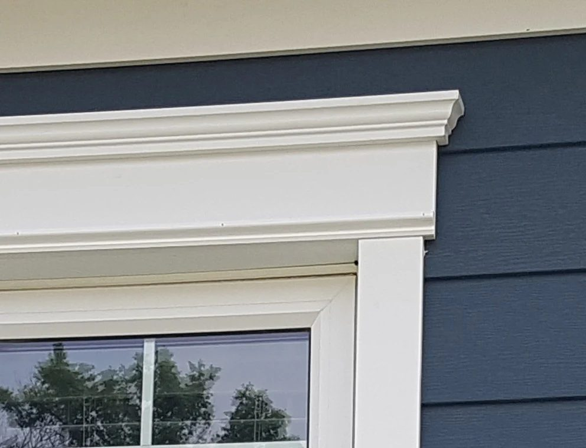
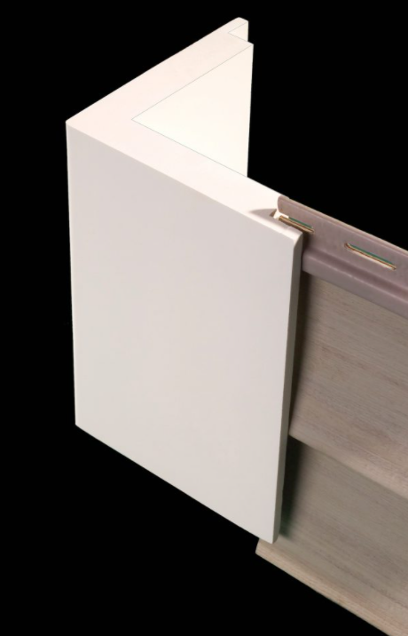

# Casing, Corner & Band

<figure markdown>
  
  <figcaption markdown="span">Top corner of a window: flat PVC casing on the sides and head, a head crown with a cap above it. Casing sides and head are counted in LFT from the opening size; crown and cap are separate rows by the head width. Photo: elitetrimworks.com, [source](https://elitetrimworks.com/products/pvc-rams-crown-2), found via Pinterest.</figcaption>
</figure>

<figure markdown>
  
  <figcaption markdown="span">A corner board covers the cut edge of the siding at the corner. Counted in LFT: the sum of the corner heights, x2 for a corner made of two boards, plus 1.1 waste.</figcaption>
</figure>

## What it is

Trim around openings and across the face of the elevation: ext. casing (sides, heads, apron,
mulls), corner boards, band and watertable, head crowns with cap and flashing,
window sills, shutters, louvers, brackets. All of it is wood, PVC or composite
linear stock; siding and cladding are not part of it.

## Where to find it on the plans

| Sheet | What to take |
| --- | --- |
| Elevations | Where there is casing, corner, band; how many corners; shutters and louvers by window |
| Window and door details (A5xx, A6xx) | Casing profile (`5/4x4`), head crown, cap, drip cap, sill, 3-sides or 4-sides |
| Wall sections | Band and watertable, flashing above them, build-up under the corner |
| Spec and notes | Material (PVC, Azek, Hardi trim, vinyl), `All trims to be verified` |

## How to measure in OurPlanCore

Casing, corner and band are Lines in the `trims` root, one item per profile:
`2" casing`, `8" horizontal trim`, `corner 5/4x6`. Elevations have no sheet dot,
so check that the item landed in `trims`. Casing is easier to count
with a formula from the opening list (perimeter of one window x quantity); use a Line
only where the profile follows a complex outline. Corners: one line per
outside corner along its height; G takes the sum of the heights, and the x2 for two
boards is in the formula, not in the takeoff. Shutters, louvers and
brackets are Count points, with their own color and symbol for each takeoff.

## Tree name and DFL row

| Tree name | DFL row | Size | Unit | Rule |
| --- | --- | --- | --- | --- |
| `trims/casing sides` | `Ext Casing` | `5/4x4` | LFT | `=CEILING(G*1.1,10)`; one row per profile; sides and heads together while the head is the same size |
| `trims/casing heads` | `Ext Casing Head` | `5/4x6` / `5/4x8` | LFT | only when the head is wider than the sides or has a crown over it; this LFT is not inside `Ext Casing` |
| | `Ext Casing` as a second row | `5/4x3` | LFT | sides and apron under the window in another profile |
| | `Mullion trims` | `5/4x4` / `5/4x6` | LFT | between ganged windows: height x count |
| | `Ext Casing`, `Ext Casing Head` for overhead doors | `5/4x8`, `5/4x12` | LFT | overhead doors in their own rows when the board is wider |
| | `Ext Casing` | `J-Channel` / `3-1/2" Vinyl casing` | LFT | with vinyl siding, do not duplicate with `5/4` |
| | `Crowns`, `Crown Cap`, `Head Trim Flashing` | `3-1/2" crown`, `1x4`, `Drip Edge` | LFT | stack over the head: crown, cap, flashing; same length as the head |
| | `Window Sills` | `2" Sill`, not specified: `TBD Sill` | LFT | when a sill is shown; not inside the casing length |
| `trims/corner 5/4x6` | `Corner Boards` | `5/4x6` / `5/4x8` | LFT | G = sum of the outside corner heights; two boards per corner: `=EVEN(G*2*1.1)`; bays as a separate row |
| | `Corner Boards` | `5/4x6x6` (L profile per the detail) | LFT | one L piece per corner: `=EVEN(G*1.1)`, no x2 |
| `trims/band 5/4x10` | `Watertable Trim` | `5/4x10` / `5/4x12` | LFT | band and watertable under one label; right below it a `Head Trim Flashing` `Drip Edge` row of the same length |
| `trims/shutters` | `Shutters` | `20"x60" paneled` | pairs | a pair per window, size and style in B |
| | `Louver vent`, `Brackets` | `24" Dia`, `5-1/2"x7"x?` | pcs | the `?` in the size stays as verify |

- Linear trim has one formula: `=CEILING(G*1.1,10)`, where G is the measured length;
  when the total is under 50 it rounds to 2. `Corner Boards` has its own formula with
  `EVEN`.
- A corner made of two `5/4` boards is two boards for the full corner height, hence
  the x2. No corner detail: count two boards. A vinyl corner (`4" Vinyl corner`) and a
  solid corner are one piece per corner: no x2, and it is a different product, not
  `5/4`. Inside corners get no row unless the detail shows a board.
- Write exterior board casing as `5/4x`, not `1x`, even when the legend
  calls it `1x`.
- `4-sides` casing runs around the whole perimeter, `3-sides` has no bottom (sill or
  siding). Write this in the row; it changes the LFT.
- Size not specified: `TBD` in size, `scaled` or `assumed` in E, the note
  `Note: All trims to be verified. Scaled per elevations`.

## Common mistakes

- A head of another size, mull trims and overhead doors merged into one `Ext Casing` row.
- With vinyl siding both J-channel and wood casing counted.
- Head crown without cap and drip edge, though the detail shows them.
- `Watertable Trim` without a `Head Trim Flashing` on top.
- `Corner Boards` without x2 on a two-board corner; or x2 already in G and again in the formula.
- A label that differs from the template (`CornerBoards`, `Ext. Casing sides`): the macro will not collect the rows.
- Shutters in pcs instead of pairs; shutter size lost.
- Trim around stone or EIFS missed (see [Exclusions](exclusions.md)).
- All Excel and row mistakes: [Excel DFL and notes](../../start/common-mistakes.md#excel).

## Example

```text
Takeoffs/Main/trims/casing sides       Line   374 LFT   (2 x 5.5' x 34 windows)
Takeoffs/Main/trims/casing heads       Line   112.2 LFT (3.3' x 34 windows)
Takeoffs/Main/trims/corner 5/4x6       Line   8 x 28' = 224 LFT

Ext Casing           5/4x4       420  LFT   =CEILING(374*1.1,10)     A601
Ext Casing Head      5/4x6       130  LFT   =CEILING(112.2*1.1,10)   A601
Head Trim Flashing   Drip Edge   130  LFT   =CEILING(112.2*1.1,10)
Corner Boards        5/4x6       494  LFT   =EVEN(224*2*1.1)         A201
Shutters             20"x60" paneled   12   pairs                    A201

Casing: 374 x 1.1 = 411.4, rounded up to 10 = 420
Heads: 112.2 x 1.1 = 123.4, rounded up to 10 = 130
Corners: 224 x 2 x 1.1 = 492.8, rounded up to even = 494
```

## See also

- [Overview](overview.md), [Exclusions and J-Channel](exclusions.md), [Furring & Window Jambs](furring-and-jambs.md), [Soffit & Fascia](soffit-fascia.md)
- [Windows and Doors](../vertical/openings/windows-doors.md), [Window flashing](../vertical/openings/window-flashing.md)
- [Trim macros](macros.md), [Standard notes](../../reference/standard-notes.md)
