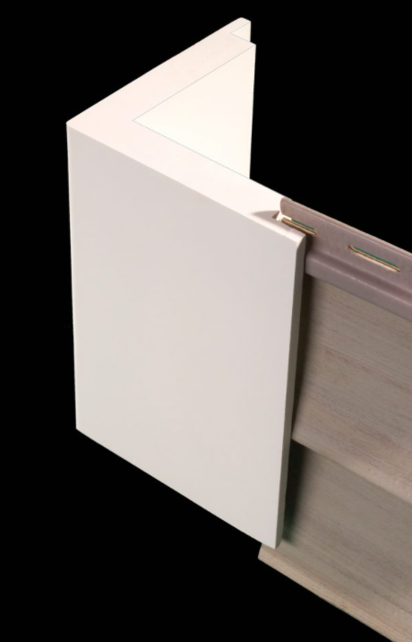

# Casing, Corner & Band (наружные наличники, угловые доски, пояса)

<!-- TODO-PHOTO: exterior window with 5/4 PVC casing, head crown and drip cap on lap siding, EN: "exterior window trim casing drip cap lap siding" -->

<figure markdown>
  
  <figcaption markdown="span">Corner board закрывает обрезанный край siding на углу. Считается LFT по высоте угла, умноженной на число углов этого типа.</figcaption>
</figure>

## Что это

Trim вокруг проёмов и по полю фасада: ext. casing (sides, heads, apron,
mulls), corner boards, band и watertable, head crowns с cap и flashing,
window sills, shutters, louvers, brackets. Всё это wood, PVC или composite
погонаж; siding и облицовка в него не входят.

## Где искать на чертежах

| Лист | Что взять |
| --- | --- |
| Elevations | Где есть casing, corner, band; сколько углов; shutters и louvers по окнам |
| Window и door details (A5xx, A6xx) | Профиль casing (`5/4x4`), head crown, cap, drip cap, sill, 3-sides или 4-sides |
| Wall sections | Band и watertable, flashing над ними, build-up под corner |
| Spec и notes | Материал (PVC, Azek, Hardi trim, vinyl), `All trims to be verified` |

## Как мерить в OurPlanCore

Casing, corner и band это Line в корне `trims`, по итему на профиль:
`2" casing`, `8" horizontal trim`, `corner 5/4x6`. Фасады без точки листа,
поэтому проверяй, что итем попал в `trims`. Casing удобнее считать
формулой от списка проёмов (периметр одного окна x количество), Line
только там, где профиль идёт по сложному контуру. Shutters, louvers и
brackets это Count точками, свой цвет и символ у каждой позиции.

## Как назвать в дереве и строка DFL

| Имя в дереве | Строка DFL | Size | Unit | Правило |
| --- | --- | --- | --- | --- |
| `trims/casing sides` | `Ext. Casing sides` | `5/4x4` | LFT | вертикальные стороны openings |
| `trims/casing heads` | `Ext. Casing heads` | `5/4x4` / `5/4x6` | LFT | верх, часто шире; `(at crowns)` отдельной строкой |
| | `Ext. Casing (apron & sides)` | `5/4x3` | LFT | sides плюс apron под окном |
| | `Mull trims` | `5/4x6` | LFT | между спаренными окнами |
| | `Casing garage doors (sides)`, `Head casing garage dr` | `5/4x8`, `5/4x12` | LFT | ворота отдельно |
| | `Ext. Casing` | `Vinyl J-channel` / `3-1/2" Vinyl casing` | LFT | при vinyl siding, не дублировать с `5/4` |
| | `Head crowns`, `Crown cap`, `Head flashing` | `3-1/2" crown`, `1x4`, `Drip edge` | LFT | слойка над head: crown, cap, flashing |
| | `Window Sills` | `1" Sill` / `2" Sill` | LFT | когда показан sill |
| `trims/corner 5/4x6` | `CornerBoards` | `5/4x6` / `5/4x8` | LFT | высота угла x число углов; bays отдельной строкой |
| `trims/band 5/4x10` | `Band Trims`, `Watertable Trim` | `5/4x10` / `5/4x12` | LFT | плюс `Flashing at band` drip edge сверху |
| `trims/shutters` | `Shutters - paneled` | `20"x60"` | pairs | пара на окно, размер в строке |
| | `Louver vent`, `Brackets` | `24" Dia`, `5-1/2"x7"x?` | pcs | `?` в размере остаётся как verify |

- `4-sides` casing идёт по всему периметру, `3-sides` без низа (sill или
  siding). Пиши это в строке, это меняет LFT.
- Vinyl corner (`4" Vinyl corner`) это другой продукт, не `5/4`.
- Размер не указан: `TBD` в size, `scaled` или `assumed` в E, нота
  `Note: All trims to be verified. Scaled per elevations`.

## Частые ошибки

- Casing одной строкой без разделения sides, heads, mulls, garage.
- При vinyl siding посчитаны и J-channel, и wood casing.
- Над head crown без cap и drip edge, хотя деталь их показывает.
- Band и watertable без flashing сверху.
- Shutters в pcs вместо pairs; размер shutter потерян.
- Trim вокруг stone или EIFS пропущен (см. [Exclusions](exclusions.md)).
- Все ошибки по Excel и строкам: [Excel DFL и ноты](../../start/common-mistakes.md#excel).

## Пример

```text
Takeoffs/Main/trims/2" casing          Line   412 LFT
Takeoffs/Main/trims/corner 5/4x6       Line   8 x 28' = 224 LFT

Ext. Casing sides    5/4x4   380  LFT   =2*5.5*34 windows     A601
Ext. Casing heads    5/4x6   112  LFT   =3.3*34               A601
Head flashing        Drip edge 112 LFT  =C<heads>
CornerBoards         5/4x6   224  LFT   8 corners x 28'       A201
Shutters - paneled   20"x60" 12   pairs                       A201
```

## См. также

- [Overview](overview.md), [Exclusions и J-Channel](exclusions.md), [Furring & Window Jambs](furring-and-jambs.md), [Soffit & Fascia](soffit-fascia.md)
- [Windows and Doors](../vertical/openings/windows-doors.md), [Window flashing](../vertical/openings/window-flashing.md)
- [Trim macros](macros.md), [Standard notes](../../reference/standard-notes.md)
