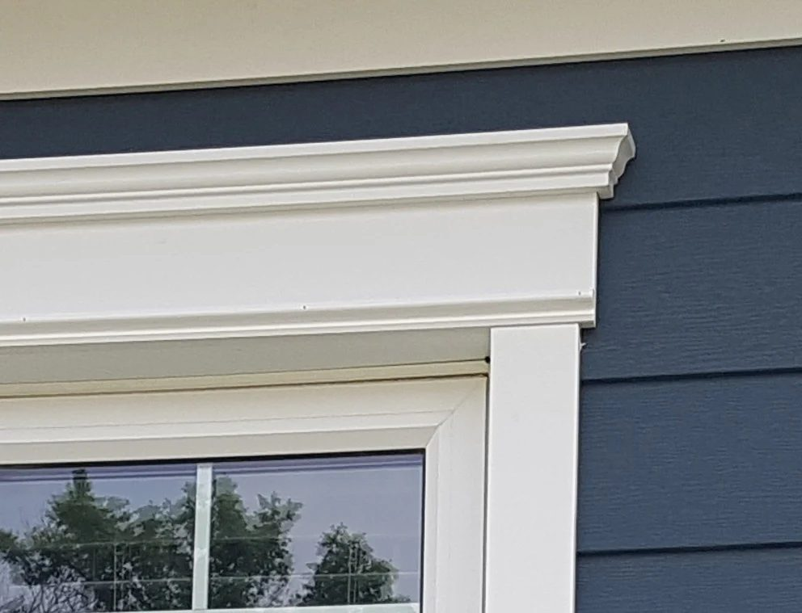
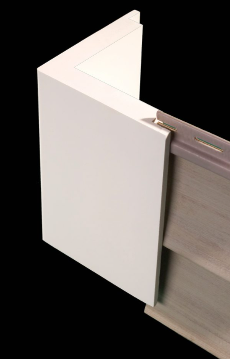

# Casing, Corner & Band (наружные наличники, угловые доски, пояса)

<figure markdown>
  
  <figcaption markdown="span">Верхний угол окна: плоский PVC casing по бокам и сверху, над ним head crown с cap. Casing sides и head считаются LFT от размеров проёма, crown и cap - отдельные строки по ширине head. Фото: elitetrimworks.com, [источник](https://elitetrimworks.com/products/pvc-rams-crown-2), найдено через Pinterest.</figcaption>
</figure>

<figure markdown>
  
  <figcaption markdown="span">Corner board закрывает обрезанный край siding на углу. Считается LFT: сумма высот углов, для угла из двух досок x2, плюс waste 1.1.</figcaption>
</figure>

## Что это

Trim вокруг проёмов и по полю фасада: ext. casing (sides, heads, apron,
mulls), corner boards, band и watertable, head crowns с cap и flashing,
window sills, shutters, louvers, brackets. Всё это wood, PVC или composite
погонаж; siding и облицовка в него не входят.

## Где искать на чертежах

| Лист | Что взять |
| --- | --- |
| Elevations | Где есть casing, corner, band; сколько углов; shutters и louvers по окнам |
| Window и door details (A5xx, A6xx) | Профиль casing (`5/4x4`), head crown, cap, drip cap, sill, 3-sides или 4-sides |
| Wall sections | Band и watertable, flashing над ними, build-up под corner |
| Spec и notes | Материал (PVC, Azek, Hardi trim, vinyl), `All trims to be verified` |

## Как мерить в OurPlanCore

Casing, corner и band это Line в корне `trims`, по итему на профиль:
`2" casing`, `8" horizontal trim`, `corner 5/4x6`. Фасады без точки листа,
поэтому проверяй, что итем попал в `trims`. Casing удобнее считать
формулой от списка проёмов (периметр одного окна x количество), Line
только там, где профиль идёт по сложному контуру. Corner: одна линия на
каждый наружный угол по его высоте; в G идёт сумма высот, x2 на две доски
стоит в формуле, не в замере. Shutters, louvers и brackets это Count
точками, свой цвет и символ у каждой позиции.

## Как назвать в дереве и строка DFL

| Имя в дереве | Строка DFL | Size | Unit | Правило |
| --- | --- | --- | --- | --- |
| `trims/casing sides` | `Ext Casing` | `5/4x4` | LFT | `=CEILING(G*1.1,10)`; строка на каждый профиль; sides и heads вместе, пока head того же размера |
| `trims/casing heads` | `Ext Casing Head` | `5/4x6` / `5/4x8` | LFT | только когда head шире sides или над ним crown; эти LFT в `Ext Casing` не входят |
| | `Ext Casing` второй строкой | `5/4x3` | LFT | sides и apron под окном другим профилем |
| | `Mullion trims` | `5/4x4` / `5/4x6` | LFT | между спаренными окнами: высота x число |
| | `Ext Casing`, `Ext Casing Head` для ворот | `5/4x8`, `5/4x12` | LFT | ворота своими строками, когда доска шире |
| | `Ext Casing` | `J-Channel` / `3-1/2" Vinyl casing` | LFT | при vinyl siding, не дублировать с `5/4` |
| | `Crowns`, `Crown Cap`, `Head Trim Flashing` | `3-1/2" crown`, `1x4`, `Drip Edge` | LFT | слойка над head: crown, cap, flashing; длина равна head |
| | `Window Sills` | `2" Sill`, не указан: `TBD Sill` | LFT | когда показан sill; в длину casing не входит |
| `trims/corner 5/4x6` | `Corner Boards` | `5/4x6` / `5/4x8` | LFT | G = сумма высот наружных углов; две доски на угол: `=EVEN(G*2*1.1)`; bays отдельной строкой |
| | `Corner Boards` | `5/4x6x6` (L-профиль по детали) | LFT | один цельный L-элемент на угол: `=EVEN(G*1.1)`, без x2 |
| `trims/band 5/4x10` | `Watertable Trim` | `5/4x10` / `5/4x12` | LFT | band и watertable под одной подписью; сразу под ней строка `Head Trim Flashing` `Drip Edge` той же длины |
| `trims/shutters` | `Shutters` | `20"x60" paneled` | pairs | пара на окно, размер и тип в B |
| | `Louver vent`, `Brackets` | `24" Dia`, `5-1/2"x7"x?` | pcs | `?` в размере остаётся как verify |

- Формула погонажа одна: `=CEILING(G*1.1,10)`, где G это измеренная длина;
  когда итог меньше 50, округление до 2. У `Corner Boards` своя формула с
  `EVEN`.
- Угол из двух досок `5/4` это две доски на всю высоту угла, поэтому x2.
  Нет детали угла: считай две доски. Vinyl corner (`4" Vinyl corner`) и
  solid corner это один элемент на угол: без x2, и это другой продукт, не
  `5/4`. Внутренние углы без строки, пока деталь не показывает доску.
- Наружный casing из доски пиши `5/4x`, а не `1x`, даже когда легенда
  называет `1x`.
- `4-sides` casing идёт по всему периметру, `3-sides` без низа (sill или
  siding). Пиши это в строке, это меняет LFT.
- Размер не указан: `TBD` в size, `scaled` или `assumed` в E, нота
  `Note: All trims to be verified. Scaled per elevations`.

## Частые ошибки

- Head другого размера, mull trims и ворота слиты в одну строку `Ext Casing`.
- При vinyl siding посчитаны и J-channel, и wood casing.
- Над head crown без cap и drip edge, хотя деталь их показывает.
- `Watertable Trim` без `Head Trim Flashing` сверху.
- `Corner Boards` без x2 при угле из двух досок; или x2 уже в G и ещё раз в формуле.
- Подпись не как в шаблоне (`CornerBoards`, `Ext. Casing sides`): макрос не соберёт строки.
- Shutters в pcs вместо pairs; размер shutter потерян.
- Trim вокруг stone или EIFS пропущен (см. [Exclusions](exclusions.md)).
- Все ошибки по Excel и строкам: [Excel DFL и ноты](../../start/common-mistakes.md#excel).

## Пример

```text
Takeoffs/Main/trims/casing sides       Line   374 LFT   (2 x 5.5' x 34 windows)
Takeoffs/Main/trims/casing heads       Line   112.2 LFT (3.3' x 34 windows)
Takeoffs/Main/trims/corner 5/4x6       Line   8 x 28' = 224 LFT

Ext Casing           5/4x4       420  LFT   =CEILING(374*1.1,10)     A601
Ext Casing Head      5/4x6       130  LFT   =CEILING(112.2*1.1,10)   A601
Head Trim Flashing   Drip Edge   130  LFT   =CEILING(112.2*1.1,10)
Corner Boards        5/4x6       494  LFT   =EVEN(224*2*1.1)         A201
Shutters             20"x60" paneled   12   pairs                    A201

Casing: 374 x 1.1 = 411.4, вверх до 10 = 420
Heads: 112.2 x 1.1 = 123.4, вверх до 10 = 130
Corners: 224 x 2 x 1.1 = 492.8, вверх до чётного = 494
```

## См. также

- [Overview](overview.md), [Exclusions и J-Channel](exclusions.md), [Furring & Window Jambs](furring-and-jambs.md), [Soffit & Fascia](soffit-fascia.md)
- [Windows and Doors](../vertical/openings/windows-doors.md), [Window flashing](../vertical/openings/window-flashing.md)
- [Trim macros](macros.md), [Standard notes](../../reference/standard-notes.md)
