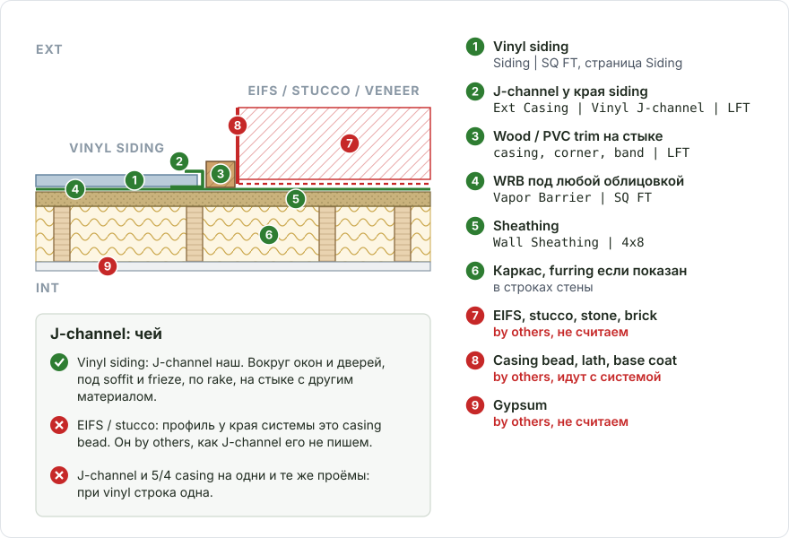

# Exclusions and J-Channel

<figure markdown>
  
  <figcaption markdown="span">EIFS, stucco, stone and brick veneer are by others. WRB, sheathing, furring and wood/PVC trim around them are ours; J-channel is ours only with vinyl siding.</figcaption>
</figure>

## What it is

The exclusion rule for the trim scope and the canonical page for `J-Channel`. What EIFS,
stucco, stone and brick veneer are, how to recognize them on the plans and which accessories
come with them is covered on the canonical page
[Siding - EIFS / Stucco / Veneer](../siding/eifs-stucco-veneer.md).

## What we do not count in Exterior Trims

| System | Count it? | Why |
| --- | --- | --- |
| EIFS (synthetic stucco, Dryvit, Sto) | no | finish system by others |
| Stucco (cement, 3-coat) | no | plaster trade, by others |
| Stone veneer, brick veneer | no | masonry by others |
| Siding (Hardi, vinyl, cedar) | not here | its own scope [Siding](../siding/overview.md) |

What stays ours next to them: wood/PVC casing, corner board, band,
watertable, soffit, fascia, frieze, columns, porch and balcony trim, WRB and
sheathing under the cladding, furring. If the whole elevation is EIFS or stone, trim
can be close to zero: do not pad the quantity, add the note
`Note: Stone Veneer by others`.

## J-Channel

`J-Channel` is a J-shaped profile that takes the cut edge of the
siding. It covers the end and gives a clean termination line.

| Condition | Where J-channel goes | Whose |
| --- | --- | --- |
| Vinyl siding | around windows and doors, under soffit and frieze, at corner posts, inside corners, along the rake | **ours**, LFT |
| Siding meets another material | joint with stone, brick, EIFS, decking, porch ceiling | ours, if the siding is ours |
| EIFS / stucco | casing bead, stop bead, track at the bottom, at dissimilar material | usually by others with the system |

With vinyl siding `Ext. Casing` is often the `Vinyl J-channel` itself: the row
`Ext. Casing | Vinyl J-channel | LFT`. Then do not duplicate it with `5/4` wood casing.
Quantity: perimeter of all openings plus terminations. The word `J-channel`
stays in the row; do not reduce it to a generic `casing`.

## How to measure in OurPlanCore

J-channel with vinyl siding: a Line around the openings on the elevation, or
a formula from the opening list (perimeter x quantity), plus a Line along the rake and the
joints. No separate takeoff is needed for EIFS, stucco and veneer: they are by
others; siding area `0` and a note.

## Common mistakes

- Stone or brick veneer counted as siding.
- With vinyl siding both `J-channel` and `5/4` casing counted on the same openings.
- J-channel with EIFS written as ours.
- Trim around veneer missed because "the wall is by others".
- All sheathing and WRB mistakes: [Sheathing](../../start/common-mistakes.md#sheathing).

## See also

- [EIFS / Stucco / Veneer](../siding/eifs-stucco-veneer.md) (canonical), [Siding](../siding/overview.md), [Underlayment](../siding/underlayment.md)
- [Overview](overview.md), [Casing, Corner & Band](casing-corner-band.md), [Soffit & Fascia](soffit-fascia.md), [Furring & Window Jambs](furring-and-jambs.md)
- [Standard notes](../../reference/standard-notes.md)
