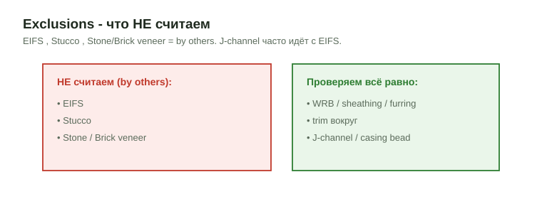

# Exclusions и J-Channel (что не считаем в trims и где идёт J-channel)

<figure markdown>
  
  <figcaption markdown="span">EIFS, stucco, stone и brick veneer by others. WRB, sheathing, furring и wood/PVC trim вокруг них наши; J-channel наш только при vinyl siding.</figcaption>
</figure>

## Что это

Правило исключений для trim-scope и канон по `J-Channel`. Что такое EIFS,
stucco, stone и brick veneer, как их узнать на чертеже и какие accessory
идут с ними, разобрано на канонической странице
[Siding - EIFS / Stucco / Veneer](../siding/eifs-stucco-veneer.md).

## Что не считаем в Exterior Trims

| Система | Считаем? | Почему |
| --- | --- | --- |
| EIFS (synthetic stucco, Dryvit, Sto) | нет | finish system by others |
| Stucco (cement, 3-coat) | нет | plaster trade, by others |
| Stone veneer, brick veneer | нет | masonry by others |
| Siding (Hardi, vinyl, cedar) | не здесь | свой scope [Siding](../siding/overview.md) |

Что остаётся нашим рядом с ними: wood/PVC casing, corner board, band,
watertable, soffit, fascia, frieze, columns, porch и balcony trim, WRB и
sheathing под облицовкой, furring. Если весь фасад EIFS или stone, trim
может быть почти нулевым: не добивай количество, ставь ноту
`Note: Stone Veneer by others`.

## J-Channel

`J-Channel` это профиль буквой J, в который заводится обрезанный край
siding. Он закрывает торец и даёт чистую линию примыкания.

| Условие | Где идёт J-channel | Чей |
| --- | --- | --- |
| Vinyl siding | вокруг окон и дверей, под soffit и frieze, у corner posts, inside corners, по rake | **наш**, LFT |
| Siding примыкает к другому материалу | стык со stone, brick, EIFS, decking, потолком porch | наш, если siding наш |
| EIFS / stucco | casing bead, stop bead, track по низу, у dissimilar material | обычно by others с системой |

При vinyl siding `Ext. Casing` часто и есть `Vinyl J-channel`: строка
`Ext. Casing | Vinyl J-channel | LFT`. Тогда не дублируй `5/4` wood casing.
Количество: периметр всех openings плюс terminations. Слово `J-channel`
остаётся в строке, не сводить к generic `casing`.

## Как мерить в OurPlanCore

J-channel при vinyl siding: Line по периметру openings на фасаде или
формулой от списка проёмов (периметр x количество), плюс Line по rake и по
стыкам. Отдельный takeoff на EIFS, stucco и veneer не нужен: они by
others; площадь siding `0` и нота.

## Частые ошибки

- Stone или brick veneer посчитаны как siding.
- При vinyl siding посчитаны и `J-channel`, и `5/4` casing на одни проёмы.
- J-channel с EIFS записан как наш.
- Trim вокруг veneer пропущен, потому что "стена by others".
- Все ошибки по обшивке и WRB: [Обшивка](../../start/common-mistakes.md#sheathing).

## См. также

- [EIFS / Stucco / Veneer](../siding/eifs-stucco-veneer.md) (канон), [Siding](../siding/overview.md), [Underlayment](../siding/underlayment.md)
- [Overview](overview.md), [Casing, Corner & Band](casing-corner-band.md), [Soffit & Fascia](soffit-fascia.md), [Furring & Window Jambs](furring-and-jambs.md)
- [Standard notes](../../reference/standard-notes.md)
