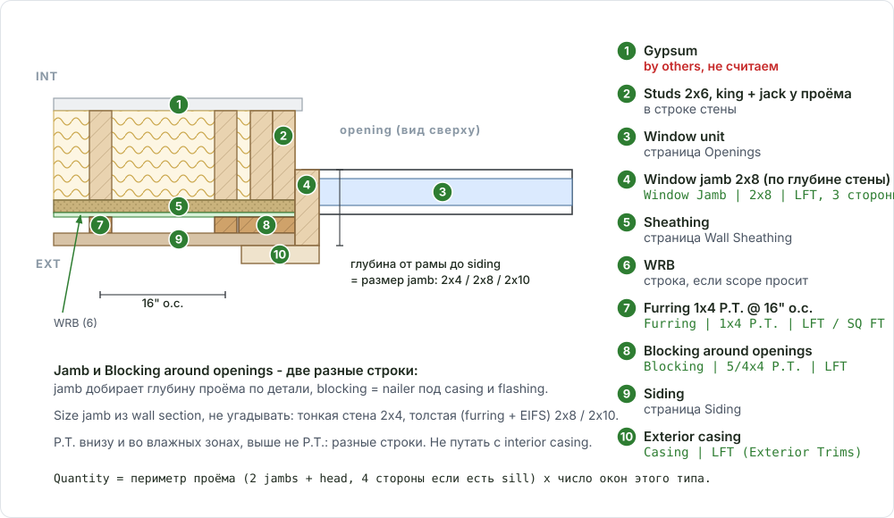

# Furring & Window Jambs

<figure markdown>
  
  <figcaption markdown="span">Horizontal section through a window: stud wall, sheathing, furring under the siding, window frame, jamb for the wall depth, casing outside. Jambs and furring live in the sections, not on the elevation.</figcaption>
</figure>

## What it is

Two things that are easy to miss because they are not on the elevations.
**Furring** is the strip between the WRB and the siding: a vent gap (rainscreen) or a flat
plane for the cladding. A **window jamb** is the board that builds out the opening depth
from the window frame to the siding plane. Z-furring on CMU and basement furring
are covered on [Furring (walls)](../vertical/walls/furring.md); this page covers
furring under siding and jambs as part of the exterior scope.

## Where to find it on the plans

| Sheet | What to take |
| --- | --- |
| Wall sections (A3xx, A4xx) | Whether there is furring under the siding, size `1x4` / `2x4`, spacing, P.T. or not |
| Window and door details (head, jamb, sill) | Jamb `2x4` / `2x8` / `2x10` by wall thickness, P.T. at the bottom |
| Wall types (wt) | Rainscreen in the wall assembly, continuous insulation (the jamb gets deeper) |
| Flare and bump details | `2x blocking, rip as req'd` |

## How to measure in OurPlanCore

Furring under siding: from the siding area (from `siding` or the elevations) converted
to LFT by spacing; no separate Line is needed; solid furring is written in SQ FT.
Jambs: with a formula from the opening list (perimeter x quantity); the opening sizes
come from `openings`. Basement wall area under treated furring: an Area or
Line along the section on the sheet with the W point.

## Tree name and DFL row

| DFL row | Size | Unit | Rule |
| --- | --- | --- | --- |
| `Furring 1x4 @ 16" o.c.` | `1x4` or `1x4 P.T.` | LFT | `=CEILING(G*12/16*1.1,10)`, G = siding area in SQ FT; spacing in the row |
| `Furring` (solid) | `1x4` | SQ FT | when the detail calls for a solid plane |
| `Furring 2x4` | `2x4` / `2x4 P.T.` | LFT | thicker per structural |
| `Window jamb` | `2x4` / `2x8` / `2x10` | LFT | G = perimeter of 3 sides (2 jambs + head) or 4 with the sill, x number of windows; C = G x 1.1 rounded up to 10 |
| `Jambs` (in older workbooks `Blocking around all openings`) | `5/4x4 P.T.` | LFT | nailer for casing and flashing; inserted by `B_JambsAllBlock` |
| `2x blocking, rip as req'd` | `2x` | LFT | flare and bump per the detail |

- `P.T.` and non-`P.T.` are different products: P.T. at the foundation and in wet
  areas, usually not higher up. Do not write one size for the whole wall if the detail
  distinguishes them.
- `Window jamb` and `Blocking around all openings` are two different rows, not a
  choice: the jamb builds out the depth, the blocking gives a nailer.
- Do not offer furring at CMU as optional; if the detail shows it, it is
  required. Treated basement furring is a separate P.T. assembly.
- Metal stud walls: the wood jamb in the openings is ours even if the framing is by
  others. If jambs are not needed, the note `Assumed window jambs 2x4 are not used
  per A8.53; verify`.

## Common mistakes

- Furring missed because only the elevations were checked.
- One size and one P.T. for the whole wall height.
- `2x4` jamb on a thick wall with continuous insulation (`2x8` is needed).
- Furring written as optional for no reason.
- Structural jamb confused with interior casing.
- All wall mistakes: [Walls](../../start/common-mistakes.md#walls).

## Example

```text
Furring 1x4 @ 16" o.c.         1x4 P.T.   1290  LFT   =CEILING(1560*12/16*1.1,10)        7/A401
Window jamb                    2x8        670   LFT   =CEILING((2*5.5+3.3)*42*1.1,10)    4/A601
Jambs                          5/4x4 P.T. 650   LFT   B_JambsAllBlock                    A601

Furring: 1560 x 12 / 16 = 1170, x 1.1 = 1287, rounded up to 10 = 1290
Window jamb: (2 x 5.5 + 3.3) x 42 windows = 600.6, x 1.1 = 660.7, rounded up to 10 = 670
```

## See also

- [Overview](overview.md), [Casing, Corner & Band](casing-corner-band.md), [Trim macros](macros.md)
- [Furring (walls)](../vertical/walls/furring.md), [Exterior Wall Materials](../vertical/sheathing/exterior-materials.md)
- [Underlayment](../siding/underlayment.md), [Windows and Doors](../vertical/openings/windows-doors.md)
