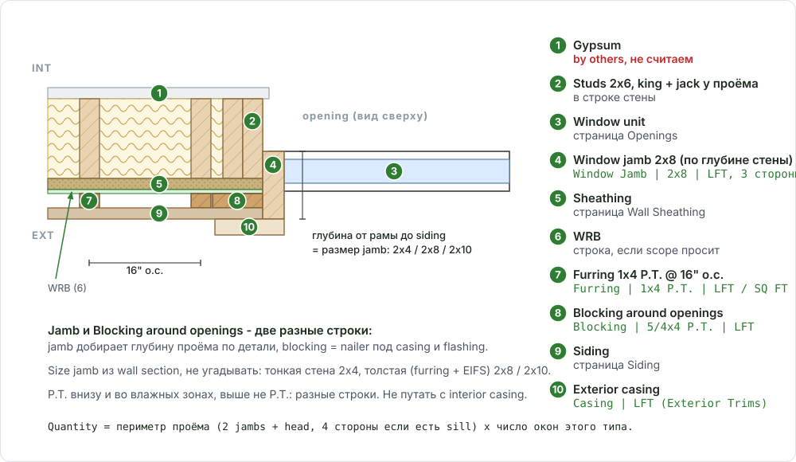

# Furring & Window Jambs (рейка под siding и доска в проёмах)

<figure markdown>
  
  <figcaption markdown="span">Горизонтальный разрез окна: stud wall, sheathing, furring под siding, рама окна, jamb по глубине стены, casing снаружи. Jamb и furring живут в разрезах, не на фасаде.</figcaption>
</figure>

## Что это

Две вещи, которые легко пропустить, потому что их нет на elevations.
**Furring** это рейка между WRB и siding: вентзазор (rainscreen) или ровная
плоскость под обшивку. **Window jamb** это доска, добирающая глубину проёма
от рамы окна до плоскости siding. Z-furring по CMU и furring подвала
разобраны на [Furring (стены)](../vertical/walls/furring.md); здесь
furring под siding и jambs как часть exterior-scope.

## Где искать на чертежах

| Лист | Что взять |
| --- | --- |
| Wall sections (A3xx, A4xx) | Есть ли furring под siding, размер `1x4` / `2x4`, шаг, P.T. или нет |
| Window и door details (head, jamb, sill) | Jamb `2x4` / `2x8` / `2x10` по толщине стены, P.T. у низа |
| Wall types (wt) | Rainscreen в составе стены, continuous insulation (jamb становится глубже) |
| Flare и bump details | `2x blocking, rip as req'd` |

## Как мерить в OurPlanCore

Furring под siding: по площади siding (из `siding` или фасадов) с пересчётом
в LFT по шагу, отдельный Line не нужен; сплошной furring пишется в SQ FT.
Jambs: формулой от списка проёмов (периметр x количество), размеры проёмов
берутся из `openings`. Площадь стен подвала под treated furring: Area или
Line по разрезу на листе с точкой W.

## Как назвать в дереве и строка DFL

| Строка DFL | Size | Unit | Правило |
| --- | --- | --- | --- |
| `Furring 1x4 @ 16" o.c.` | `1x4` или `1x4 P.T.` | LFT | `=CEILING(SF*12/16*1.1,10)`; шаг в строке |
| `Furring` (сплошной) | `1x4` | SQ FT | когда деталь задаёт сплошную плоскость |
| `Furring 2x4` | `2x4` / `2x4 P.T.` | LFT | толще по structural |
| `Window jamb` | `2x4` / `2x8` / `2x10` | LFT | периметр 3 стороны (2 jambs + head) или 4 с sill, x число окон |
| `Blocking around all openings` | `5/4x4 P.T.` | LFT | nailer под casing и flashing; вставляет `B_JambsAllBlock` |
| `2x blocking, rip as req'd` | `2x` | LFT | flare и bump по детали |

- `P.T.` и не `P.T.` это разный продукт: P.T. у foundation и во влажных
  зонах, выше обычно нет. Не пиши один size на всю стену, если деталь
  различает.
- `Window jamb` и `Blocking around all openings` это две разные строки, а не
  выбор: jamb добирает глубину, blocking даёт nailer.
- Furring у CMU не предлагать как optional; если деталь его показывает, он
  обязательный. Treated furring подвала отдельная P.T.-сборка.
- Metal stud стены: деревянный jamb в проёмах наш, даже если каркас by
  others. Если jambs не нужны, нота `Assumed window jambs 2x4 are not used
  per A8.53; verify`.

## Частые ошибки

- Furring пропущен, потому что смотрели только фасады.
- Один size и один P.T. на всю высоту стены.
- Jamb `2x4` при толстой стене с continuous insulation (нужен `2x8`).
- Furring записан как optional без причины.
- Structural jamb перепутан с interior casing.
- Все ошибки по стенам: [Стены](../../start/common-mistakes.md#walls).

## Пример

```text
Furring 1x4 @ 16" o.c.         1x4 P.T.   1290  LFT   =CEILING(1560*12/16*1.1,10)   7/A401
Window jamb                    2x8        612   LFT   =(2*5.5+3.3)*42 windows        4/A601
Blocking around all openings   5/4x4 P.T. 650   LFT   B_JambsAllBlock                A601
```

## См. также

- [Overview](overview.md), [Casing, Corner & Band](casing-corner-band.md), [Trim macros](macros.md)
- [Furring (стены)](../vertical/walls/furring.md), [Exterior Wall Materials](../vertical/sheathing/exterior-materials.md)
- [Underlayment](../siding/underlayment.md), [Windows and Doors](../vertical/openings/windows-doors.md)
