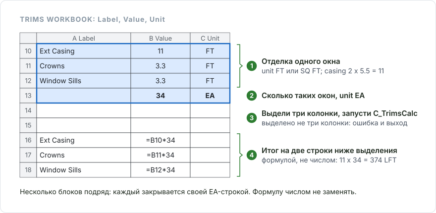

# Trim macros

Excel macros that calculate and insert trim blocks: `C_TrimsCalc`
(a block for one element multiplied by the quantity), collapsing identical
rows, inserting ready-made jambs, pavers, balcony and bolts blocks. The general map of
hotkeys and all the workbook macros: [Excel macro hotkeys](../../reference/excel-hotkeys.md).

<figure markdown>
  
  <figcaption markdown="span">C_TrimsCalc: the trim rows of one window are multiplied by the number of such windows; the total is written as a formula, not a number.</figcaption>
</figure>

<!-- TODO-SCREEN: excel-trimscalc-before-after.png (trims workbook worksheet before and after C_TrimsCalc) -->

## If the macro "does nothing"

1. The active workbook is the one with macros (TemplateCom or the trims workbook), not an xlsx copy.
2. Macros are enabled: Excel asks when opening; otherwise `File > Options >
   Trust Center > Macro Settings`.
3. Run it: the assigned key, a ribbon button, or `Alt+F8` and the macro name.

## Three columns: Label, Value, Unit

The trim calculation macros expect exactly three adjacent columns: `Label`,
`Value`, `Unit`. Select three columns with the trim rows:

| Label | Value | Unit |
| --- | --- | --- |
| `Ext. Casing sides` | `380` | `LFT` |
| `Head casing` | `204` | `LFT` |
| `Soffits at Porch` | `120` | `SQ FT` |
| (quantity row) | `2` | `EA` |

If the selection is not three columns, the macro shows an error and exits.

## C_TrimsCalc: block x quantity

Calculates the trim for one element multiplied by the number of such elements
(trim of one window x number of windows, trim of one balcony x number of balconies).

1. Write out the trim rows of one element (unit `FT` or `SQ FT`).
2. Right below them, a row where Value equals the quantity, Unit `EA`.
3. Several blocks in a row are fine: each one is closed by its own `EA` row.
4. Select the three columns across all blocks, run `C_TrimsCalc`.
5. Two rows below the selection a `Label | Sum * EA` table appears with
   formulas `=B12*3`. Check the Labels and multipliers.

The macro writes formulas, not numbers: the checker sees what the quantity
is made of. Do not replace the formula with a number.

## C_SumTheSameValues: collapse identical rows

Key `Label + Unit`, values are summed. Useful when `CornerBoards
5/4x6 | LFT` appears on every elevation and floor. Select the three columns,
run it (default ++ctrl+shift+f++). The selection is cleared and replaced with
unique rows with sums: work on a copy if you need the source rows.

## Y_MultiplySelectedCells: multiply everything

Multiplies every selected cell by a multiplier address (it asks for the address, for example
`G208`): appends `*G208` to a formula, turns a number into `=<number>*G208`.
For a waste factor and a block-wide multiplier. Default ++ctrl+m++.

## Inserting ready-made blocks

Insertion goes **from the selected row down**, shifting A:H. First put the cursor
on the right row, then run it: one row off will shift someone else's data.

| Macro | What it inserts | What to fix afterwards |
| --- | --- | --- |
| `B_JambsAllBlock` | `Jambs 5/4x4 P.T.` with a formula by openings, the `Wall Materials` header only if it is missing | size (`5/4x4`, `2x4`, `2x8`) and `P.T.` per the detail |
| `B_PaversBlock` | `Pavers` with the note `Note: Pavers Deck System are by others` | area in G, scope by others. Railing: `Decking + ... Railing` in the [Insert Block](../../reference/ewood-tab.md#insert) menu |
| `B_Balcony_Insert_Template_FromText` | a balcony block from the command `b 12x30` or `b 1.3x1.9 u2` (posts, beam, ledger, joists, decking, trims) | structure per S: cap by plies, Zmax hangers, decking per the detail; see [DFL blocks](../../reference/dfl-blocks.md) |
| `B_BoltsAdd` | Blocking, Anchor Bolts, Washers, Nuts (4 rows), G empty | lengths in G, size and spacing per the detail |
| `B_ShaftWallsBlocks` | two shaft wall blocks, CH + J and H + C, G empty | area in G, size and spacing; `Delete Zeros` removes the extra block |

## Cleanup after inserting

| Macro | Key | Action |
| --- | --- | --- |
| `X_DeleteRowsByColor` | ++ctrl+shift+d++ | delete the gray placeholder rows of the template |
| `B_DeleteZeroRowsOnlyIn_AtoH` | ++ctrl+e++ | delete rows with Value `0` only in A:H |
| `X_DeleteCellsUp` / `Y_InsertCellsUp` | ++ctrl+q++ / ++ctrl+w++ | delete or insert cells with a shift |
| `Y_noValidation` | ++ctrl+shift+v++ | remove validation dropdowns |
| `Y_CheckEnglish` | ++ctrl+shift+t++ | spell check |
| `Y_InsertDate` | ++ctrl+shift+o++ | insert the date |

## Order for a trim block

1. Put the cursor on the row, run the right insert macro.
2. Fix the size and `P.T.` per the specific detail.
3. Fill Value with formulas with visible addends.
4. The element repeats N times: an `EA` row and `C_TrimsCalc`.
5. Collapse duplicates across elevations: `C_SumTheSameValues`.
6. Waste or a block-wide multiplier: `Y_MultiplySelectedCells`.
7. Cleanup: gray rows, zeros, validation. Finish: date and spell check.

## See also

- [Overview](overview.md), [Furring & Window Jambs](furring-and-jambs.md), [Porch / Deck / Balcony](porch-deck-balcony.md)
- [Excel macro hotkeys](../../reference/excel-hotkeys.md), [DFL blocks](../../reference/dfl-blocks.md), [Formulas and factors](../../reference/formulas.md)
