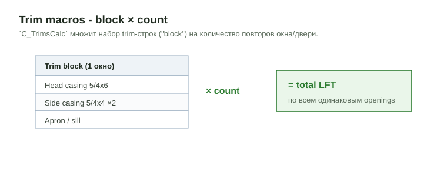

# Trim macros (макросы Excel для отделки)

Макросы Excel, которые считают и вставляют блоки отделки: `C_TrimsCalc`
(блок одного элемента, умноженный на количество), сворачивание одинаковых
строк, вставка готовых блоков jambs, pavers, balcony, bolts. Общая карта
клавиш и всех макросов книги: [Excel macro hotkeys](../../reference/excel-hotkeys.md).

<figure markdown>
  
  <figcaption markdown="span">C_TrimsCalc: строки отделки одного окна умножаются на число таких окон, итог пишется формулой, а не числом.</figcaption>
</figure>

<!-- TODO-SCREEN: excel-trimscalc-before-after.png (лист trims workbook до и после C_TrimsCalc) -->

## Если макрос "ничего не делает"

1. Активна книга с макросами (TemplateCom или trims workbook), а не копия xlsx.
2. Макросы включены: Excel спрашивает при открытии; иначе `File > Options >
   Trust Center > Macro Settings`.
3. Запуск: назначенная клавиша, кнопка на ленте или `Alt+F8` и имя макроса.

## Три колонки Label, Value, Unit

Расчётные макросы отделки ждут ровно три соседних столбца: `Label`,
`Value`, `Unit`. Выдели три столбца со строками отделки:

| Label | Value | Unit |
| --- | --- | --- |
| `Ext. Casing sides` | `380` | `LFT` |
| `Head casing` | `204` | `LFT` |
| `Soffits at Porch` | `120` | `SQ FT` |
| (строка количества) | `2` | `EA` |

Выделено не три столбца: макрос покажет ошибку и выйдет.

## C_TrimsCalc: блок x количество

Считает отделку на один элемент, умноженную на число таких элементов
(trim одного окна x число окон, trim одного балкона x число балконов).

1. Выпиши строки отделки одного элемента (unit `FT` или `SQ FT`).
2. Сразу под ними строка, где Value равно количеству, Unit `EA`.
3. Можно несколько блоков подряд: каждый закрывается своей `EA`-строкой.
4. Выдели три колонки по всем блокам, запусти `C_TrimsCalc`.
5. На две строки ниже выделения появится таблица `Label | Sum * EA` с
   формулами `=B12*3`. Проверь Label и множители.

Макрос пишет формулы, не числа: проверяющий видит, из чего получилось
количество. Не заменяй формулу числом.

## C_SumTheSameValues: свернуть одинаковые

Ключ `Label + Unit`, значения суммируются. Полезно, когда `CornerBoards
5/4x6 | LFT` встречается по всем фасадам и этажам. Выдели три колонки,
запусти (по умолчанию ++ctrl+shift+f++). Выделение очищается, на его месте
уникальные строки с суммами: делай на копии, если исходные строки нужны.

## Y_MultiplySelectedCells: умножить всё

Умножает каждую выделенную ячейку на адрес-множитель (спросит адрес, например
`G208`): к формуле допишет `*G208`, число превратит в `=<число>*G208`.
Для waste-фактора и общего множителя блока. По умолчанию ++ctrl+m++.

## Вставка готовых блоков

Вставка идёт **с выделенной строки вниз** со сдвигом A:H. Сначала встань
на нужную строку, потом запускай: ошибка строкой сдвинет чужие данные.

| Макрос | Что вставляет | Потом поправить |
| --- | --- | --- |
| `B_JambsAllBlock` | `Wall Materials` и `Blocking around all openings 5/4x4 P.T.` с формулой по проёмам | size (`5/4x4`, `2x4`, `2x8`) и `P.T.` по детали |
| `B_PaversBlock` | `Pavers` с нотой `Note: Pavers Deck System are by others`, Posts at Rails, Cables, Cap Rail | количества, scope by others |
| `B_Balcony_Insert_Template_FromText` | балконный блок по команде `b 12x30` или `b 1.3x1.9 u2` (posts, beam, ledger, joists, decking, trims) | конструктив по S: cap по plies, hangers Zmax, decking по детали; см. [Блоки DFL](../../reference/dfl-blocks.md) |
| `B_BoltsAdd` | Blocking, Anchor Bolts, Washers, Nuts (4 строки) | size и шаг по детали |
| `B_ShaftWallsBlocks` | блок shaft wall | size и шаг |

## Чистка после вставок

| Макрос | Клавиша | Действие |
| --- | --- | --- |
| `X_DeleteRowsByColor` | ++ctrl+shift+d++ | удалить серые строки-заглушки шаблона |
| `B_DeleteZeroRowsOnlyIn_AtoH` | ++ctrl+e++ | удалить строки с Value `0` только в A:H |
| `X_DeleteCellsUp` / `Y_InsertCellsUp` | ++ctrl+q++ / ++ctrl+w++ | удалить или вставить ячейки со сдвигом |
| `Y_noValidation` | ++ctrl+shift+v++ | убрать validation-дропдауны |
| `Y_CheckEnglish` | ++ctrl+shift+t++ | проверка орфографии |
| `Y_InsertDate` | ++ctrl+shift+o++ | поставить дату |

## Порядок для блока отделки

1. Встань на строку, запусти нужный insert-макрос.
2. Поправь size и `P.T.` по конкретной детали.
3. Заполни Value формулами с видимыми слагаемыми.
4. Элемент повторяется N раз: `EA`-строка и `C_TrimsCalc`.
5. Сверни дубли по фасадам: `C_SumTheSameValues`.
6. Waste или общий множитель: `Y_MultiplySelectedCells`.
7. Чистка: серые строки, нули, validation. Финал: дата и spell check.

## См. также

- [Overview](overview.md), [Furring & Window Jambs](furring-and-jambs.md), [Porch / Deck / Balcony](porch-deck-balcony.md)
- [Excel macro hotkeys](../../reference/excel-hotkeys.md), [Блоки DFL](../../reference/dfl-blocks.md), [Formulas and factors](../../reference/formulas.md)
