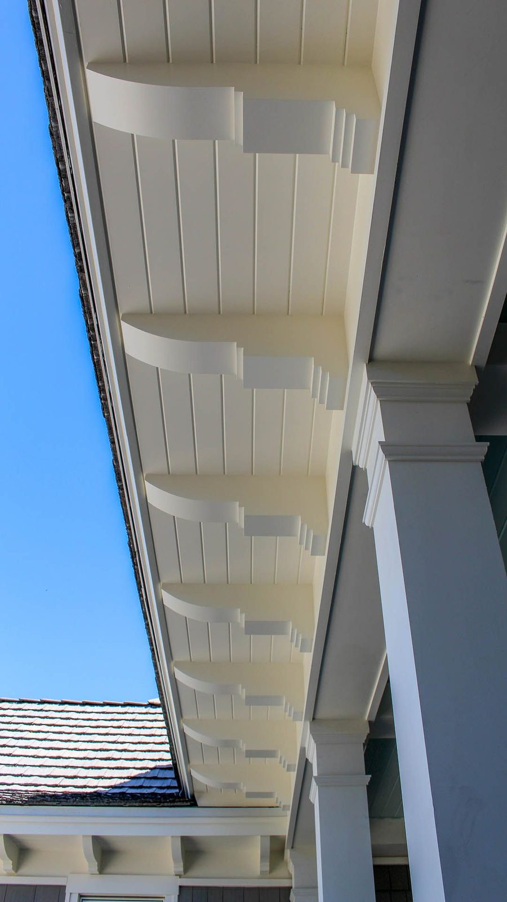
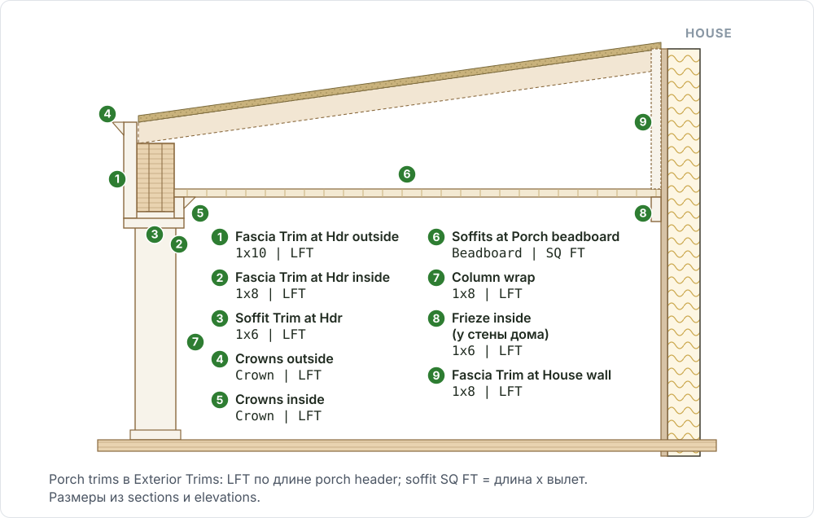
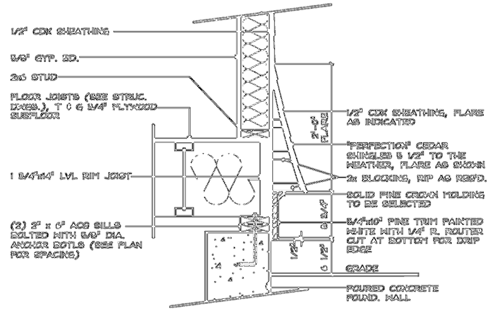

# Porch / Deck / Balcony

The hub for trim on open platforms. The frame is counted on
[Deck / Porch / Balcony Frame](../deck/deck-porch-balcony-frame.md); this page covers
what goes on top and outside: porch trims, railing and decking, balcony layers,
shower screen and pergola.

!!! note "Always include"
    These elements are not visible on the main elevations and are easy to forget. Go through every
    porch, deck and balcony separately, by its own sections and details.
    Insert trim only when it is in scope; with Frame only do not insert it.

-   :material-fence:{ .lg .middle } **Rails & Decking** - railing by type
    (composite as a system, wood by components, metal by others), decking,
    post hardware, lattice, skirt.
    [open](rails-decking.md)

-   :material-layers-triple:{ .lg .middle } **Balcony build-up** - all balcony
    layers, finish rows 7-12, assembly with pavers.
    [open](balcony-buildup.md)

-   :material-shower:{ .lg .middle } **Shower & Pergola** - privacy screen,
    pergola, trellis, canopy.
    [open](shower-pergola.md)

## Workflow

1. On the plans and elevations find every porch, deck and balcony, determine the type
   and the number of instances (see the blocks on the frame page).
2. Open the section and details of each: what is shown (fascia, soffit, columns,
   railing), what material.
3. For each block, after the frame rows add the trim rows with the block
   multiplier G. Size not specified: `TBD` and a note.

## Porch trims

<figure markdown>
  { width="360" }
  <figcaption markdown="span">Porch ceiling from below: board soffit (row `Soffits at Porch`, SQ FT), fascia along the edge (`Fascia Trim at Hdr outside`), decorative brackets and wrapped columns. Each element is counted as a separate row with the block multiplier. Photo: hbelementsinc.com, [source](https://www.hbelementsinc.com/portfolio/soffit-ceilings/), found via Pinterest.</figcaption>
</figure>

| DFL row | Typical size | Unit | Note |
| --- | --- | --- | --- |
| `Fascia Trim at Hdr outside` | `1x8` / `1x10` / `1x12` | LFT | along the header outside |
| `Fascia Trim at Hdr inside` | `1x12` | LFT | along the header inside |
| `Soffit Trim at Hdr` | `1x4` / `1x6` / `1x12` | LFT | |
| `Fascia Trim at House wall` | `5/4x6` / `5/4x12` | LFT | where it meets the house |
| `Soffits at Porch` | `Beadboard` / `Beadboard Vinyl` | SQ FT | porch ceiling, `=W*D*G` |
| `Frieze inside` | `5/4x12` | LFT | |
| `Crowns outside` / `Crowns inside` | `3-1/2" crown` | LFT | often `scaled` |
| `Columns` | `10"-12" Dia Fbg`, `SQ Fluted` | pcs + height | see [Soffit & Fascia](soffit-fascia.md) |
| `Column wrap` | `1x8` | LFT | post wrap |
| `Posts at Rails` | `4x4 P.T.` | pcs + 4' | plus sleeve and cap, see [Rails & Decking](rails-decking.md) |
| `Porch deck Fascia` | `1x10` | LFT | |

- The porch ceiling in the framing scope: `5/8" Gyp` as one row with two layers in
  the formula, see [frame](../deck/deck-porch-balcony-frame.md). Beadboard
  is the finish on top.
- No details: `Note: No Details provided; all trims are assumed per
  elevations`, all rows with `assumed`.

<figure markdown>
  
  <figcaption markdown="span">Section through the porch header: fascia trim outside and inside, soffit trim, frieze, crown, beadboard soffit (SQ FT), column wrap.</figcaption>
</figure>

## Flare / shingled bump

A wall that flares out at the bottom under shingles: its own set of blocking and trim.

<figure markdown>
  
  <figcaption markdown="span">Flare: 2x blocking (rip as req'd), crown, 5/4x10 trim with drip edge, cedar shingles. Flare sheathing and WRB go in their own rows.</figcaption>
</figure>

| DFL row | Size | Unit |
| --- | --- | --- |
| `Blocking (plates double)` / `(studs double)` | `2x6` | LFT |
| `Trims` | `5/4x10` | LFT |
| `Crowns` | `2" Crowns` | LFT |
| `Flare Sheathing` | `1/2" CDX Ply` | 4x8 |
| `WRB` | per the wall spec | SQ FT |

## Common mistakes

- Porch SQFT on the Front Page not filled when the porch is stacked with a balcony.
- Canopy and porch counted again in eave and rake.
- Trim inserted when the scope is Frame only.
- Columns without type and height; column wrap confused with column.
- All mistakes for the section: [Deck, porch, balconies](../../start/common-mistakes.md#deck).

## See also

- [Rails & Decking](rails-decking.md), [Balcony build-up](balcony-buildup.md), [Shower & Pergola](shower-pergola.md)
- [Soffit & Fascia](soffit-fascia.md), [Overview](overview.md)
- [Deck / Porch / Balcony Frame](../deck/deck-porch-balcony-frame.md), [Balcony Trims](../deck/balcony-trims.md), [Railing](../deck/railing.md)
- [Porch SQFT](../sqfts/porch.md), [Deck SQFT](../sqfts/deck.md), [Balcony SQFT](../sqfts/balcony.md)
