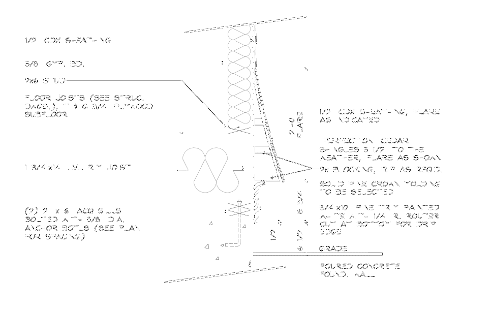

# Porch / Deck / Balcony (отделка крылец, deck и балконов)

Хаб по отделке открытых площадок. Каркас считается на
[Deck / Porch / Balcony Frame](../deck/deck-porch-balcony-frame.md), здесь
то, что сверху и снаружи: porch trims, перила и настил, слои балкона,
shower screen и pergola.

!!! note "Включать всегда"
    Эти элементы не видны на основных фасадах, их легко забыть. Каждый
    porch, deck и balcony проходи отдельно по своим разрезам и деталям.
    Отделку вставляй только когда она в scope; при Frame only не вставляй.

-   :material-fence:{ .lg .middle } **Rails & Decking** - перила по типам
    (composite система, wood поэлементно, metal by others), decking,
    hardware постов, lattice, skirt.
    [открыть](rails-decking.md)

-   :material-layers-triple:{ .lg .middle } **Balcony build-up** - все слои
    балкона, finish-строки 7-12, composition с pavers.
    [открыть](balcony-buildup.md)

-   :material-shower:{ .lg .middle } **Shower & Pergola** - privacy screen,
    pergola, trellis, canopy.
    [открыть](shower-pergola.md)

## Порядок работы

1. На планах и фасадах найди каждый porch, deck и balcony, определи тип
   и число экземпляров (см. блоки на странице каркаса).
2. Открой разрез и детали каждого: что показано (fascia, soffit, columns,
   перила), какой материал.
3. Для каждого блока после строк каркаса добавь строки отделки с
   множителем G блока. Размер не указан: `TBD` и нота.

## Porch trims

<!-- TODO-PHOTO: porch ceiling beadboard soffit with header fascia and columns, EN: "porch ceiling beadboard columns fascia" -->

| Строка DFL | Типовой size | Unit | Заметка |
| --- | --- | --- | --- |
| `Fascia Trim at Hdr outside` | `1x8` / `1x10` / `1x12` | LFT | по header снаружи |
| `Fascia Trim at Hdr inside` | `1x12` | LFT | по header изнутри |
| `Soffit Trim at Hdr` | `1x4` / `1x6` / `1x12` | LFT | |
| `Fascia Trim at House wall` | `5/4x6` / `5/4x12` | LFT | примыкание к дому |
| `Soffits at Porch` | `Beadboard` / `Beadboard Vinyl` | SQ FT | потолок крыльца, `=W*D*G` |
| `Frieze inside` | `5/4x12` | LFT | |
| `Crowns outside` / `Crowns inside` | `3-1/2" crown` | LFT | часто `scaled` |
| `Columns` | `10"-12" Dia Fbg`, `SQ Fluted` | pcs + высота | см. [Soffit & Fascia](soffit-fascia.md) |
| `Column wrap` | `1x8` | LFT | обшивка стойки |
| `Posts at Rails` | `4x4 P.T.` | pcs + 4' | плюс sleeve и cap, см. [Rails & Decking](rails-decking.md) |
| `Porch deck Fascia` | `1x10` | LFT | |

- Потолок porch в scope каркаса: `5/8" Gyp` одной строкой с двумя слоями в
  формуле, см. [каркас](../deck/deck-porch-balcony-frame.md). Beadboard
  это отделка поверх.
- Нет деталей: `Note: No Details provided; all trims are assumed per
  elevations`, все строки с `assumed`.

## Flare / shingled bump

Расширение стены книзу под shingle: свой набор blocking и trim.

<figure markdown>
  
  <figcaption markdown="span">Flare: 2x blocking (rip as req'd), crown, 5/4x10 trim с drip-edge, cedar shingles. Обшивка и WRB flare идут в свои строки.</figcaption>
</figure>

| Строка DFL | Size | Unit |
| --- | --- | --- |
| `Blocking (plates double)` / `(studs double)` | `2x6` | LFT |
| `Trims` | `5/4x10` | LFT |
| `Crowns` | `2" Crowns` | LFT |
| `Flare Sheathing` | `1/2" CDX Ply` | 4x8 |
| `WRB` | по спецификации стены | SQ FT |

## Частые ошибки

- Porch SQFT на Front Page не заполнен, когда porch стоит стопкой с балконом.
- Canopy и porch посчитаны повторно в eve и rake.
- Отделка вставлена при scope Frame only.
- Columns без типа и высоты; column wrap перепутан с column.
- Все ошибки раздела: [Deck, porch, балконы](../../start/common-mistakes.md#deck).

## См. также

- [Rails & Decking](rails-decking.md), [Balcony build-up](balcony-buildup.md), [Shower & Pergola](shower-pergola.md)
- [Soffit & Fascia](soffit-fascia.md), [Overview](overview.md)
- [Deck / Porch / Balcony Frame](../deck/deck-porch-balcony-frame.md), [Balcony Trims](../deck/balcony-trims.md), [Railing](../deck/railing.md)
- [Porch SQFT](../sqfts/porch.md), [Deck SQFT](../sqfts/deck.md), [Balcony SQFT](../sqfts/balcony.md)
