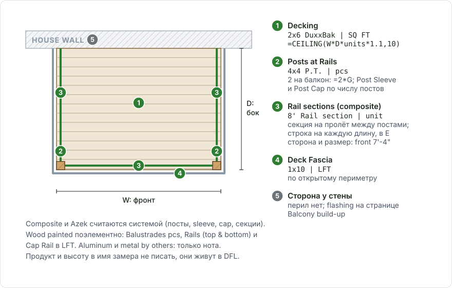
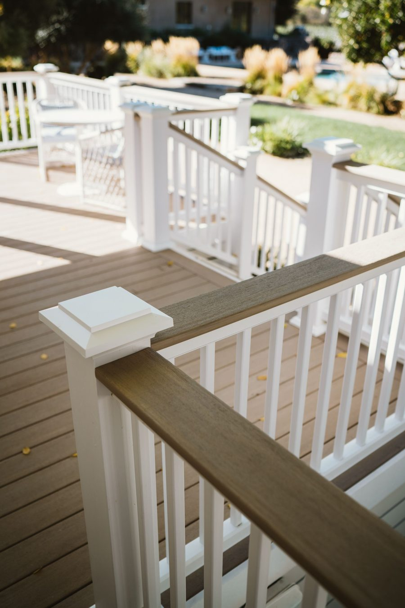
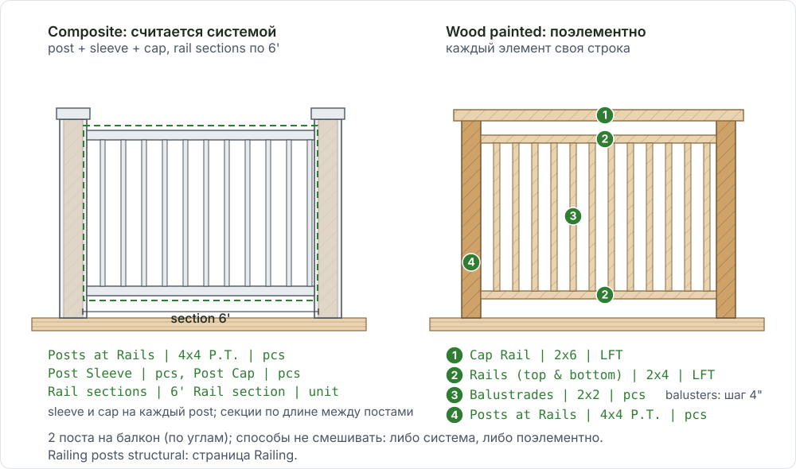

# Rails & Decking

<figure markdown>
  
  <figcaption markdown="span">Balcony plan: decking by the area W x D, two railing posts at the outer corners, rail sections along the front and the open sides, fascia along the open perimeter. Composite railing is counted as a system, painted wood railing by components.</figcaption>
</figure>

<figure markdown>
  { width="360" }
  <figcaption markdown="span">Composite railing on a deck: the post is covered with a white sleeve and cap, a wood-look cap rail on top, balusters between the top and bottom rail, composite decking. Such a system is counted as railing LFT plus posts in pieces; decking separately in SQ FT. Photo: timbertech.com, [source](https://www.timbertech.com/products/railing/), found via Pinterest.</figcaption>
</figure>

## What it is

Railing and decking of balconies, porches and decks: railing systems (composite, Azek,
wood, cable, metal), decking, post hardware, balusters, cap rail, deck
fascia, skirt, risers, lattice. This is neither trim nor framing: the frame is on
[Deck / Porch / Balcony Frame](../deck/deck-porch-balcony-frame.md), the balcony layers
on [Balcony build-up](balcony-buildup.md). This page is the canonical page for
railing types; the short version for the balcony block is on [Railing](../deck/railing.md).

## Where to find it on the plans

| Sheet | What to take |
| --- | --- |
| Elevations | Railing type (composite, wood, cable, aluminum), height 36" or 42", whether the decking is visible |
| Details A5xx (railing detail, deck edge) | Post, sleeve, cap, rail sections or balusters, cap rail, fascia, skirt |
| Spec and notes | `Railing by others`, product (Trex, Azek, DuxxBak), `verify` |
| Plans | Railing length by side, number of balconies and porches of each type |

## How to measure in OurPlanCore

Decking and railing come from the block size: area `W x D`, railing front
`W` plus open sides `D`, multiplied by the number of instances G. The area
of balconies and porches as an Area sits in `sqfts/blcny` and `sqfts/porch`; a deck near
grade with a complex outline is traced as an Area in `sqfts` with a clear name, railing
along a broken outline as a Line. Do not put the product and height in the name; they live in the DFL.

<figure markdown>
  
  <figcaption markdown="span">Left: composite as a system (posts with sleeve and cap, 6' sections); right: painted wood by components (posts, balusters, rails, cap rail). Two posts per balcony; do not mix methods in one block.</figcaption>
</figure>

## Tree name and DFL row

One counting method per run: a **system** (factory sections) or
**by components**. Composite and Azek are always a system; by components only for painted
wood. Do not mix.

| Type | DFL rows | Unit | Rule |
| --- | --- | --- | --- |
| Composite / Azek (system) | `Note: Railing called composite; Decking assumed Composite`, `Posts at Rails 4x4 P.T.`, `Post Sleeve` `Sleeve for 4x4`, `Post Cap` `Cap for 4x4`, `Rail sections` `6' Rail section` | pcs, unit | posts `=2*G` per balcony; front and side sections as separate rows |
| Wood painted (by components) | `Posts at Rails 4x4 P.T.`, `Balustrades 2x2`, `Rails (top & bottom) 2x4`, `Cap Rail 2x6` | pcs, LFT | `Balustrades =EVEN(G*2.2)`, `Rails =EVEN(G*2.2)`, `Cap Rail =EVEN(G*1.1)`, G = railing LFT x units |
| Cable | `Posts at Rails 4x4 P.T.` or `Mtl post`, sleeve/cap, `Cables SS`, `Cap Rail 2x6` | pcs, LFT | cables = run x number of cables (`assumed 7 runs`), note `verify product` |
| Aluminum / metal | `Note: Aluminum railing materials are by others; verify components` | | material not counted, the note is required |

Decking and perimeter:

| DFL row | Material | Unit | Rule |
| --- | --- | --- | --- |
| Balcony `Decking` | `2x6 DuxxBak` | SQ FT | `=W*D*G`; on a terrace over the garage `5/4x6` over `3/4" Ply` and `Sleepers 2x4 P.T.` |
| Deck / porch `Decking` | `5/4x6` Composite, Azek, Wd, `5/4x4 T&G Mahogany` | SQ FT | product per spec, otherwise `TBD` and a note |
| `Treads` | per decking material | LFT / pcs | separate from the area |
| `Deck Fascia` / `Deck Skirt` | `1x8`, `1x10`, `1x12 Azek` | LFT | along the open perimeter |
| `Deck Risers`, `Stringer trim` | `1x6`, `1x8`, `1x12` | LFT | deck stair |
| `Lattice` + `Lattice wrap trim` | `PVC lattice`, `5/4x6` | SQ FT + LFT | area plus framing trim |

Outdoor posts are always `P.T.`; under a roof (enclosed porch) regular.
Post base and anchor (`ABU66 Zmax`, `DTT2Z`) only when the detail shows them,
as frame rows with the detail in E, format per [Hangers](../../reference/hangers.md#dfl-format).
Full block content: [DFL blocks](../../reference/dfl-blocks.md).

## Common mistakes

- Three posts per balcony instead of two; a corner balcony against two walls carries one.
- System and component counting mixed: `Rail sections` together with `Balustrades`.
- Aluminum railing counted as material.
- `Rails (top & bottom)` taken as one run instead of two.
- Balcony decking `5/4x6` instead of `2x6 DuxxBak` per the detail.
- A product guessed instead of `TBD` and the note `Decking & Railing products to verify`.
- All mistakes for the section: [Deck, porch, balconies](../../start/common-mistakes.md#deck).

## Example

```text
Note: Railing called composite; Decking assumed Composite
Posts at Rails   4x4 P.T.          12  pcs    =2*G       4'
Post Sleeve      Sleeve for 4x4    12  pcs    =C<posts>
Post Cap         Cap for 4x4       12  pcs    =C<posts>
Rail sections    6' Rail section   12  unit   front 12'
Rail sections    6' Rail section   16  unit   sides 2 x 8'
Decking          2x6 DuxxBak       576 SQ FT  =12*8*G    5/A550
```

## See also

- [Railing](../deck/railing.md), [Deck / Porch / Balcony Frame](../deck/deck-porch-balcony-frame.md), [Balcony build-up](balcony-buildup.md)
- [Porch / Deck / Balcony](porch-deck-balcony.md), [Soffit & Fascia](soffit-fascia.md)
- [DFL blocks](../../reference/dfl-blocks.md), [Material catalog](../../reference/material-catalog.md), [Standard notes](../../reference/standard-notes.md)
