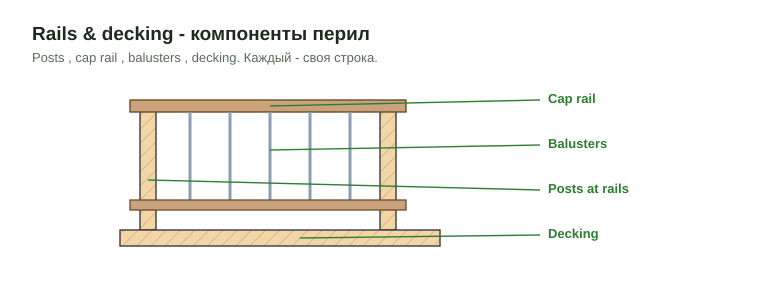
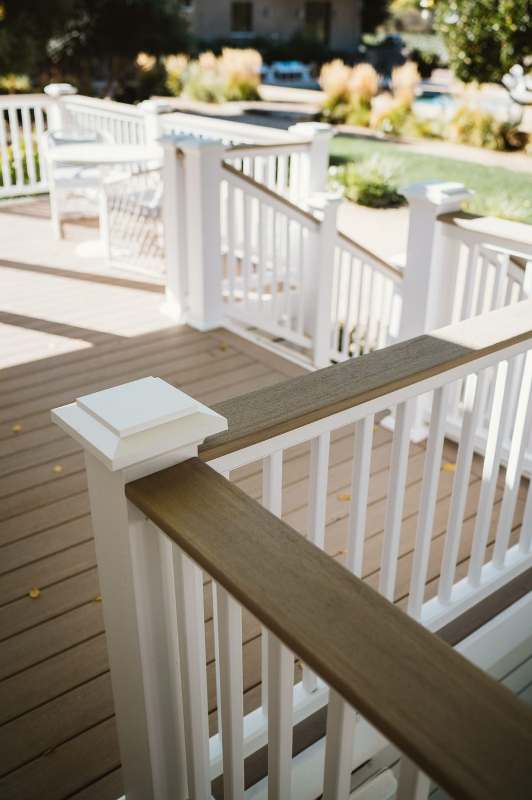
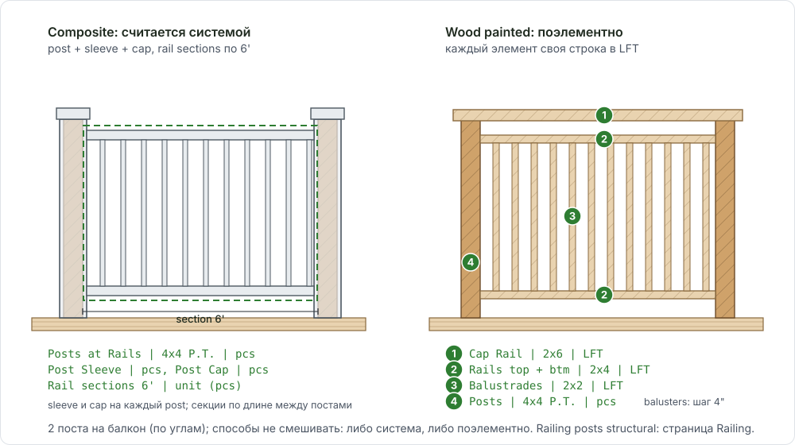

# Rails & Decking (перила и настил: канон по типам)

<figure markdown>
  
  <figcaption markdown="span">Posts, cap rail, balusters, decking: у каждого своя строка. Composite перила считаем системой, деревянные крашеные поэлементно.</figcaption>
</figure>

<figure markdown>
  { width="360" }
  <figcaption markdown="span">Composite railing на deck: пост закрыт белым sleeve с cap, сверху cap rail под дерево, balusters между top и bottom rail, настил composite. Такую систему считаем LFT перил плюс посты штуками; decking отдельно SQ FT. Фото: timbertech.com, [источник](https://www.timbertech.com/products/railing/), найдено через Pinterest.</figcaption>
</figure>

## Что это

Перила и настил балконов, porch и deck: railing-системы (composite, Azek,
wood, cable, metal), decking, hardware постов, balusters, cap rail, deck
fascia, skirt, risers, lattice. Это не trim и не каркас: каркас на
[Deck / Porch / Balcony Frame](../deck/deck-porch-balcony-frame.md), слои
балкона на [Balcony build-up](balcony-buildup.md). Эта страница канон по
типам перил; короткая версия для блока балкона на [Railing](../deck/railing.md).

## Где искать на чертежах

| Лист | Что взять |
| --- | --- |
| Elevations | Тип перил (composite, wood, cable, aluminum), высота 36" или 42", decking виден или нет |
| Детали A5xx (railing detail, deck edge) | Post, sleeve, cap, rail sections или balusters, cap rail, fascia, skirt |
| Spec и notes | `Railing by others`, продукт (Trex, Azek, DuxxBak), `verify` |
| Планы | Длина перил по сторонам, количество балконов и порчей каждого типа |

## Как мерить в OurPlanCore

Decking и перила берутся из размеров блока: площадь `W x D`, перила фронт
`W` плюс открытые бока `D`, умноженные на число экземпляров G. Площадь
балконов и порчей как Area лежит в `sqfts/blcny` и `sqfts/porch`; deck у
земли со сложным контуром обводят Area в `sqfts` с понятным именем, перила
по изломанному контуру Line. Продукт и высоту в имя не писать, они живут в DFL.

<figure markdown>
  
  <figcaption markdown="span">Слева composite как система (посты с sleeve и cap, секции 6'), справа wood painted поэлементно (posts, balusters, rails, cap rail). Два поста на балкон, способы в одном блоке не смешивать.</figcaption>
</figure>

## Как назвать в дереве и строка DFL

Способ счёта один на участок: **система** (заводские секции) или
**поэлементно**. Composite и Azek всегда система; поэлементно только wood
painted. Не смешивать.

| Тип | Строки DFL | Unit | Правило |
| --- | --- | --- | --- |
| Composite / Azek (система) | `Note: Railing called composite; Decking assumed Composite`, `Posts at Rails 4x4 P.T.`, `Post Sleeve` `Sleeve for 4x4`, `Post Cap` `Cap for 4x4`, `Rail sections` `6' Rail section` | pcs, unit | посты `=2*G` на балкон; секции фронт и бока отдельными строками |
| Wood painted (поэлементно) | `Posts at Rails 4x4 P.T.`, `Balustrades 2x2`, `Rails (top & bottom) 2x4`, `Cap Rail 2x6` | pcs, LFT | `Balustrades =EVEN(G*2.2)`, `Rails =EVEN(G*2.2)`, `Cap Rail =EVEN(G*1.1)`, G = LFT перил x units |
| Cable | `Posts at Rails 4x4 P.T.` или `Mtl post`, sleeve/cap, `Cables SS`, `Cap Rail 2x6` | pcs, LFT | cables = прогон x число тросов (`assumed 7 runs`), нота `verify product` |
| Aluminum / metal | `Note: Aluminum railing materials are by others; verify components` | | материал не считаем, нота обязательна |

Decking и периметр:

| Строка DFL | Материал | Unit | Правило |
| --- | --- | --- | --- |
| `Decking` балкона | `2x6 DuxxBak` | SQ FT | `=W*D*G`; в Terrace над гаражом `5/4x6` поверх `3/4" Ply` и `Sleepers 2x4 P.T.` |
| `Decking` deck / porch | `5/4x6` Composite, Azek, Wd, `5/4x4 T&G Mahogany` | SQ FT | продукт по spec, иначе `TBD` и нота |
| `Treads` | по материалу decking | LFT / pcs | отдельно от площади |
| `Deck Fascia` / `Deck Skirt` | `1x8`, `1x10`, `1x12 Azek` | LFT | по открытому периметру |
| `Deck Risers`, `Stringer trim` | `1x6`, `1x8`, `1x12` | LFT | лестница deck |
| `Lattice` + `Lattice wrap trim` | `PVC lattice`, `5/4x6` | SQ FT + LFT | площадь плюс обрамление |

Посты на улице всегда `P.T.`; под крышей (закрытый porch) обычные.
Post base и anchor (`ABU66 Zmax`, `DTT2Z`) только когда деталь их показывает,
строки каркаса с деталью в E, формат по [Hangers](../../reference/hangers.md#dfl-format).
Полный состав блока: [Блоки DFL](../../reference/dfl-blocks.md).

## Частые ошибки

- Три поста на балкон вместо двух; угловой балкон у двух стен несёт один.
- Система и поэлементный счёт смешаны: `Rail sections` вместе с `Balustrades`.
- Aluminum перила посчитаны как материал.
- `Rails (top & bottom)` взяты одной ниткой вместо двух.
- Decking балкона `5/4x6` вместо `2x6 DuxxBak` по детали.
- Продукт угадан вместо `TBD` и ноты `Decking & Railing products to verify`.
- Все ошибки раздела: [Deck, porch, балконы](../../start/common-mistakes.md#deck).

## Пример

```text
Note: Railing called composite; Decking assumed Composite
Posts at Rails   4x4 P.T.          12  pcs    =2*G       4'
Post Sleeve      Sleeve for 4x4    12  pcs    =C<posts>
Post Cap         Cap for 4x4       12  pcs    =C<posts>
Rail sections    6' Rail section   12  unit   front 12'
Rail sections    6' Rail section   16  unit   sides 2 x 8'
Decking          2x6 DuxxBak       576 SQ FT  =12*8*G    5/A550
```

## См. также

- [Railing](../deck/railing.md), [Deck / Porch / Balcony Frame](../deck/deck-porch-balcony-frame.md), [Balcony build-up](balcony-buildup.md)
- [Porch / Deck / Balcony](porch-deck-balcony.md), [Soffit & Fascia](soffit-fascia.md)
- [Блоки DFL](../../reference/dfl-blocks.md), [Material catalog](../../reference/material-catalog.md), [Standard notes](../../reference/standard-notes.md)
