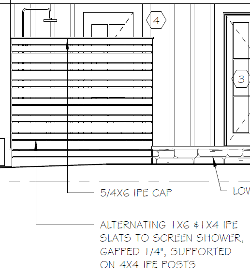

# Outdoor Shower & Pergola

<figure markdown>
  
  <figcaption markdown="span">Outdoor shower screen: 1x6 and 1x4 IPE slats with a 1/4" gap, 4x4 IPE posts, 5/4 IPE cap. Slats are counted by the screen area, posts in pieces with the height.</figcaption>
</figure>

## What it is

Open garden structures in the exterior scope: privacy and shower screens,
pergolas and trellises, a canopy over the entry. There are usually few details, and many rows
go in as `assumed` per the elevation.

## Where to find it on the plans

| Sheet | What to take |
| --- | --- |
| Elevations and site plan | Where the screen, pergola, canopy are; heights |
| Details A5xx | Slat, post and cap sizes, 1E shape beams, trellis, brackets |
| Roof plan and canopy section | Header wrap, fascia, canopy soffit; canopy framing separately |

## How to measure in OurPlanCore

Screen: an Area for the screen area (slats) and a Count of posts. Pergola: a Count of beams
and trellis members with the length in the row, a Line for the ledger. Canopy: a Line along the fascia and
an Area for the soffit, in its own item, not in `eves rakes`. Canopy framing is counted
on [Canopy](../horizontal/roof-framing/canopy.md).

## Tree name and DFL row

| Element | DFL row | Material | Unit |
| --- | --- | --- | --- |
| Shower screen | `Posts` | `4x4 P.T.`, `4x4 IPE` | pcs + height (`7'`, `10'`, `14'`) |
| | `Jamb` | `5/4 IPE Jambs`, `2x4 P.T.` | pcs / LFT |
| | `Slats` | `1x6 IPE` + `1x4 IPE` alternating, `1x6 Vert. Cedar BDS.` | SQ FT of screen, gap in the note |
| | `Cap` | `5/4 IPE Cap` | LFT |
| Pergola / trellis | `1E Shape` | `4x10 Cedar 1E Shape` | pcs + length |
| | `Trellis` | `3x3` | pcs + length |
| | `Ledger`, `Brackets`, `Posts` | `2x4`, per detail, `4x4` / `6x6` | pcs, LFT |
| Canopy | `Soffits at Canopy Eves` | `Azek Beadboard` | SQ FT |
| | `Fascia at Canopies`, `Canopy Hdr wraps` | `1x6` / `1x8`, `1x4` | LFT |
| | `Frame for Soffits` | per detail, 24" o.c. | LFT |

- Keep the material (IPE, cedar, P.T.) in the row; do not reduce it to something generic.
- `Garage Shower Outside` is a separate run with its own posts and slats.
- No detail: `Posts 4x4 P.T. assumed`, `Jamb 2x4 P.T. assumed`.

## Common mistakes

- Canopy counted again in eave and rake.
- Slats counted in LFT instead of the screen area.
- Pergola as one row without the main beams, trellis, ledger, brackets, posts.
- All mistakes for the section: [Deck, porch, balconies](../../start/common-mistakes.md#deck).

## Example

```text
Posts   4x4 IPE                       6   pcs    10'    assumed  A502
Slats   1x6 + 1x4 IPE alternating     180 SQ FT  gap 1/4"        A502
Cap     5/4 IPE Cap                   24  LFT                    A502
```

## See also

- [Porch / Deck / Balcony](porch-deck-balcony.md), [Rails & Decking](rails-decking.md), [Soffit & Fascia](soffit-fascia.md)
- [Canopy](../horizontal/roof-framing/canopy.md), [Furring & Window Jambs](furring-and-jambs.md)
