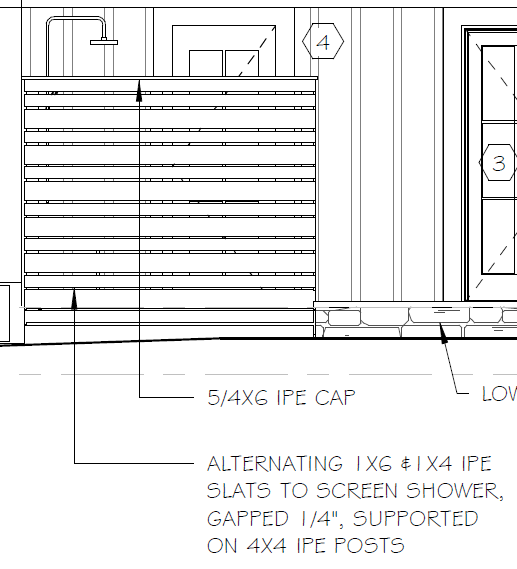

# Outdoor Shower & Pergola (экран душа, pergola, canopy)

<figure markdown>
  
  <figcaption markdown="span">Экран наружного душа: 1x6 и 1x4 IPE slats с зазором 1/4", 4x4 IPE posts, 5/4 IPE cap. Slats считаем площадью экрана, posts штуками с высотой.</figcaption>
</figure>

## Что это

Открытые садовые конструкции из exterior-scope: privacy и shower screen,
pergola и trellis, canopy над входом. Деталей обычно мало, много строк
идёт с `assumed` по elevation.

## Где искать на чертежах

| Лист | Что взять |
| --- | --- |
| Elevations и site plan | Где стоит экран, pergola, canopy; высоты |
| Details A5xx | Сечения slats, posts, cap, 1E shape балок, trellis, brackets |
| Roof plan и canopy section | Header wrap, fascia, soffit canopy; каркас canopy отдельно |

## Как мерить в OurPlanCore

Экран: Area по площади экрана (slats) и Count постов. Pergola: Count балок
и trellis-реек с длиной в строке, Line для ledger. Canopy: Line по fascia и
Area по soffit, в своём итеме, не в `eves rakes`. Каркас canopy считается
на [Canopy](../horizontal/roof-framing/canopy.md).

## Как назвать в дереве и строка DFL

| Элемент | Строка DFL | Материал | Unit |
| --- | --- | --- | --- |
| Shower screen | `Posts` | `4x4 P.T.`, `4x4 IPE` | pcs + высота (`7'`, `10'`, `14'`) |
| | `Jamb` | `5/4 IPE Jambs`, `2x4 P.T.` | pcs / LFT |
| | `Slats` | `1x6 IPE` + `1x4 IPE` alternating, `1x6 Vert. Cedar BDS.` | SQ FT экрана, gap в ноте |
| | `Cap` | `5/4 IPE Cap` | LFT |
| Pergola / trellis | `1E Shape` | `4x10 Cedar 1E Shape` | pcs + длина |
| | `Trellis` | `3x3` | pcs + длина |
| | `Ledger`, `Brackets`, `Posts` | `2x4`, по детали, `4x4` / `6x6` | pcs, LFT |
| Canopy | `Soffits at Canopy Eves` | `Azek Beadboard` | SQ FT |
| | `Fascia at Canopies`, `Canopy Hdr wraps` | `1x6` / `1x8`, `1x4` | LFT |
| | `Frame for Soffits` | по детали, 24" o.c. | LFT |

- Материал (IPE, cedar, P.T.) держи в строке, не своди к generic.
- `Garage Shower Outside` отдельный участок со своими posts и slats.
- Нет детали: `Posts 4x4 P.T. assumed`, `Jamb 2x4 P.T. assumed`.

## Частые ошибки

- Canopy посчитан в eve и rake повторно.
- Slats посчитаны LFT вместо площади экрана.
- Pergola одной строкой без главных балок, trellis, ledger, brackets, posts.
- Все ошибки раздела: [Deck, porch, балконы](../../start/common-mistakes.md#deck).

## Пример

```text
Posts   4x4 IPE                       6   pcs    10'    assumed  A502
Slats   1x6 + 1x4 IPE alternating     180 SQ FT  gap 1/4"        A502
Cap     5/4 IPE Cap                   24  LFT                    A502
```

## См. также

- [Porch / Deck / Balcony](porch-deck-balcony.md), [Rails & Decking](rails-decking.md), [Soffit & Fascia](soffit-fascia.md)
- [Canopy](../horizontal/roof-framing/canopy.md), [Furring & Window Jambs](furring-and-jambs.md)
