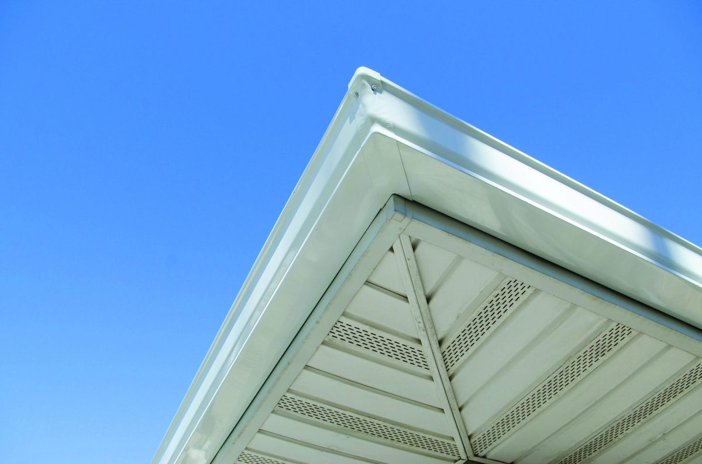
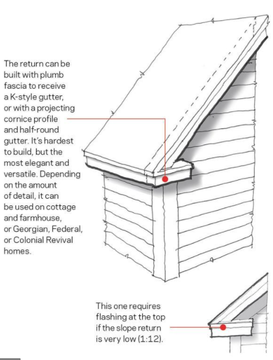
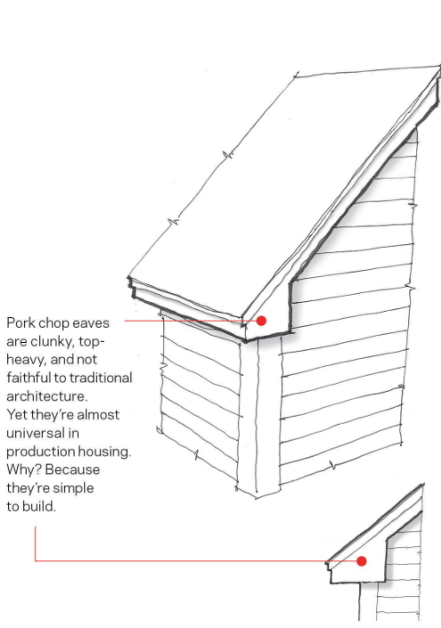

# Soffit & Fascia

<figure markdown>
  
  <figcaption markdown="span">Eave corner from below: vented soffit panels between the wall and the fascia, fascia with a gutter along the edge. Soffit is counted by area (overhang length times width), fascia in LFT along the same line. Photo: brothersgutters.com, [source](https://brothersgutters.com/gutter-services/exterior-solutions/fascia-board/), found via Pinterest.</figcaption>
</figure>

<figure markdown>
  
  <figcaption markdown="span">Gable corner: the eave with soffit and fascia runs along the wall, the rake follows the slope, a return in the corner. A proper cornice return is a separate set of rows.</figcaption>
</figure>

## What it is

Soffit (the underside of the overhang), fascia (the edge board), frieze (the board on the wall
under the soffit), rake moulding, returns and porch columns. Usually a separate block
`Soffits and Fascias`. Eave and rake lengths come from
[Eve](../sheathing-and-misc/eve.md) and [Rake](../sheathing-and-misc/rake.md);
soffit sheathing (5/8" exterior gypsum, plywood) is
[Sheathing](../vertical/sheathing/wall-sheathing.md), not trim.

## Where to find it on the plans

| Sheet | What to take |
| --- | --- |
| Eave and rake details (A5xx) | Overhang width, soffit material (vinyl vented, beadboard, 1x), fascia, frieze, rake moulding |
| Elevations | Where the eaves are, where the rakes are, returns (cornice or pork-chop), columns and their type |
| RCP and porch sections | Porch and canopy ceiling: material, area, 5/8" exterior gypsum under the finish |
| Spec | `Soffits assumed Vinyl; Fascias assumed PVC or 1x Alum wrapped; verify` |

## How to measure in OurPlanCore

Overhang lengths are Lines in `eves rakes/eves` and `eves rakes/rakes` with the overhang in
inches in the name (`eve 24 main`, `rake 12 main`, `returns 12`): one line
feeds both the trim and the overhang sheathing. Soffit as an area (beadboard, panel) is an
Area along the real underside outline in `trims` or in the job's agreed branch
(`rcp 1.6`); the outline is not the roof deck. Do not feed one area twice:
either `length x width` or an Area. A canopy is not part of eave and rake; it has its own
rows. Columns are Count points.

## Tree name and DFL row

| Tree name | DFL row | Size | Unit | Rule |
| --- | --- | --- | --- | --- |
| `eves rakes/eves/eve 24 main` | `Soffits at Eves` | `12" Vinyl vented`, `1x12`, `T&G beadboard` | LFT or SQ FT | a constant-width board in LFT; panel and beadboard in SQ FT = length x overhang |
| | `Fascia at Eves` | `1x8`, `2x8`, `5/4x10` | LFT | |
| | `Frieze` | `5/4x6` / `5/4x8` | LFT | on the wall under the soffit |
| | `Trim over fascia` | `1x3` / `1x4` | LFT | extra strip |
| `eves rakes/rakes/rake 12 main` | `Soffits at Rakes`, `Fascia at Rakes` | `1x8`, `9" Vinyl` | LFT / SQ FT | separate from eaves: different size and material |
| | `Rake Moulding`, `Crown at Frieze` | `3" crown` | LFT | |
| `eves rakes/eves/returns 12` | `Soffit / Fascia / Crown at Returns` | per detail | LFT | a cornice return as a mini set; pork-chop only fascia and a small soffit |
| `trims/soffit porch` | `Soffits at Porch`, `at Canopy`, `at Floor Overhangs` | `Beadboard`, `Azek Beadboard` | SQ FT | their own rows, not in main eaves |
| `trims/columns` | `Columns` | `12" Dia Fbg Non-taper w/c&b` | pcs + height | `w/c&b`, taper, round/square in the row; height separately |
| | `Column wrap` | `1x8` | LFT | post wrap, not a column |
| | `Posts at Rails`, `Post Sleeve`, `Post cap` | `4x4 P.T.`, `Sleeve for 4x4` | pcs | a set, see [Rails & Decking](rails-decking.md) |

Material not specified: `Note: Soffits assumed Vinyl; Fascias assumed PVC or
1x Alum wrapped; verify`. Do not substitute wood if vinyl or alum is possible.

<figure markdown>
  
  <figcaption markdown="span">Pork-chop return: a simple triangular stub. Trim is minimal, but the fascia and a small soffit are counted.</figcaption>
</figure>

## Common mistakes

- Canopy and porch counted again in eave and rake.
- Soffit panel counted both as LFT x width and as an Area.
- Eaves and rakes in one row with different sizes.
- Returns not identified (cornice or pork-chop), trim at returns missed.
- Columns without type, taper and height; column wrap confused with column.
- 5/8" exterior gypsum soffit written in trim instead of sheathing and WRB.
- All roof mistakes: [Roof](../../start/common-mistakes.md#roof).

## Example

```text
Takeoffs/Main/eves rakes/eves/eve 24 main     Line   310 LFT
Takeoffs/Main/eves rakes/rakes/rake 12 main   Line   96 LFT

Soffits at Eves     12" Vinyl vented   620  SQ FT  =310*2
Fascia at Eves      1x8                310  LFT
Frieze              5/4x6              310  LFT
Soffits at Rakes    9" Vinyl           96   LFT
Fascia at Rakes     1x6                96   LFT
Columns             12" Dia Fbg Non-taper w/c&b   4  pcs   8'
```

## See also

- [Overview](overview.md), [Casing, Corner & Band](casing-corner-band.md), [Porch / Deck / Balcony](porch-deck-balcony.md)
- [Eve](../sheathing-and-misc/eve.md), [Rake](../sheathing-and-misc/rake.md), [Returns](../sheathing-and-misc/returns.md), [Canopy](../horizontal/roof-framing/canopy.md)
- [Porch SQFT](../sqfts/porch.md), [Standard notes](../../reference/standard-notes.md)
