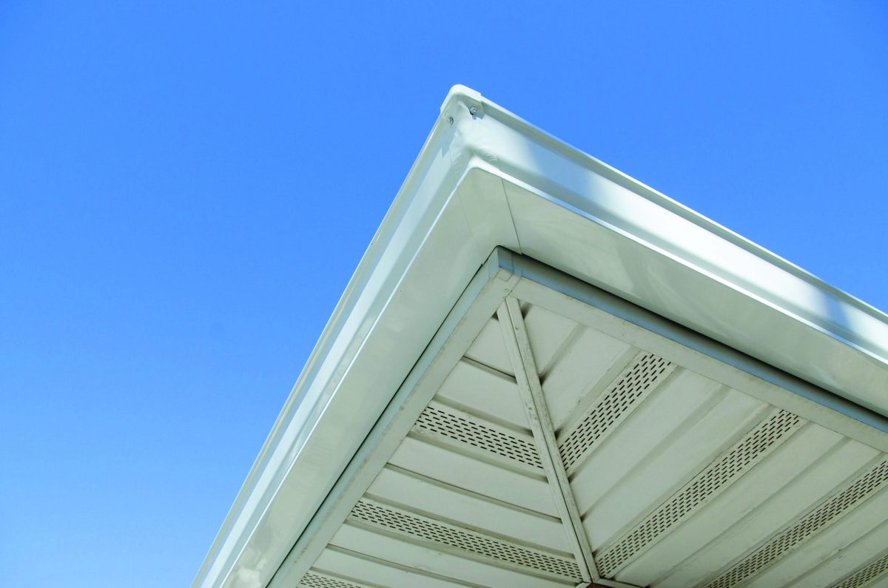
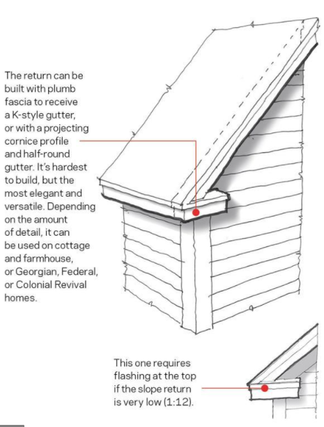
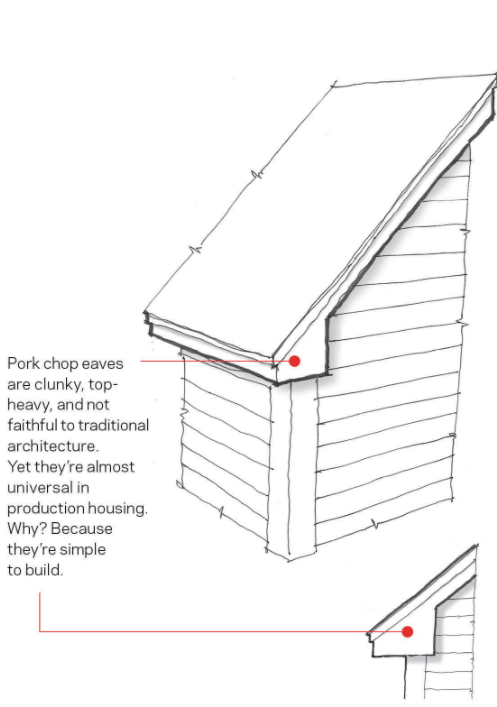

# Soffit & Fascia (подшивка свесов, торцевые доски, columns)

<figure markdown>
  
  <figcaption markdown="span">Угол eave снизу: панели вентилируемого soffit между стеной и fascia, по торцу fascia с водостоком. Soffit считаем площадью (длина свеса на ширину), fascia - LFT по той же линии. Фото: brothersgutters.com, [источник](https://brothersgutters.com/gutter-services/exterior-solutions/fascia-board/), найдено через Pinterest.</figcaption>
</figure>

<figure markdown>
  
  <figcaption markdown="span">Угол фронтона: eave с soffit и fascia уходит вдоль стены, rake по скату, в углу return. Длина return меряется отдельной линией и прибавляется к длине eave в строках soffit и fascia.</figcaption>
</figure>

## Что это

Soffit (подшивка свеса), fascia (торцевая доска), frieze (доска по стене
под soffit), rake moulding, returns и columns porch. Обычно отдельный блок
`Soffits and Fascias`. Длины eves и rakes приходят из
[Eve](../sheathing-and-misc/eve.md) и [Rake](../sheathing-and-misc/rake.md);
обшивка soffit (5/8" exterior gypsum, plywood) это
[Sheathing](../vertical/sheathing/wall-sheathing.md), не trim. Plywood как
сама видимая отделка soffit - другое дело: это `AC Ply` в `Soffits at Eves`,
SQ FT (таблица дефолтов ниже).

## Где искать на чертежах

| Лист | Что взять |
| --- | --- |
| Eave и rake details (A5xx) | Ширина свеса, материал soffit (vinyl vented, beadboard, 1x), fascia, frieze, rake moulding |
| Elevations | Где eaves, где rakes, returns (cornice или pork-chop), columns и их тип |
| RCP и porch sections | Потолок porch и canopy: материал, площадь, 5/8" exterior gypsum под отделкой |
| Spec | `Soffits assumed Vinyl; Fascias assumed PVC or 1x Alum wrapped; verify` |

## Как мерить в OurPlanCore

Длины свесов это Line в `eves rakes/eves` и `eves rakes/rakes` с выносом в
дюймах в имени (`eve 24 main`, `rake 12 main`, `returns 24`): одна линия
питает и trim, и обшивку свеса. Soffit как площадь (beadboard, panel) это
Area по реальному нижнему контуру в `trims` или в принятой ветке проекта
(`rcp 1.6`), контур не равен roof deck. Не корми одну площадь дважды:
или `длина x ширина`, или Area. Canopy не входит в eve и rake, у него свои
строки. Columns это Count точками.

## Как назвать в дереве и строка DFL

| Имя в дереве | Строка DFL | Size | Unit | Правило |
| --- | --- | --- | --- | --- |
| `eves rakes/eves/eve 24 main` | `Soffits at Eves` | `12" Vinyl vented`, `T&G beadboard`, `Soffit panel` | SQ FT | `=EVEN((eve + returns)*G/12*1.1)`, G = ширина soffit в дюймах |
| | `Soffits at Eves` | `1x12`, `1x4`, одна узкая vinyl-полоса | LFT | soffit шириной в ОДНУ доску или полосу: `=EVEN((eve + returns)*1.1)`, без ширины |
| | `Fascia at Eves` | `1x8`, `1x10`, `1x6`, `2x8` | LFT | `=EVEN((eve + returns)*1.1)` |
| | `Frieze Board` | `5/4x6` / `5/4x10` | LFT | по стене под soffit, только где есть на разрезе; та же длина |
| | `Crowns` | `3" crown` | LFT | crown или moulding под fascia или у frieze, только где есть на разрезе |
| | `Over Fascia Trims` | `1x3` / `1x4` | LFT | вторая доска поверх fascia; длина как у fascia |
| `eves rakes/rakes/rake 12 main` | `Soffits at Rakes`, `Fascia at Rakes` | `9" Vinyl`, `1x12`; `1x8`, `1x6` | SQ FT или LFT; LFT | отдельно от eves: `=EVEN(rake*G/12*1.1)` и `=EVEN(rake*1.1)`; то же правило одной доски |
| `eves rakes/eves/returns 24` | своей строки нет | | LFT | число в имени - вынос того eave, который заворачивает; длина returns прибавляется к eave в `Soffits at Eves` и `Fascia at Eves` |
| `trims/soffit porch` | `Soffits at Porch`, `Soffits at Canopy`, `Soffits at Floor Overhangs` | `Beadboard`, `Azek Beadboard` | SQ FT | свои строки, не в main eves |
| `trims/columns` | `Columns` | `12" Dia Fbg Non-taper` | высота колонны (`8'`) | C = число колонн; taper, round или square в B; в E `w/ cap & base` |
| | `Post Wrap` | `1x8` | LFT | обшивка стойки досками, не column: G = высота x 4 стороны x число стоек; C = G x 1.1, до 50 вверх до 2, от 50 вверх до 10 |
| | `Posts at Rails`, `Post Sleeve`, `Post Cap` | `4x4 P.T.`, `Sleeve for 4x4` | `4` у постов (длина поста), pcs у sleeve и cap | набор, см. [Rails & Decking](rails-decking.md) |

В формулах `eve`, `returns` и `rake` это длины из дерева в LFT; в шаблоне
DFL они приходят из таблицы свесов сами, руками вписывается только ширина
в G. `EVEN` округляет вверх до чётного.

### Soffit: LFT или SQ FT

- Soffit считается в `SQ FT`: (eave + returns) x ширина / 12 x 1.1.
- `LFT` только когда свес закрыт ОДНОЙ доской или одной полосой по ширине
  (`1x12`, `1x4`, одна узкая vinyl-полоса): (eave + returns) x 1.1, ширина в
  формулу не входит.
- Проверка вопросом: сколько кусков материала лежит поперёк свеса? Один
  кусок = LFT. Панели, beadboard, несколько досок = SQ FT.
- Так `12" Vinyl vented` панели это SQ FT при любом выносе. Свес 9" это LFT,
  только если он закрыт одной `1x10` или одной полосой; тот же свес 9" из
  vinyl-панелей это SQ FT.
- Aluminum и metal soffit, fascia с alum wrap по разрезу: by others, без
  строки, с нотой.

Soffit на чертежах не назван: бери по типу siding (тренинг).

| Siding | Soffit по умолчанию | Unit |
| --- | --- | --- |
| Vinyl | vinyl soffit | SQ FT |
| Wood или composite clapboard | `1x` Azek доска; если много свесов шире 12", soffit panel на всё | LFT; panel SQ FT |
| Cedar shingles | beadboard | SQ FT |
| Hardie, board and batten, panels | soffit panel | SQ FT |
| Plywood soffit по детали | `AC Ply` | SQ FT, не листы `4x8` |

Материал принят, а не прочитан: `Note: Soffits assumed Vinyl; Fascias
assumed PVC or 1x Alum wrapped; verify`. Не подставляй wood, если возможен
vinyl или alum.

<figure markdown>
  
  <figcaption markdown="span">Pork-chop return: простой треугольный обрубок. Trim минимальный, но fascia и маленький soffit считаем.</figcaption>
</figure>

## Частые ошибки

- Canopy и porch посчитаны повторно в eve и rake.
- Soffit panel посчитан и как LFT x ширина, и как Area.
- Soffit из панелей записан в LFT, или soffit из одной доски в SQ FT.
- Eves и rakes одной строкой при разных размерах.
- Returns не измерены линией `returns`: soffit и fascia по ним пропущены.
- Подпись не как в шаблоне: `Frieze` вместо `Frieze Board`, `Trim over fascia` вместо `Over Fascia Trims`.
- Columns без типа, taper и высоты; `Post Wrap` перепутан с column.
- 5/8" exterior gypsum soffit записан в trim вместо обшивки и WRB.
- Все ошибки по крыше: [Крыша](../../start/common-mistakes.md#roof).

## Пример

```text
Takeoffs/Main/eves rakes/eves/eve 24 main     Line   310 LFT
Takeoffs/Main/eves rakes/eves/returns 24      Line   8 LFT
Takeoffs/Main/eves rakes/rakes/rake 12 main   Line   96 LFT

Soffits at Eves     12" Vinyl vented   700  SQ FT  =EVEN((310+8)*24/12*1.1)   24" Projection
Fascia at Eves      1x8                350  LFT    =EVEN((310+8)*1.1)
Frieze Board        5/4x6              350  LFT    =EVEN((310+8)*1.1)
Soffits at Rakes    1x12               106  LFT    =EVEN(96*1.1)              12" Projection
Fascia at Rakes     1x6                106  LFT    =EVEN(96*1.1)
Columns             12" Dia Fbg Non-taper   4  8'     w/ cap & base

Eave soffit: панели 12" на свесе 24" = SQ FT: 318 x 24 / 12 x 1.1 = 699.6, чётное вверх = 700
Rake soffit: свес 12" закрыт одной доской 1x12 = LFT: 96 x 1.1 = 105.6, чётное вверх = 106
Fascia и frieze: 318 x 1.1 = 349.8, чётное вверх = 350
```

## См. также

- [Overview](overview.md), [Casing, Corner & Band](casing-corner-band.md), [Porch / Deck / Balcony](porch-deck-balcony.md)
- [Eve](../sheathing-and-misc/eve.md), [Rake](../sheathing-and-misc/rake.md), [Returns](../sheathing-and-misc/returns.md), [Canopy](../horizontal/roof-framing/canopy.md)
- [Porch SQFT](../sqfts/porch.md), [Standard notes](../../reference/standard-notes.md)
