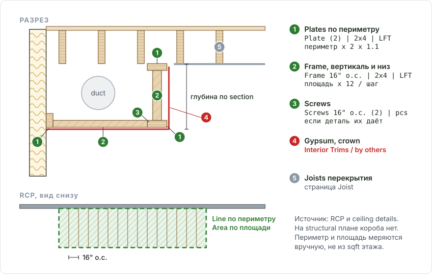

# Ceiling / Soffit Framing

<figure markdown>
  
  <figcaption markdown="span">Dropped soffit: a 2x box around the perimeter below the ceiling. The source is the RCP, it is not on the structural plan. We count the framing (plates, frame, screws), the finish goes in Interior Trims.</figcaption>
</figure>

<figure markdown>
  { width="420" }
  <figcaption markdown="span">Dropped soffit with the gypsum removed: a 2x box hung under the floor joists along the wall, with pipes and a duct running inside. On the RCP such a box shows as a line with a height mark; we count plates around the perimeter and frame by area. Photo: themakerista.com, [source](http://www.themakerista.com/the-kitchen-gut-job-and-hiccups/), found via Pinterest.</figcaption>
</figure>

## What it is

Interior ceiling and box framing: dropped soffits over kitchens and in corridors, ceiling boxes for ducts, the mechanical room ceiling (`Ceiling Mech`), the kitchen ceiling per unit. This is framing scope, not finish and not the exterior soffit. Ceiling finish (crown, gypsum) is [Interior Trims](../interior-trims/overview.md); the roof soffit under the overhang is [Eve / Eave](../sheathing-and-misc/eve.md); soffit plywood under roof trusses is [Roof Sheathing](roof-framing/roof-sheathing.md); gypsum backing on a wall parallel to the joists is the `Blocking for Drywall` row, page [Wall Bracing and Blocking for Drywall](floor-framing/details/bracingdrywall.md).

## Where to find it on the plans

| Sheet | What to take |
| --- | --- |
| RCP (`a8.01 1st rcp`) | dropped soffits, boxes, ceiling heights, zones by unit |
| Mech / MEP plans | mech room ceiling, screens, equipment above the ceiling |
| Sections, ceiling details (`A454`) | box depth, construction, plate and frame size, spacing |
| Kitchen and unit plans | kitchen ceiling per unit |

## How to measure in OurPlanCore

On the RCP sheet (sheet dot by floor):

- Line (L) along the length of each box (soffit, bulkhead). Put the drop height in feet in the line name (`soffit 1.5`): the vertical frame is counted from length x height.
- Area (A) over the dropped ceiling area for the horizontal frame at a spacing; the perimeter of that area is needed for the plates.

Area and perimeter are measured by hand from the A sheets, not taken from the floor's overall sqft. Anything already counted as floor or roof framing is not repeated here.

!!! note "Tree branch"
    There is no single branch for soffit takeoffs across all jobs. Put them in the branch the current job already uses (`framing/<floor> framing/details/soffit` or `roof misc`), the same way in every building. If the job has no such branch yet, pick one of the two and keep it in every building.

## Takeoff name and DFL row

The rows go in the `Ceiling Materials` DFL section, by floor or by area (1st, 2nd, Loft), like interior trims. `G` and `H` mean something different in every row, so they are spelled out row by row:

| Group | A (Label) | B | C | D | G | H |
| --- | --- | --- | --- | --- | --- | --- |
| Boxes and dropped ceiling | `Vertical Frame 24" o.c.` | `2x4` | `=CEILING(G*0.5*1.1,10)` | `LFT` | sum of (box length x drop height), SQ FT | empty |
| Boxes and dropped ceiling | `Vertical Frame Plate (2)` | `2x4` | `=CEILING(G*H*1.1,10)` | `LFT` | sum of the box lengths, LFT | number of plates: 2 = top and bottom |
| Boxes and dropped ceiling | `Horizontal Frame 24" o.c.` | `2x4` | `=CEILING(G*0.5*1.1,10)` | `LFT` | dropped ceiling area, SQ FT | empty |
| Boxes and dropped ceiling | `Horizontal Frame Plate (1)` | `2x4` | `=CEILING(G*H*1.1,10)` | `LFT` | dropped ceiling perimeter, LFT | number of plates |
| Mech room | `Plate (1) Ceiling Mech` | `2x6` | `=CEILING(G*H*1.1,10)` | `LFT` | plate length along the mech room walls, LFT | number of plates |
| Mech room | `Frame 24" o.c. Ceiling Mech` | `2x6` | `=CEILING(G*12/H/D,10)` | `12` | ceiling area, SQ FT | spacing in inches |
| Mech room | `Screws 16" o.c. (2)` | `Screws 0.22 x 4"` | `=CEILING(G*12*1.1/H*2,10)` | `pcs` | plate length, LFT | spacing in inches |
| Kitchen ceiling | kitchen ceiling materials | per spec | per unit x number of units | `LFT` / `SQ FT` | from the unit plan | |

- The `0.5` multiplier in the box frame rows is 24" o.c. spacing (`0.75` at 16" o.c.); it must match the spacing in the Label. The `1.1` allowance in these rows is on both the frame and the plate.
- `(n)` in the plate Label = the number in H.
- `Frame 24" o.c. Ceiling Mech`: `G*12/H` is the LFT of frame boards at spacing H, and `/D` turns them into 12' boards, which is why D holds `12`, not `LFT`. This formula has no `1.1` multiplier: rounding up to 10 boards gives the allowance.
- `Screws 16" o.c. (2)`: `G*12/H` is the number of points along the plate, `2` is the screws per point.
- Plain ceiling joists (no box) go in the `Ceiling Joists 16" o.c.` row of the Floor Framing List, not here.

Ceiling Mech is typical for single-story jobs with a mech room. On a multifamily building the boxes and dropped ceilings by floor are counted with the vertical and horizontal frame rows from the table above.

## Common mistakes

- Dropped soffits from the RCP not counted: they are not on the structural plan.
- Ceiling Mech missing one of its three rows (plate, frame, screws).
- The perimeter put into G of the frame row, or the area into G of the plate row: check in the table what G means in each row.
- The spacing multiplier does not match the Label: `0.5` at `16" o.c.`.
- Kitchen ceiling counted as one area when it should be per unit.
- Dropped soffit written as bracing or as a deflection-track wall.
- Detail callout on Frame copied from the previous building, not checked against the sheet.
- Ceiling framing and finish mixed in one section.
- [All floor framing mistakes](../../start/common-mistakes.md#floor)

## Example

| A | B | C | D | E | G | H |
| --- | --- | --- | --- | --- | --- | --- |
| `Plate (1) Ceiling Mech` | `2x6` | `=CEILING(G*H*1.1,10)` | LFT | | 1395 | 1 |
| `Frame 24" o.c. Ceiling Mech` | `2x6` | `=CEILING(G*12/H/D,10)` | 12 | `A454` | 3896 | 24 |
| `Screws 16" o.c. (2)` | `Screws 0.22 x 4"` | `=CEILING(G*12*1.1/H*2,10)` | pcs | `10/19/S500` | 1395 | 16 |

Check: plate 1395 LFT x 1 x 1.1 = 1534.5, so 1540 LFT. Frame: area 3896 SQ FT x 12 / 24 = 1948 LFT, / 12 = 162.3, so 170 boards of 12'. Screws: 1395 x 12 / 16 = 1046.25 points, x 2 x 1.1 = 2301.75, so 2310 pcs.

## See also

- [Interior Trims, overview](../interior-trims/overview.md), [Eve / Eave](../sheathing-and-misc/eve.md), [Roof Sheathing](roof-framing/roof-sheathing.md)
- [Truss Heel](../vertical/sheathing/truss-heel.md), [Wall Bracing and Blocking for Drywall](floor-framing/details/bracingdrywall.md), [Quantity benchmarks](../../reference/quantity-benchmarks.md)
