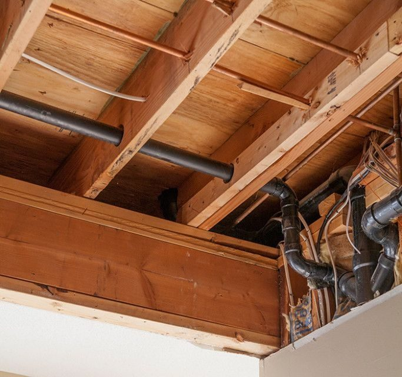

# Ceiling / Soffit Framing

<figure markdown>
  
  <figcaption markdown="span">Dropped soffit: a 2x box around the perimeter below the ceiling. The source is the RCP, it is not on the structural plan. We count the framing (plates, frame, screws), the finish goes in Interior Trims.</figcaption>
</figure>

<figure markdown>
  { width="420" }
  <figcaption markdown="span">Dropped soffit with the gypsum removed: a 2x box hung under the floor joists along the wall, with pipes and a duct running inside. On the RCP such a box shows as a line with a height mark; we count plates around the perimeter and frame by area. Photo: themakerista.com, [source](http://www.themakerista.com/the-kitchen-gut-job-and-hiccups/), found via Pinterest.</figcaption>
</figure>

## What it is

Interior ceiling and box framing: dropped soffits over kitchens and in corridors, ceiling boxes for ducts, the mechanical room ceiling (`Ceiling Mech`), the kitchen ceiling per unit. This is framing scope, not finish and not the exterior soffit. Ceiling finish (crown, gypsum) is [Interior Trims](../interior-trims/overview.md); the roof soffit under the overhang is [Eve / Eave](../sheathing-and-misc/eve.md); soffit plywood under roof trusses is [Roof Sheathing](roof-framing/roof-sheathing.md); gypsum backing on a wall parallel to the joists is [Bracing for Drywall](floor-framing/details/bracingdrywall.md).

## Where to find it on the plans

| Sheet | What to take |
| --- | --- |
| RCP (`a8.01 1st rcp`) | dropped soffits, boxes, ceiling heights, zones by unit |
| Mech / MEP plans | mech room ceiling, screens, equipment above the ceiling |
| Sections, ceiling details (`A454`) | box depth, construction, plate and frame size, spacing |
| Kitchen and unit plans | kitchen ceiling per unit |

## How to measure in OurPlanCore

On the RCP sheet (sheet dot by floor): Line (L) around the perimeter of each box for plates, Area (A) over the ceiling area for frame at a spacing. Area and perimeter are measured by hand from the A sheets, not taken from the floor's overall sqft. There is no fixed branch for these takeoffs in the tree.

!!! warning "To be confirmed"
    Where to put soffit takeoffs in the tree (`framing/<floor> framing/details/soffit` or `roof misc`) is not confirmed by delivered jobs.

## Takeoff name and DFL row

Sections are organized per floor or per area (1st, 2nd, Loft), like interior trims.

| Section | A (Label) | B | C | D | E |
| --- | --- | --- | --- | --- | --- |
| Interior Soffit Framing | `Plate (2)` + `Frame 16" o.c.` | `2x4` | perimeter x 2 x 1.1; area x 12 / spacing | `LFT` | RCP |
| Ceiling Mech | `Plate (1) Ceiling Mech` | `2x6` | `=CEILING(G*H*1.1,10)` | `LFT` | details |
| Ceiling Mech | `Frame 24" o.c. Ceiling Mech` | `2x6` | `=CEILING(G*12/H/D,10)` | `12` | `A454` |
| Ceiling Mech | `Screws 16" o.c. (2)` | `Screws 0.22 x 4"` | `=CEILING(G*12*1.1/H*2,10)` | `pcs` | `10/19/S500` |
| Kitchen Ceiling | kitchen ceiling materials | per spec | per unit x number of units | `LFT` / `SQ FT` | unit plan |
| Ceiling per floor (multifamily) | `Plate (1) Ceiling`, `Plate (2) Vertical Frame`, `Frame 24" o.c. Ceiling`, `Vertical Frame 24" o.c. Ceiling` | `2x4` | `=CEILING(G*H*1.1,10)`, `=CEILING(G*12/H,10)` | `LFT` | `A454` |

Ceiling Mech is typical for single-story jobs with a mech room; on a multifamily building it is replaced by a ceiling per floor in the truss heel zone: [Truss Heel](../vertical/sheathing/truss-heel.md). `G` is the perimeter or area from the A plans, `H` the number of plates or the spacing, `D` the board length.

## Common mistakes

- Dropped soffits from the RCP not counted: they are not on the structural plan.
- Ceiling Mech missing one of its three rows (plate, frame, screws).
- Kitchen ceiling counted as one area when it should be per unit.
- Dropped soffit written as bracing or as a deflection-track wall.
- Detail callout on Frame copied from the previous building, not checked against the sheet.
- Ceiling framing and finish mixed in one section.
- [All floor framing mistakes](../../start/common-mistakes.md#floor)

## Example

| A | B | C | D | E | G | H |
| --- | --- | --- | --- | --- | --- | --- |
| `Plate (1) Ceiling Mech` | `2x6` | `=CEILING(G*H*1.1,10)` | LFT | | 1395 | 1 |
| `Frame 24" o.c. Ceiling Mech` | `2x6` | `=CEILING(G*12/H/D,10)` | 12 | `A454` | 3896 | 24 |
| `Screws 16" o.c. (2)` | `Screws 0.22 x 4"` | `=CEILING(G*12*1.1/H*2,10)` | pcs | `10/19/S500` | 1395 | 16 |

## See also

- [Interior Trims, overview](../interior-trims/overview.md), [Eve / Eave](../sheathing-and-misc/eve.md), [Roof Sheathing](roof-framing/roof-sheathing.md)
- [Truss Heel](../vertical/sheathing/truss-heel.md), [Bracing for Drywall](floor-framing/details/bracingdrywall.md), [Quantity benchmarks](../../reference/quantity-benchmarks.md)
