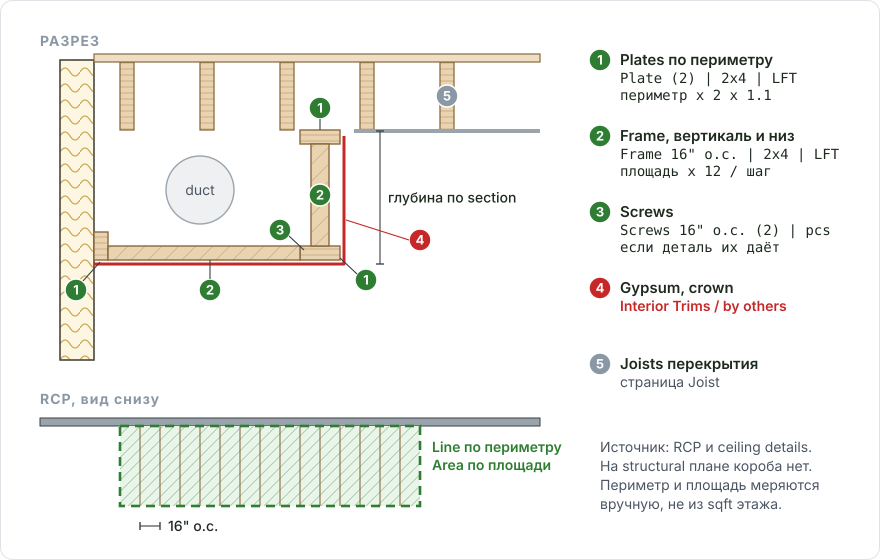
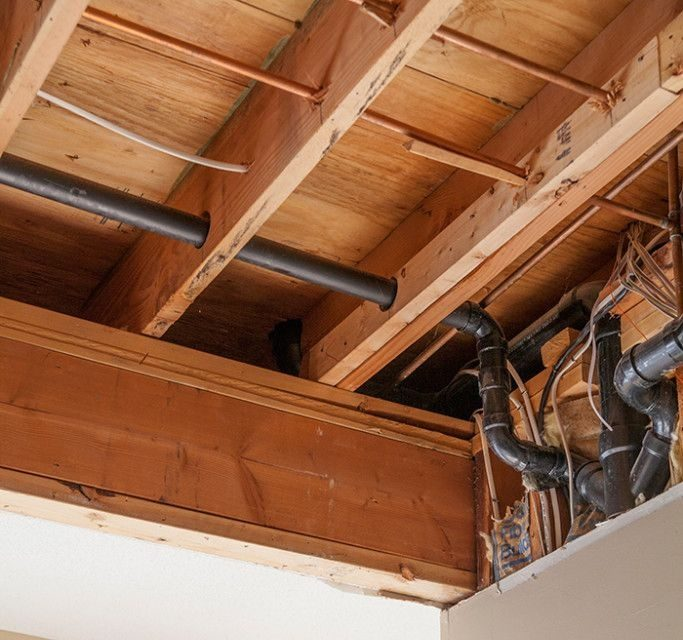

# Ceiling / Soffit Framing (каркас потолков и коробов внутри)

<figure markdown>
  
  <figcaption markdown="span">Dropped soffit: короб из 2x по периметру ниже потолка. Источник - RCP, на structural плане его нет. Считается каркас (plates, frame, screws), отделка - в Interior Trims.</figcaption>
</figure>

<figure markdown>
  { width="420" }
  <figcaption markdown="span">Dropped soffit со снятым гипсом: короб из 2x подвешен под joists перекрытия вдоль стены, внутри проходят трубы и воздуховод. На RCP такой короб виден линией с отметкой высоты; считаем plates по периметру и frame по площади. Фото: themakerista.com, [источник](http://www.themakerista.com/the-kitchen-gut-job-and-hiccups/), найдено через Pinterest.</figcaption>
</figure>

## Что это

Внутренний каркас потолков и коробов: dropped soffits над кухней и в коридорах, потолочные короба под воздуховоды, потолок мех-комнаты (`Ceiling Mech`), потолок кухни per unit. Это framing-scope, не отделка и не наружный soffit. Отделка потолка (crown, гипс) - [Interior Trims](../interior-trims/overview.md); roof soffit под свесом - [Eve / Eave](../sheathing-and-misc/eve.md); soffit plywood под roof trusses - [Roof Sheathing](roof-framing/roof-sheathing.md); опора гипса на стене параллельно joists - строка `Blocking for Drywall`, страница [Wall Bracing и Blocking for Drywall](floor-framing/details/bracingdrywall.md).

## Где искать на чертежах

| Лист | Что взять |
| --- | --- |
| RCP (`a8.01 1st rcp`) | dropped soffits, короба, высоты потолков, зоны по units |
| Mech / MEP-планы | mech-room ceiling, screens, оборудование над потолком |
| Sections, ceiling details (`A454`) | глубина короба, конструкция, сечение plates и frame, шаг |
| Kitchen и unit plans | kitchen ceiling per unit |

## Как мерить в OurPlanCore

На листе RCP (точка листа по этажу):

- Line (L) по длине каждого короба (soffit, bulkhead). В имени линии высота опуска в футах (`soffit 1.5`): вертикальный каркас считается от длины x высоту.
- Area (A) по площади опущенного потолка для горизонтального каркаса с шагом; периметр этой площади нужен для plates.

Площадь и периметр меряются вручную с A-листов, не берутся из общего sqft этажа. То, что уже посчитано как каркас перекрытия или крыши, сюда не повторяется.

!!! note "Ветка в дереве"
    Одной ветки для soffit-позиций на все работы нет. Клади их в ветку, которую уже использует текущий job (`framing/<этаж> framing/details/soffit` или `roof misc`), одинаково во всех корпусах. Если в job такой ветки ещё нет, выбери одну из двух и держи её во всех корпусах.

## Как назвать в дереве и строка DFL

Строки идут в секцию DFL `Ceiling Materials`, по этажам или зонам (1st, 2nd, Loft), как interior trims. `G` и `H` в каждой строке значат своё, поэтому они расписаны по строкам:

| Группа | A (Label) | B | C | D | G | H |
| --- | --- | --- | --- | --- | --- | --- |
| Короба и опущенный потолок | `Vertical Frame 24" o.c.` | `2x4` | `=ОКРВВЕРХ(G*0.5*1.1;10)` | `LFT` | сумма (длина короба x высота опуска), SQ FT | пусто |
| Короба и опущенный потолок | `Vertical Frame Plate (2)` | `2x4` | `=ОКРВВЕРХ(G*H*1.1;10)` | `LFT` | сумма длин коробов, LFT | число plates: 2 = верх и низ |
| Короба и опущенный потолок | `Horizontal Frame 24" o.c.` | `2x4` | `=ОКРВВЕРХ(G*0.5*1.1;10)` | `LFT` | площадь опущенного потолка, SQ FT | пусто |
| Короба и опущенный потолок | `Horizontal Frame Plate (1)` | `2x4` | `=ОКРВВЕРХ(G*H*1.1;10)` | `LFT` | периметр опущенного потолка, LFT | число plates |
| Мех-комната | `Plate (1) Ceiling Mech` | `2x6` | `=ОКРВВЕРХ(G*H*1.1;10)` | `LFT` | длина plate по стенам мех-комнаты, LFT | число plates |
| Мех-комната | `Frame 24" o.c. Ceiling Mech` | `2x6` | `=ОКРВВЕРХ(G*12/H/D;10)` | `12` | площадь потолка, SQ FT | шаг в дюймах |
| Мех-комната | `Screws 16" o.c. (2)` | `Screws 0.22 x 4"` | `=ОКРВВЕРХ(G*12*1.1/H*2;10)` | `pcs` | длина plate, LFT | шаг в дюймах |
| Потолок кухни | материалы потолка кухни | по спецификации | per unit x число units | `LFT` / `SQ FT` | с unit plan | |

- Множитель `0.5` в строках frame коробов - это шаг 24" o.c. (при 16" o.c. `0.75`); он должен совпадать с шагом в Label. Запас `1.1` в этих строках есть и у frame, и у plate.
- `(n)` в Label plate = число в H.
- `Frame 24" o.c. Ceiling Mech`: `G*12/H` - LFT досок каркаса при шаге H, `/D` переводит их в доски по 12', поэтому в D стоит `12`, а не `LFT`. Множителя `1.1` в этой формуле нет: запас даёт округление вверх до 10 досок.
- `Screws 16" o.c. (2)`: `G*12/H` - число точек вдоль plate, `2` - screws в точке.
- Простые ceiling joists (без короба) идут строкой `Ceiling Joists 16" o.c.` в Floor Framing List, не сюда.

Ceiling Mech характерен для одноэтажных проектов с мех-комнатой. В многоэтажке короба и опущенные потолки по этажам считаются строками vertical и horizontal frame из таблицы выше.

## Частые ошибки

- Dropped soffits с RCP не посчитаны: на structural плане их нет.
- Ceiling Mech без одной из трёх строк (plate, frame, screws).
- В G строки frame попал периметр, а в G строки plate площадь: проверь по таблице, что значит G в каждой строке.
- Множитель шага не совпадает с Label: `0.5` при `16" o.c.`.
- Kitchen ceiling посчитан одной площадью, а нужно per unit.
- Dropped soffit записан как bracing или как deflection-track стена.
- Callout детали у Frame скопирован из прошлого дома, не сверен с листом.
- Каркас и отделка потолка смешаны в одной секции.
- [Все ошибки по перекрытиям](../../start/common-mistakes.md#floor)

## Пример

| A | B | C | D | E | G | H |
| --- | --- | --- | --- | --- | --- | --- |
| `Plate (1) Ceiling Mech` | `2x6` | `=ОКРВВЕРХ(G*H*1.1;10)` | LFT | | 1395 | 1 |
| `Frame 24" o.c. Ceiling Mech` | `2x6` | `=ОКРВВЕРХ(G*12/H/D;10)` | 12 | `A454` | 3896 | 24 |
| `Screws 16" o.c. (2)` | `Screws 0.22 x 4"` | `=ОКРВВЕРХ(G*12*1.1/H*2;10)` | pcs | `10/19/S500` | 1395 | 16 |

Проверка: plate 1395 LFT x 1 x 1.1 = 1534.5, значит 1540 LFT. Frame: площадь 3896 SQ FT x 12 / 24 = 1948 LFT, / 12 = 162.3, значит 170 досок по 12'. Screws: 1395 x 12 / 16 = 1046.25 точки, x 2 x 1.1 = 2301.75, значит 2310 pcs.

## См. также

- [Interior Trims, обзор](../interior-trims/overview.md), [Eve / Eave](../sheathing-and-misc/eve.md), [Roof Sheathing](roof-framing/roof-sheathing.md)
- [Truss Heel](../vertical/sheathing/truss-heel.md), [Wall Bracing и Blocking for Drywall](floor-framing/details/bracingdrywall.md), [Quantity benchmarks](../../reference/quantity-benchmarks.md)
