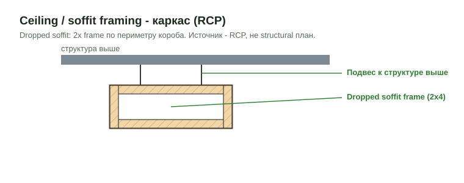

# Ceiling / Soffit Framing (каркас потолков и коробов внутри)

<figure markdown>
  
  <figcaption markdown="span">Dropped soffit: короб из 2x по периметру ниже потолка. Источник - RCP, на structural плане его нет. Считается каркас (plates, frame, screws), отделка - в Interior Trims.</figcaption>
</figure>

<!-- TODO-PHOTO: interior dropped soffit framing 2x4 before drywall, EN query "dropped soffit framing 2x4 ceiling" -->

## Что это

Внутренний каркас потолков и коробов: dropped soffits над кухней и в коридорах, потолочные короба под воздуховоды, потолок мех-комнаты (`Ceiling Mech`), потолок кухни per unit. Это framing-scope, не отделка и не наружный soffit. Отделка потолка (crown, гипс) - [Interior Trims](../interior-trims/overview.md); roof soffit под свесом - [Eve / Eave](../sheathing-and-misc/eve.md); soffit plywood под roof trusses - [Roof Sheathing](roof-framing/roof-sheathing.md); опора гипса на стене параллельно joists - [Bracing for Drywall](floor-framing/details/bracingdrywall.md).

## Где искать на чертежах

| Лист | Что взять |
| --- | --- |
| RCP (`a8.01 1st rcp`) | dropped soffits, короба, высоты потолков, зоны по units |
| Mech / MEP-планы | mech-room ceiling, screens, оборудование над потолком |
| Sections, ceiling details (`A454`) | глубина короба, конструкция, сечение plates и frame, шаг |
| Kitchen и unit plans | kitchen ceiling per unit |

## Как мерить в OurPlanCore

На листе RCP (точка листа по этажу): Line (L) по периметру каждого короба для plates, Area (A) по площади потолка для frame с шагом. Площадь и периметр меряются вручную с A-листов, не берутся из общего sqft этажа. Ветка для таких позиций в дереве не закреплена.

!!! warning "Уточняется"
    Куда класть soffit-позиции в дереве (`framing/<этаж> framing/details/soffit` или `roof misc`) - не подтверждено сданными работами.

## Как назвать в дереве и строка DFL

Секции организуются per floor или per area (1st, 2nd, Loft), как interior trims.

| Секция | A (Label) | B | C | D | E |
| --- | --- | --- | --- | --- | --- |
| Interior Soffit Framing | `Plate (2)` + `Frame 16" o.c.` | `2x4` | периметр x 2 x 1.1; площадь x 12 / шаг | `LFT` | RCP |
| Ceiling Mech | `Plate (1) Ceiling Mech` | `2x6` | `=ОКРВВЕРХ(G*H*1.1;10)` | `LFT` | детали |
| Ceiling Mech | `Frame 24" o.c. Ceiling Mech` | `2x6` | `=ОКРВВЕРХ(G*12/H/D;10)` | `12` | `A454` |
| Ceiling Mech | `Screws 16" o.c. (2)` | `Screws 0.22 x 4"` | `=ОКРВВЕРХ(G*12*1.1/H*2;10)` | `pcs` | `10/19/S500` |
| Kitchen Ceiling | материалы потолка кухни | по спецификации | per unit x число units | `LFT` / `SQ FT` | unit plan |
| Ceiling per floor (многоэтажка) | `Plate (1) Ceiling`, `Plate (2) Vertical Frame`, `Frame 24" o.c. Ceiling`, `Vertical Frame 24" o.c. Ceiling` | `2x4` | `=ОКРВВЕРХ(G*H*1.1;10)`, `=ОКРВВЕРХ(G*12/H;10)` | `LFT` | `A454` |

Ceiling Mech характерен для одноэтажных проектов с мех-комнатой; в многоэтажке вместо него ceiling per floor в зоне truss heel: [Truss Heel](../vertical/sheathing/truss-heel.md). `G` - периметр или площадь с A-планов, `H` - число plates или шаг, `D` - длина доски.

## Частые ошибки

- Dropped soffits с RCP не посчитаны: на structural плане их нет.
- Ceiling Mech без одной из трёх строк (plate, frame, screws).
- Kitchen ceiling посчитан одной площадью, а нужно per unit.
- Dropped soffit записан как bracing или как deflection-track стена.
- Callout детали у Frame скопирован из прошлого дома, не сверен с листом.
- Каркас и отделка потолка смешаны в одной секции.
- [Все ошибки по перекрытиям](../../start/common-mistakes.md#floor)

## Пример

| A | B | C | D | E | G | H |
| --- | --- | --- | --- | --- | --- | --- |
| `Plate (1) Ceiling Mech` | `2x6` | `=ОКРВВЕРХ(G*H*1.1;10)` | LFT | | 1395 | 1 |
| `Frame 24" o.c. Ceiling Mech` | `2x6` | `=ОКРВВЕРХ(G*12/H/D;10)` | 12 | `A454` | 3896 | 24 |
| `Screws 16" o.c. (2)` | `Screws 0.22 x 4"` | `=ОКРВВЕРХ(G*12*1.1/H*2;10)` | pcs | `10/19/S500` | 1395 | 16 |

## См. также

- [Interior Trims, обзор](../interior-trims/overview.md), [Eve / Eave](../sheathing-and-misc/eve.md), [Roof Sheathing](roof-framing/roof-sheathing.md)
- [Truss Heel](../vertical/sheathing/truss-heel.md), [Bracing for Drywall](floor-framing/details/bracingdrywall.md), [Quantity benchmarks](../../reference/quantity-benchmarks.md)
