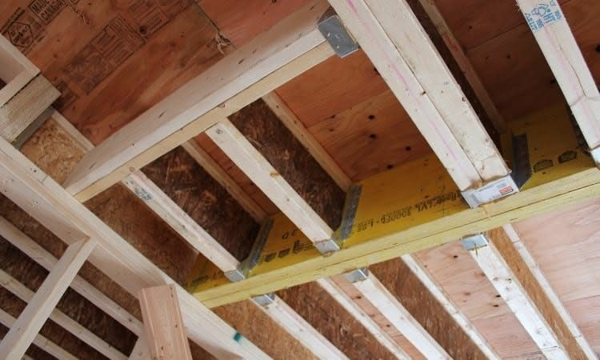

# Beam

<figure markdown>
  
  <figcaption markdown="span">Beam tool: two points along the beam from bearing to bearing; the app rounds the length and creates a Count takeoff `FB1 8` with the first mark. A second beam of the same mark and length goes into the same takeoff as a second point.</figcaption>
</figure>

<figure markdown>
  { width="520" }
  <figcaption markdown="span">Flush LVL beam at joist depth: joists on both sides hang on face-mount hangers. The beam is one Count takeoff with the length in the name; hangers are counted by the number of joist ends on it. Photo: plasticinehouse.com, [source](https://plasticinehouse.com/how-far-can-a-lvl-beam-span-without-support/), found via Pinterest.</figcaption>
</figure>

## What it is

A beam is a floor or roof beam that carries joists, rafters or posts: `(2) 2x10`, `(3) 1 3/4 x 11 7/8 LVL`, `5 1/4 x 11 7/8 PSL`, `5 1/2 x 14 GL`. A steel beam is by others, but the wood nailer on it is ours: [Steel Beam Web Fillers](details/steelbeams.md). A header over an opening is [Headers](../../vertical/openings/headers.md); a beam between doubled rafters in the roof is [Roof Header](../roof-framing/header.md). Flush (at joist depth, on hangers) and Dropped (below the joists) go into the Label.

## Where to find it on the plans

| Sheet | What to take |
| --- | --- |
| S framing plan of the floor | marks (`FB1`, `B2`, `H5`), location, span, bearing at both ends |
| Beam schedule (S5xx, S6xx) | size, plies, material by mark. No schedule - build the legend yourself from the labels on the plan |
| Sections, details | flush or dropped, bearing, hangers, PSL and squash blocks under the ends |
| General notes | EWP by others, nailer on steel beams, lumber grade |

## Size when there is no beam schedule { #default-sizes }

The mark and size from the S sheet always win. If there are none, use the E-Wood defaults by span for flush beams and the garage center beam:

| Beam | 6'-9' | 9'-12' | 12'-14' | 14'-16' | 16'-18' |
| --- | --- | --- | --- | --- | --- |
| Flush under the floor | `(2) LVL` at joist depth | `(2) LVL` at joist depth | `(3) LVL` at joist depth | `(3) LVL` at joist depth | `(3) 14" LVL` |
| Flush under the floor and roof (under an exterior wall) | `(3) 9-1/2" LVL` | `(3) 11-7/8" LVL` | `(3) 14" LVL` | `(3) 16" LVL` | `(3) 18" LVL` |

| Garage center beam | 22' | 24' | 26' |
| --- | --- | --- | --- |
| Floor above | `(3) 16" LVL` | `(3) 18" LVL` | `(3) 24" LVL` |
| Ceiling only | `(3) 14" LVL` | `(3) 16" LVL` | `(3) 18" LVL` |

Up to 6' and headers in walls: [full table on the Headers page](../../vertical/openings/headers.md#default-sizes).

## How to measure in OurPlanCore

Beam tool (B), framing sheet with the F point. Draw a line along the beam centerline from bearing face to bearing face; the length appears in the name by itself.

- The app does the rounding: up to 8' inclusive it rounds up to the whole foot, longer rounds up to the next even foot (9.2' gives 10, 12.1' gives 14). Do not add feet yourself.
- One built-up beam = one point with `(n)` in the name. Do not place n points and `(n)` at the same time.
- Draw every beam that is not part of the wall panels. Every mark on every floor where it is shown.
- A mark with the letter H (`H5`) can be a beam by its role; do not move it to `headers` just because of the letter.
- Ledger, rim, blocking, nailer are separate Lines in `details`, not beam points.
- Repeat Beam (the button next to Beam) draws several separate beams in a row without picking the tool again.

## Tree name and DFL row

Path: `framing/<floor> framing/beams/<mark or size> <length>`. The size for a mark comes from the LG legend (`B2 - (3) 2x10`) on export.

| Tree name | A (Label) | B (material) | C | D | E |
| --- | --- | --- | --- | --- | --- |
| `beams/FB1 8` | `Beam (2) Flush` | `2x10` | points | `8` | `FB1 per S601` |
| `beams/(3) 1 3/4 x 11 7/8 LVL 14` | `Beam (3)` | `1 3/4 x 11 7/8 LVL` | points | `14` | |
| `beams/B2 14` + LG `B2 - (3) 2x10` | `Beam (3) Dropped` | `2x10` | points | `14` | `B2` |
| `beams/int 4x10 4` | `Beam` | `4x10` | points | `4` | |
| `beams/H5 8` | `Beam (2)` | per schedule | points | `8` | `H5` |

Hangers for beams: by the built-up width and condition (face, top, concealed, skew), for every end that hangs on another beam or wall. Selection: [Hangers](../../../reference/hangers.md); how to write it in B: [hardware format in the DFL](../../../reference/hangers.md#dfl-format). Exterior and on P.T.: `Zmax` as a separate word.

Export: the BM button on the XL strip replaces only the beam rows on the floor worksheet; template rows stay. The `C_BeamsSort` macro sorts by mark and length.

??? note "Built-up LVL: actual width"
    | Written as | Actual size |
    | --- | --- |
    | `(2) 1 3/4 x 9 1/2 LVL` | `3 1/2 x 9 1/2` |
    | `(3) 1 3/4 x 9 1/2 LVL` | `5 1/4 x 9 1/2` |
    | `(4) 1 3/4 x 9 1/2 LVL` | `7 x 9 1/2` |

    The width of the pack sets the hanger (`HU412` for `3 1/2 x 11 7/8`, `HGUS7.25/12` for `7 x 11 7/8`). On EWP jobs (we count only LVL, PSL, GL, I-joists) regular 2x beams are not included: [EWP / Capital](../../../work-types/ewp-capital.md).

## Common mistakes

- A mark missed on one of the floors: the same `FB7` is on both S102 and S103.
- Feet "for bearing" added to the tool length - the rounding is already done.
- A pack of three LVLs written as three points plus `(3)` in the name: triple count.
- PSL or squash blocks under the beam ends per schedule not counted (2 became 4).
- Hangers not on both ends, or counted by purchase boards after cutting; the model does not match the detail (`U210-2`, not `LUS210-2`).
- A beam inside a wall panel drawn on a panel job.
- Tri-Force beams and beams with steel plates keep inch fractions in B: write the nearest foot.
- [All floor framing mistakes](../../../start/common-mistakes.md#floor)

## Example

```text
framing/
  2nd floor framing/
    beams/
      FB1 8                        6 points
      FB1 10                       2 points
      (3) 1 3/4 x 11 7/8 LVL 14    3 points
```

| A | B | C | D | E |
| --- | --- | --- | --- | --- |
| `Beam (2) Flush` | `2x10` | 6 | 8 | `FB1 per S601` |
| `Beam (2) Flush` | `2x10` | 2 | 10 | `FB1` |
| `Beam (3)` | `1 3/4 x 11 7/8 LVL` | 3 | 14 | `S102` |
| `Hangers` | `HU412` | 6 | pcs | `9/S501` |

## See also

- [Post](post.md), [Joist](joist.md), [Steel Beam Web Fillers](details/steelbeams.md)
- [Hangers](../../../reference/hangers.md), [Quantity benchmarks](../../../reference/quantity-benchmarks.md)
- [Takeoff item labels](../../../reference/takeoff-items.md)
